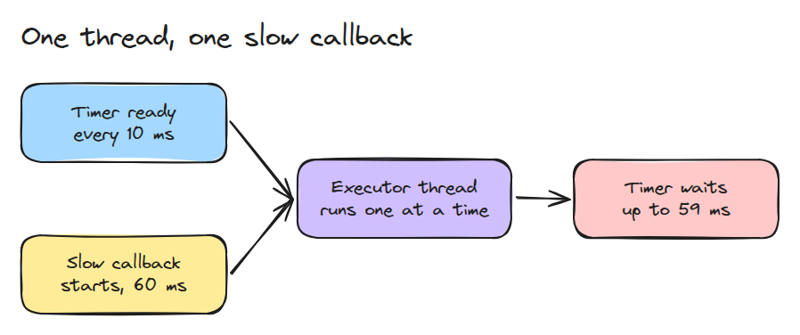
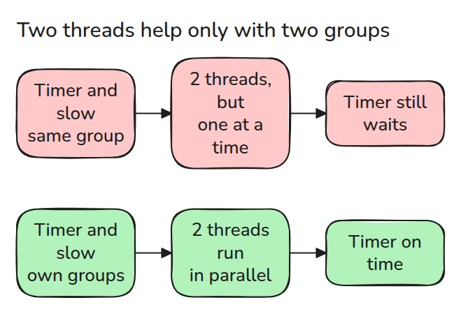
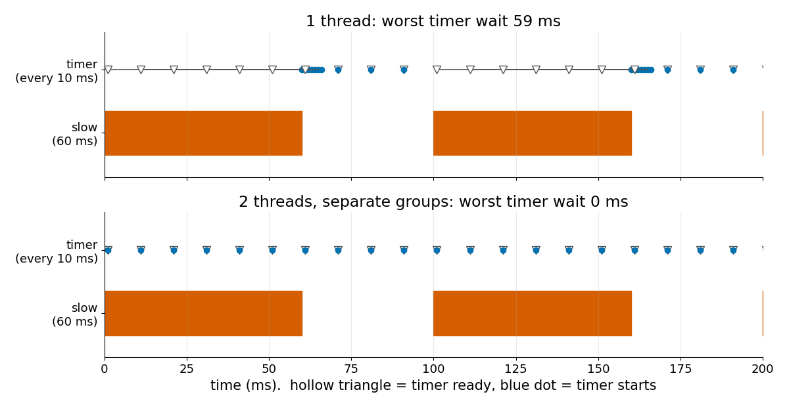

# Executors and Callbacks

> One thread runs one callback at a time, so a slow callback makes every other callback wait, whatever its period.

**Type:** Build   **Prerequisites:** 05/01 Publish-Subscribe and QoS Mismatch   **Time:** ~15 minutes

## In Plain Words

A kitchen helper starts a long chopping job. A quick request to pour a drink must wait because the helper can
do only one job at a time. Another helper can take it, unless a rule forbids those jobs from overlapping in
the shared workspace.

Threads are the helpers and callback groups supply the rule. A long callback blocks a timer on a single
thread. More threads help only when the group rules allow both callbacks to run at once.

## The Problem

A node has a 100 Hz timer that sends a heartbeat and a subscription that does 60 ms of image work. The heartbeat stutters, and a watchdog elsewhere declares the node dead. Every callback is correct on its own, and the CPU is mostly idle.

## The Concept



*A single-threaded executor takes one ready callback at a time, so the timer waits for the whole slow callback.*

An executor decides which ready callback runs next and on which thread. Callbacks are grouped. A mutually exclusive group never runs two of its callbacks at once, and callbacks of different groups may run in parallel.



*A second thread helps only if the two callbacks sit in different groups.*



*With one thread the timer starts up to 59 ms after it is ready. With two threads and separate groups it never waits.*

## Build It

```python
busy = {g for _, g in running if g is not None}
job = next((j for j in pending if j[3] is None or j[3] not in busy), None)
```

`simulate()` advances time in 1 ms steps. Each step releases the periodic callbacks, frees finished jobs, and gives every free thread the oldest pending job whose group is idle. `latencies()` returns the wait between release and start. The model is FIFO and queues every missed tick. The documentation says an overloaded executor serves ready work round-robin, so read its "Scheduling semantics" section before comparing numbers.

```bash
cd robotics-engineering-from-scratch
python3 -m pytest phases/05-robot-software/02-executors-and-callbacks -q
python3 phases/05-robot-software/02-executors-and-callbacks/code/main.py
```

## Use It

ROS 2 offers the same pieces: a single-threaded executor, a multi-threaded one, and mutually exclusive or reentrant callback groups. Callbacks created without a group join the node's default group, so give the slow callback its own group before adding threads.

Sources: ROS 2 Jazzy, "Executors" (https://docs.ros.org/en/jazzy/Concepts/Intermediate/About-Executors.html), read 2026-11-09 from its source file in the `jazzy` branch of ros2/ros2_documentation.

## Ship It

`outputs/skill-executor-starvation-check.md` finds the callback that starves the others and says which fix applies.

## Exercises

1. Add a reentrant group (`None`) with two slow jobs and show they overlap on two threads.
2. Make the timer drop missed ticks instead of queueing them and compare the worst wait.
3. Split the slow callback into six 10 ms chunks and report the timer's worst wait on one thread.
