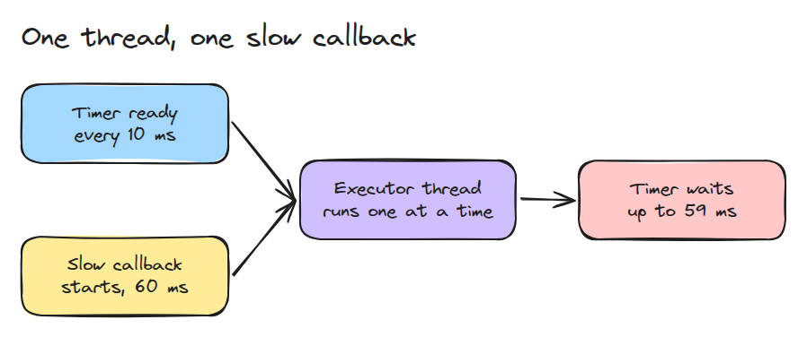
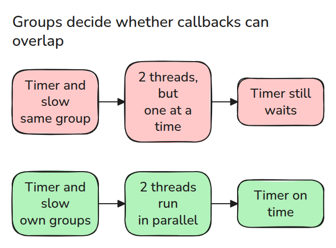
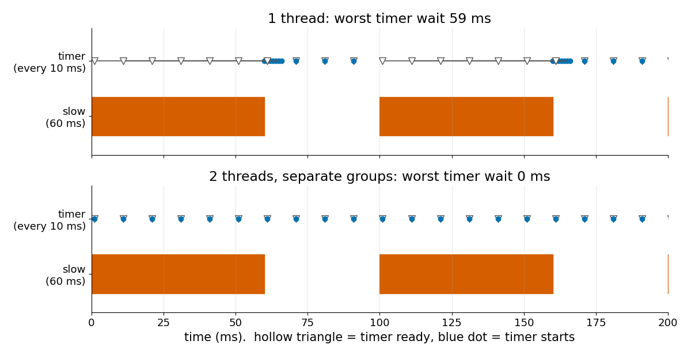

# Executor와 Callback

> 느린 작업 하나가 프로세서가 놀고 있는데도 로봇의 다른 작업을 멈춰 세우는 이유를 배웁니다.

**유형:** 만들기   **선수 지식:** 없음   **시간:** 약 15분

## 쉽게 말하면

장난감 자동차는 timer가 계속 울리는 동안에만 달려요(그 울림이 heartbeat예요). 울림이 늦으면 watchdog이 차를 세워요.

차의 프로그램에는 한 번에 한 가지 일만 하는 일꾼인 thread가 하나뿐이라서 긴 이미지 작업이 heartbeat를 기다리게 해요.

## 핵심 용어

- **Callback**: 메시지가 도착하거나 timer가 울릴 때 ROS 2가 실행하는 함수입니다.
- **Thread**: 프로그램 안의 일꾼 하나입니다. 한 번에 한 가지 일만 합니다.
- **Executor**: 준비된 callback 중 무엇을 어느 thread에서 실행할지 정하는 ROS 2의 부분입니다.
- **Callback group**: 함께 실행되는 방식을 정하는 규칙 하나를 공유하는 callback 묶음입니다. 예를 들면 서로 동시에 실행하지 않는다는 규칙입니다.
- **Starvation**: 다른 callback이 thread를 쥐고 있어서 어떤 callback이 너무 오래 기다리는 일입니다.
- **Watchdog**: heartbeat가 늦으면 로봇을 세우는 감시 장치입니다.

## 문제

장난감 자동차가 갑자기 멈춥니다. 다른 callback이 이미지 작업을 오래 하는 동안 heartbeat가 끊기고 watchdog이 차를 세웁니다. 프로세서는 대부분 놀고 있는데도 그렇습니다.

## 개념

로봇은 많은 callback을 동시에 돌리고 느린 callback 하나가 안전에 직결된 callback을 굶길 수 있습니다.



*timer는 느린 callback이 끝날 때까지 기다립니다.*

executor는 준비된 callback 중 무엇을 어느 thread에서 실행할지 정합니다. "동시에 안 함"(mutually exclusive)으로 정한 group은 그 안의 callback 두 개를 동시에 실행하지 않아서 공유 데이터를 지킵니다.
다른 group의 callback은 병렬로 실행될 수 있습니다.



*두 callback이 서로 다른 group에 있을 때만 두 번째 thread가 도움이 됩니다.*

그래서 고치려면 thread를 하나 더 두고 느린 callback을 자기만의 group에 넣어야 합니다.


*지붕의 등 하나가 thread 하나입니다. 파랑은 group을 공유해서 두 번째 등이 꺼진 채 차가 멈춥니다. 초록은 멈추지 않습니다.*



*thread가 하나이면 timer가 아주 늦게 시작합니다. thread 둘에 group이 나뉘면 늦게 시작하지 않습니다.*

<details><summary>The math (optional)</summary>

timer는 초당 100번 heartbeat를 보내고 subscription callback은 60 ms 동안 이미지 작업을 합니다. 느린 callback이 0 ms에 시작해서 60 ms 동안 thread를 쥡니다.
timer는 1 ms에 준비되므로 thread가 하나이거나 thread 둘에 group 하나이면 59 ms를 기다립니다. group이 나뉘어 있으면 바로 시작합니다.
이 모델은 먼저 온 것을 먼저 처리하지만 ROS 2는 준비된 작업을 돌아가며 처리하므로 숫자를 비교하기 전에 "Scheduling semantics"를 읽어 보세요.

</details>

## 만들기

```python
busy = {g for _, g in running if g is not None}
job = next((j for j in pending if j[3] is None or j[3] not in busy), None)
```

`simulate()`는 시간을 1 ms씩 앞으로 보냅니다. 쉬는 thread는 group이 바쁘지 않은 가장 오래된 대기 callback을 가져갑니다.

```bash
cd robotics-engineering-from-scratch
python3 -m pytest phases/05-robot-software/02-executors-and-callbacks -q
python3 phases/05-robot-software/02-executors-and-callbacks/code/main.py
```

## 실제 도구로 보기

group 없이 만든 callback은 기본 group 하나를 함께 쓰므로 thread를 늘리기 전에 느린 callback에 자기 group을 주세요.

출처: ROS 2 Jazzy, "Executors" (https://docs.ros.org/en/jazzy/Concepts/Intermediate/About-Executors.html), 2026년 11월 9일 확인.

## 결과물

`outputs/skill-executor-starvation-check.md`는 다른 callback을 굶기는 callback을 찾고 고칠 방법을 알려 줍니다.

## 연습 문제

1. 두 callback을 group 하나에 넣었다가 둘로 나누고 timer를 보세요.
2. 놓친 timer tick을 쌓지 말고 버리게 하세요.
3. 느린 callback을 10 ms 조각 여섯 개로 나누고 timer를 보세요.
