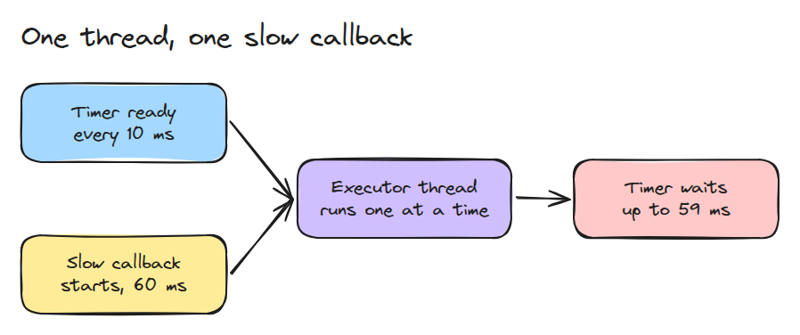
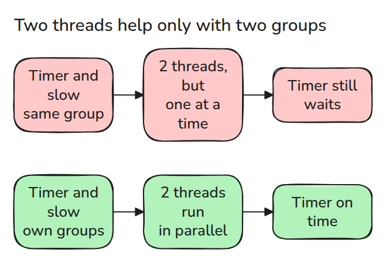
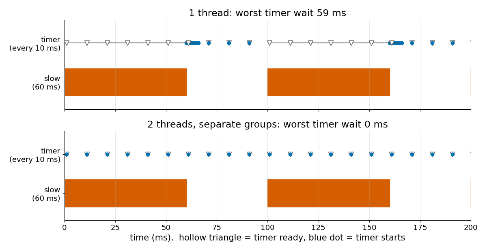

# Executor와 Callback

> 스레드 하나는 callback 하나씩만 실행하므로 느린 callback 하나가 주기와 상관없이 다른 모든 callback을 기다리게 합니다.

**유형:** 만들기   **선수 지식:** 05/01 Publish-Subscribe와 QoS 불일치   **시간:** 약 15분

## 쉽게 말하면

주방에서 한 사람이 오래 걸리는 재료 손질을 시작했어요. 음료를 따르는 짧은 부탁도 그 사람이 끝날 때까지 기다려야 해요. 다른 사람이 도와줄 수는 있어요. 그래도 규칙 때문에 같은 작업 공간에서
동시에 일하지 못하면 여전히 기다려요.

thread가 일하는 사람이고 callback group이 그 규칙에 해당해요. thread가 하나면 긴 callback이 timer를 막아요. thread를 늘려도 group 규칙이 동시 실행을
허용해야 두 callback을 함께 처리할 수 있어요.

## 문제

한 node에 heartbeat를 보내는 100 Hz timer가 있고 이미지 처리에 60 ms가 드는 subscription도 있습니다.

heartbeat가 끊기고 다른 곳의 watchdog이 이 node가 죽었다고 판단합니다. callback은 하나하나 모두 맞게 짜여 있고 CPU도 대부분 놀고 있습니다.

## 개념



*단일 스레드 executor는 준비된 callback을 한 번에 하나씩 가져가므로 timer는 느린 callback이 끝날 때까지 기다립니다.*

executor는 준비된 callback 중 무엇을 어느 스레드에서 실행할지 정합니다.

callback은 group으로 묶입니다. mutually exclusive group은 자기 callback 둘을 동시에 실행하지 않습니다. 서로 다른 group의 callback은 병렬로 실행될 수 있습니다.



*두 callback이 서로 다른 group에 있을 때만 두 번째 스레드가 도움이 됩니다.*



*스레드 하나에서는 timer가 준비된 뒤 최대 59 ms 늦게 시작합니다. 스레드 둘에 group을 나누면 전혀 기다리지 않습니다.*

## 만들기

```python
busy = {g for _, g in running if g is not None}
job = next((j for j in pending if j[3] is None or j[3] not in busy), None)
```

`simulate()`는 시간을 1 ms씩 진행합니다. 매 단계마다 주기적 callback을 준비 상태로 만들고 끝난 job을 비웁니다. 그다음 놀고 있는 스레드마다 group이 비어 있는 가장 오래된 job을 줍니다.

`latencies()`는 준비된 시점과 시작 시점의 차이를 돌려줍니다.

이 모델은 FIFO이고 놓친 tick을 전부 쌓아 둡니다. 문서에는 과부하 상태의 executor가 준비된 일을 round-robin으로 처리한다고 되어 있습니다. 숫자를 비교하기 전에 문서의 "Scheduling semantics" 절을 읽으세요.

```bash
cd robotics-engineering-from-scratch
python3 -m pytest phases/05-robot-software/02-executors-and-callbacks -q
python3 phases/05-robot-software/02-executors-and-callbacks/code/main.py
```

## 실제 도구로 보기

ROS 2에도 같은 부품이 있습니다. 단일 스레드 executor, 멀티 스레드 executor, mutually exclusive와 reentrant callback group입니다.

group 없이 만든 callback은 node의 default group에 들어갑니다. 그래서 스레드를 늘리기 전에 느린 callback에 자기 group부터 주세요.

출처: ROS 2 Jazzy, "Executors".
https://docs.ros.org/en/jazzy/Concepts/Intermediate/About-Executors.html

2026년 11월 9일에 ros2/ros2_documentation의 `jazzy` branch 소스 파일에서 읽었습니다.

## 결과물

`outputs/skill-executor-starvation-check.md`는 다른 callback을 굶기는 callback을 찾아 어떤 수정이 맞는지 알려 줍니다.

## 연습 문제

1. reentrant group(`None`)에 느린 job 둘을 넣고 스레드 둘에서 겹쳐 실행되는 것을 보이세요.
2. timer가 놓친 tick을 쌓지 않고 버리게 한 뒤 최악 대기 시간을 비교하세요.
3. 느린 callback을 10 ms 조각 여섯 개로 나누고 스레드 하나에서 timer의 최악 대기 시간을 보고하세요.
