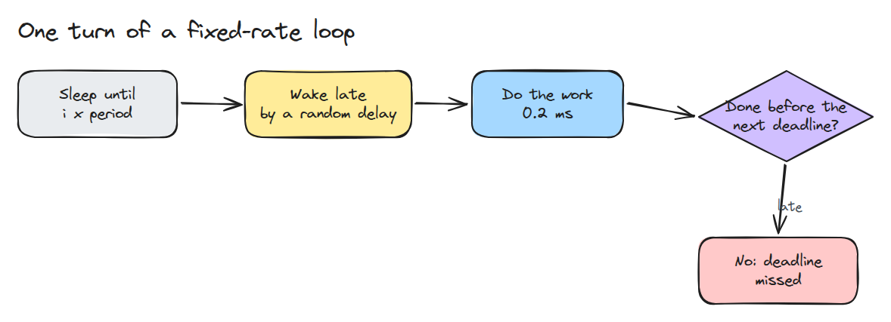
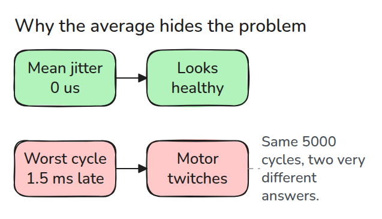
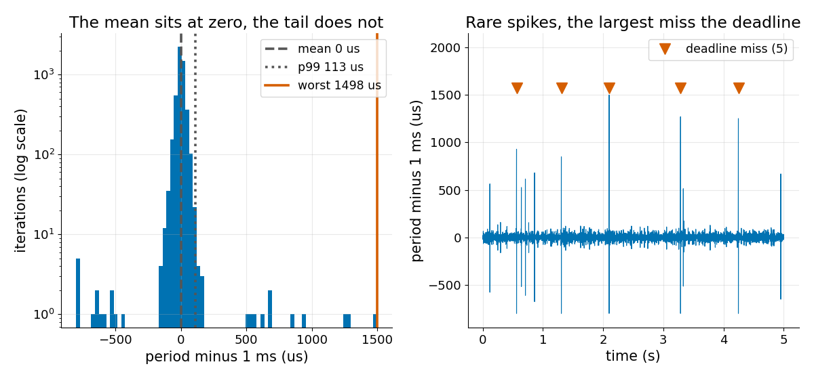

# Control Loop Jitter

> Learn why a control loop with a perfect average timing can still make a robot arm twitch.

**Type:** Build   **Prerequisites:** 05/02 Executors and Callbacks   **Time:** ~15 minutes

## In Plain Words

A control loop gives an arm a new target on every beat, like a metronome. If each beat waits one period after the last move, the beats drift later and later. Beats fixed on the clock stay on schedule. Rarely, another program holds the processor, one wake-up comes late and the arm twitches.

## Key Terms

- **Control loop**: code that repeats at a fixed rate to read sensors, compute and command the motors.
- **Period (`T`)**: the planned time between two turns of the loop.
- **Jitter**: how far a turn's real timing is from the plan.
- **Deadline**: the time by which a turn must finish.
- **p99**: the delay that 99% of cycles stay under.
- **Preemption**: the operating system pausing your program to run another one.

## The Problem

A robot arm twitches every few seconds. Its 1 kHz control loop (1000 wake-ups a second) reports a mean period of exactly 1.000 ms. One bad cycle barely moves the mean, but it causes the twitch.

## The Concept

An arm is only as steady as its slowest control cycle, not its average one.



*Each turn sleeps until a fixed time, wakes a little late, works, and must finish before the next deadline.*

Sleeping until `i * T` (turn i's own fixed time) keeps the mean at `T`, so late wake-ups show up only as spread. Sleeping `T` after the work drifts slow.



*Mean, standard deviation and even p99 can look healthy. The motor is driven by the single worst cycle.*

In this run, cycle 2098 wakes 1.5 ms late. Its 0.2 ms of work ends 0.7 ms after the next slot (1.5 + 0.2 - 1.0), so the next cycle starts 0.7 ms late too.


*The ball steps on schedule, the arm when its command goes out, so it lags once and then jumps. Ten cycles long, played 450 times slower.*



*5000 cycles, fixed seed: mean jitter 0 us (microseconds), p99 113 us, worst 1498 us, 5 deadlines missed.*

## Build It

```python
wake = (done + T if relative else i * T) + lat[i]
s[i] = max(wake, done)
d[i] = done = s[i] + work
```

`simulate()` draws small random wake-up delays plus rare spikes of 0.5 to 1.5 periods. `stats()` reports mean, p99 and worst jitter, and counts missed deadlines. The spikes model preemption and are not a measurement.

```bash
cd robotics-engineering-from-scratch
python3 -m pytest phases/05-robot-software/03-control-loop-jitter -q
python3 phases/05-robot-software/03-control-loop-jitter/code/main.py
```

## Use It

On Linux, `clock_nanosleep` with `TIMER_ABSTIME` sleeps to an absolute time, the `i * T` mode here.

Sources: clock_nanosleep(2) (https://man7.org/linux/man-pages/man2/clock_nanosleep.2.html) and ROS 2 Jazzy "Understanding real-time programming" (https://docs.ros.org/en/jazzy/Tutorials/Demos/Real-Time-Programming.html), both read 2026-11-09.

## Ship It

`outputs/skill-loop-jitter-report.md` turns loop timestamps into a mean, p99, worst and miss report.

## Exercises

1. Raise `spike_p` until p99 also looks bad.
2. Explain why the period right after each miss is shorter.
3. Add a watchdog that trips after two misses in a row.
