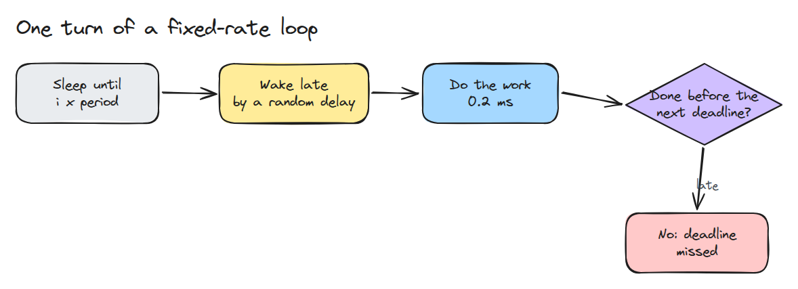
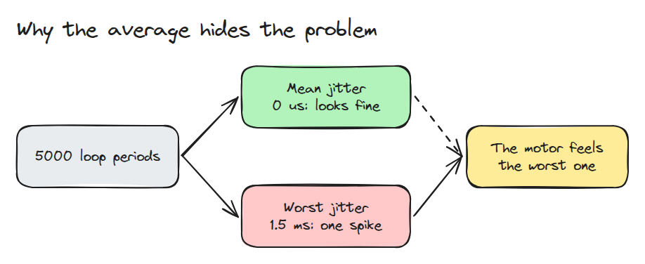
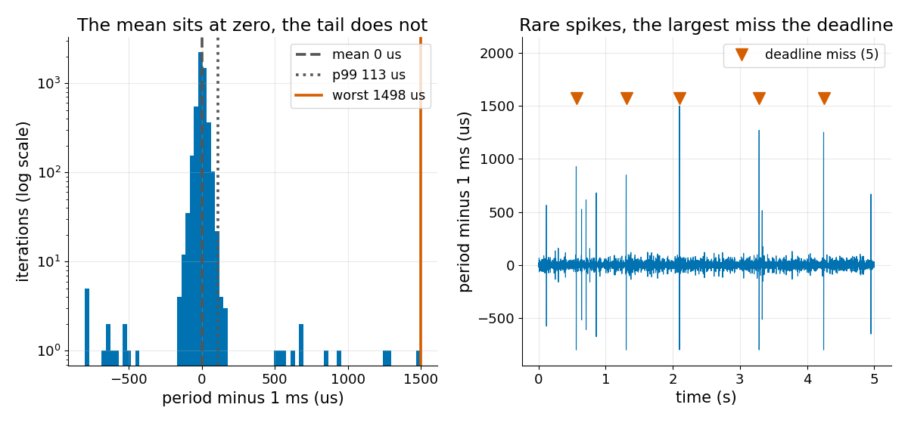

# Control Loop Jitter

> The average period of a loop can be perfect while one late wake-up in a few thousand breaks the controller.

**Type:** Build   **Prerequisites:** 05/02 Executors and Callbacks   **Time:** ~15 minutes

## The Problem

A 1 kHz control loop reports a mean period of exactly 1.000 ms, and the arm twitches once every few seconds. The mean was computed over thousands of good cycles and a single bad one barely moves it. The twitch comes from the bad one.

## The Concept



*Each turn sleeps until a fixed time, wakes a little late, works, and must finish before the next deadline.*

Jitter is the period minus the target period. Sleeping until `i * T` keeps the mean at `T`, so late wake-ups only show up as spread. Sleeping `T` after the work adds the work time to every cycle, and the loop drifts slow.



*Mean, standard deviation and even p99 can look healthy. The motor is driven by the single worst cycle.*



*In this seeded run of 5000 cycles the mean jitter is 0 us and p99 is 113 us, but the worst is 1498 us and 5 deadlines are missed.*

## Build It

```python
wake = (done + T if relative else i * T) + lat[i]
s[i] = max(wake, done)
d[i] = done = s[i] + work
```

`simulate()` draws exponential wake-up latency plus rare spikes of 0.5 to 1.5 periods. `stats()` reports mean, p99 and worst jitter, and counts iterations that finish after their next deadline. The spikes are a model of preemption, not a measurement.

```bash
cd robotics-engineering-from-scratch
python3 -m pytest phases/05-robot-software/03-control-loop-jitter -q
python3 phases/05-robot-software/03-control-loop-jitter/code/main.py
```

## Use It

On Linux, `clock_nanosleep` with `TIMER_ABSTIME` sleeps to an absolute time, which is the `i * T` mode here. Compare your simulated worst case with a measured one from your own loop before trusting it.

Sources: clock_nanosleep(2) (https://man7.org/linux/man-pages/man2/clock_nanosleep.2.html) and ROS 2 Jazzy "Understanding real-time programming" (https://docs.ros.org/en/jazzy/Tutorials/Demos/Real-Time-Programming.html), both read 2026-11-09.

## Ship It

`outputs/skill-loop-jitter-report.md` turns a list of loop timestamps into a mean, p99, worst and miss report.

## Exercises

1. Raise `spike_p` until the p99 also looks bad, and note how many cycles that takes.
2. Find the period right after each miss and explain why it is shorter than normal.
3. Add a watchdog that trips after two consecutive misses and report how often it trips.
