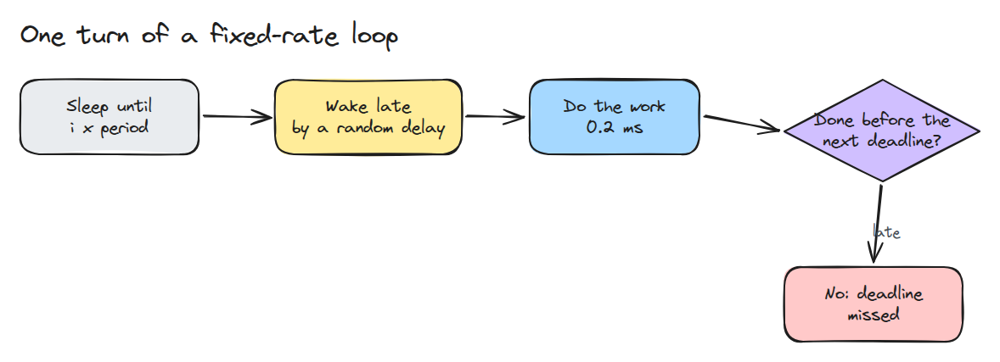
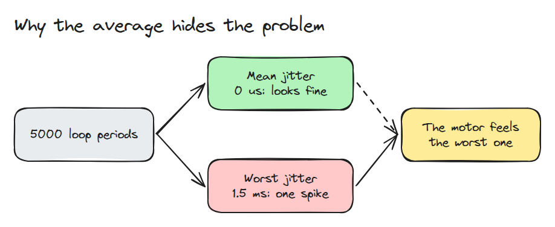
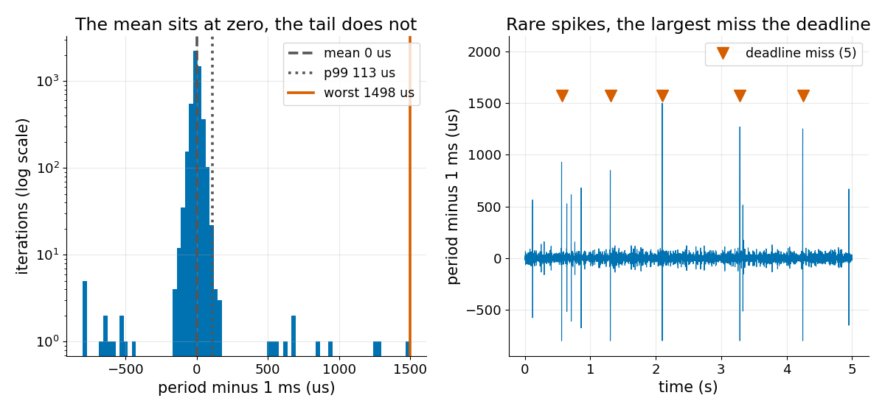

# 제어 Loop Jitter

> loop의 평균 주기가 완벽해도 수천 번에 한 번 늦게 깨어나는 것이 제어기를 깨뜨릴 수 있습니다.

**유형:** 만들기   **선수 지식:** 05/02 Executor와 Callback   **시간:** 약 15분

## 문제

1 kHz 제어 loop가 평균 주기 1.000 ms를 정확히 보고하는데 팔은 몇 초에 한 번씩 튑니다. 평균은 좋은 cycle 수천 개로 계산한 값이라 나쁜 cycle 하나는 거의 영향을 주지 못합니다. 그런데 튀는 것은 바로 그 나쁜 cycle 때문입니다.

## 개념



*한 바퀴마다 정해진 시각까지 자고 조금 늦게 깨어나서 일을 하고 다음 deadline 전에 끝나야 합니다.*

jitter는 주기에서 목표 주기를 뺀 값입니다. `i * T`까지 자면 평균이 `T`로 유지되어서 늦게 깨어나는 현상은 퍼짐으로만 나타납니다. 일을 마친 뒤 `T`만큼 자면 일한 시간이 매 cycle에 더해져서 loop가 점점 느려집니다.



*평균, 표준편차, 심지어 p99도 멀쩡해 보일 수 있습니다. 모터는 가장 나쁜 cycle 하나에 움직입니다.*



*seed를 고정한 5000 cycle 실행에서 평균 jitter는 0 us이고 p99는 113 us입니다. 그런데 최악은 1498 us이고 deadline을 5번 놓칩니다.*

## 만들기

```python
wake = (done + T if relative else i * T) + lat[i]
s[i] = max(wake, done)
d[i] = done = s[i] + work
```

`simulate()`는 지수분포를 따르는 wake-up 지연에 주기의 0.5배에서 1.5배 사이의 드문 spike를 더합니다.

`stats()`는 평균, p99, 최악 jitter를 내고 다음 deadline 뒤에 끝난 iteration을 셉니다. spike는 선점(preemption)을 흉내 낸 모델이고 측정값이 아닙니다.

```bash
cd robotics-engineering-from-scratch
python3 -m pytest phases/05-robot-software/03-control-loop-jitter -q
python3 phases/05-robot-software/03-control-loop-jitter/code/main.py
```

## 실제 도구로 보기

Linux에서 `clock_nanosleep`에 `TIMER_ABSTIME`을 주면 절대 시각까지 잡니다. 이 레슨의 `i * T` 방식입니다. 시뮬레이션의 최악값을 믿기 전에 자기 loop에서 잰 값과 비교해 보세요.

출처: clock_nanosleep(2)와 ROS 2 Jazzy "Understanding real-time programming".
https://man7.org/linux/man-pages/man2/clock_nanosleep.2.html
https://docs.ros.org/en/jazzy/Tutorials/Demos/Real-Time-Programming.html

둘 다 2026년 11월 9일에 읽었습니다.

## 결과물

`outputs/skill-loop-jitter-report.md`는 loop 타임스탬프 목록을 평균, p99, 최악, miss 보고서로 바꿉니다.

## 연습 문제

1. `spike_p`를 올려서 p99도 나빠 보이게 만들고 그때 cycle이 몇 개인지 적으세요.
2. 각 miss 바로 다음 주기를 찾고 왜 평소보다 짧은지 설명하세요.
3. 연속 miss 두 번에 작동하는 watchdog을 넣고 얼마나 자주 작동하는지 보고하세요.
