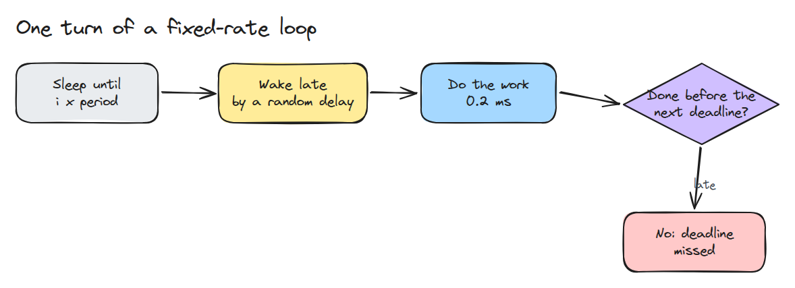
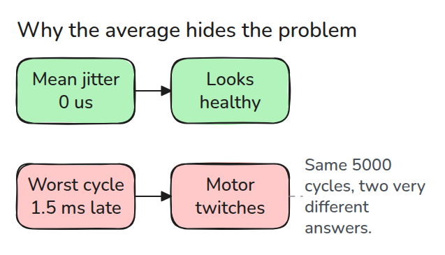
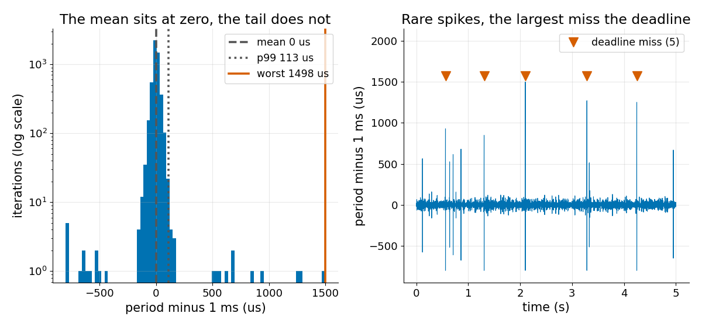

# 제어 Loop Jitter

> 평균 타이밍이 완벽한 제어 loop도 로봇 팔을 떨게 만들 수 있는 이유를 배웁니다.

**유형:** 만들기   **선수 지식:** 05/02 Executor와 Callback   **시간:** 약 15분

## 쉽게 말하면

control loop는 박자마다 로봇 팔에 새 목표를 줘요. 메트로놈과 비슷해요. 이전 동작 뒤에 한 주기를 쉬고 다음 박자를 잡으면 박자가 갈수록 늦어져요.

시계의 정해진 시각에 박자를 고정하면 일정하게 유지돼요. 그래도 아주 가끔 다른 프로그램이 processor를 붙잡아 한 번 늦게 깨어나고 팔이 떨려요.

## 핵심 용어

- **Control loop**: 센서를 읽고 계산해서 모터에 명령하는 일을 일정한 빠르기로 되풀이하는 코드입니다.
- **Period (`T`)**: loop가 한 번 도는 데 계획한 시간입니다.
- **Jitter**: 한 번의 실제 타이밍이 계획에서 벗어난 정도입니다.
- **Deadline**: 한 번의 loop가 끝나야 하는 시각입니다.
- **p99**: 주기의 99%가 그 안에 들어오는 지연 값입니다.
- **Preemption**: 운영체제가 내 프로그램을 멈추고 다른 프로그램을 실행하는 일입니다.

## 문제

로봇 팔이 몇 초마다 떨리는데 control loop는 평균 타이밍이 완벽하다고 보고합니다. 나쁜 주기 하나는 평균을 거의 움직이지 못하지만 떨림은 그 하나에서 나옵니다.

## 개념

팔은 평균 제어 주기가 아니라 가장 느린 제어 주기만큼만 안정적입니다.



*한 바퀴는 정해진 시각까지 자고 조금 늦게 깨어나 일하고 다음 deadline 전에 끝나야 합니다.*

시계의 정해진 시각까지 자면 평균이 완벽하게 유지되어서 늦게 깨어나는 일이 퍼짐으로만 나타납니다. 아주 늦은 깨어남 하나가 다음 바퀴도 늦게 만들어서 목표가 움직이는 동안 팔의 명령이 늦게 나갑니다.



*평균은 멀쩡해 보일 수 있습니다. 모터는 가장 나쁜 주기 하나에 움직입니다.*


*공은 일정대로 움직이고 팔은 명령이 나갈 때 움직여서 한 번 뒤처졌다가 튑니다.*



*평균은 완벽하지만 가장 나쁜 주기는 크게 벗어나고 deadline을 몇 번 놓칩니다.*

<details><summary>The math (optional)</summary>

1 kHz loop는 초당 1000번 깨어나고 평균 주기를 정확히 1.000 ms로 보고합니다. `i * T`까지 자면 평균이 `T`로 유지됩니다.
이 실행에서 2098번째 주기는 1.5 ms 늦게 깨어나고 일 0.2 ms가 다음 시각보다 0.7 ms 뒤에 끝나서(1.5 + 0.2 - 1.0) 다음 주기도 0.7 ms 늦게 시작합니다.
5000 주기(고정 seed)에서 평균 jitter는 0 us(마이크로초), p99는 113 us, 최악은 1498 us이고 놓친 deadline은 5개입니다. spike는 0.5에서 1.5 주기 길이입니다. 영상은 열 주기를 450배 느리게 재생한 것입니다.

</details>

## 만들기

```python
wake = (done + T if relative else i * T) + lat[i]
s[i] = max(wake, done)
d[i] = done = s[i] + work
```

`simulate()`는 작은 무작위 깨어남 지연과 드문 spike를 만듭니다. `stats()`는 평균, p99, 최악 jitter를 보고하고 놓친 deadline을 셉니다. spike는 preemption을 흉내 낸 것이고 측정값이 아닙니다.

```bash
cd robotics-engineering-from-scratch
python3 -m pytest phases/05-robot-software/03-control-loop-jitter -q
python3 phases/05-robot-software/03-control-loop-jitter/code/main.py
```

## 실제 도구로 보기

Linux에서 `TIMER_ABSTIME`을 준 `clock_nanosleep`은 절대 시각까지 잡니다.

출처: clock_nanosleep(2) (https://man7.org/linux/man-pages/man2/clock_nanosleep.2.html)와 ROS 2 Jazzy "Understanding real-time programming" (https://docs.ros.org/en/jazzy/Tutorials/Demos/Real-Time-Programming.html), 둘 다 2026년 11월 9일 확인.

## 결과물

`outputs/skill-loop-jitter-report.md`는 loop 타임스탬프를 평균, p99, 최악, deadline 놓침 보고서로 바꿉니다.

## 연습 문제

1. 드문 spike를 더 자주 나오게 해 보세요.
2. 놓친 직후의 주기가 왜 더 짧은지 설명하세요.
3. 두 번 연속 놓치면 작동하는 watchdog을 더하세요.
