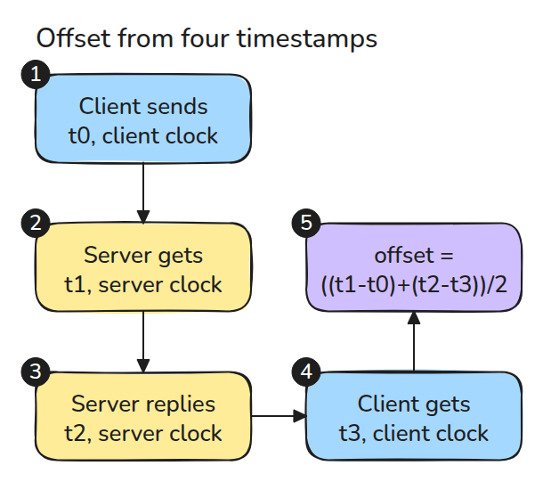
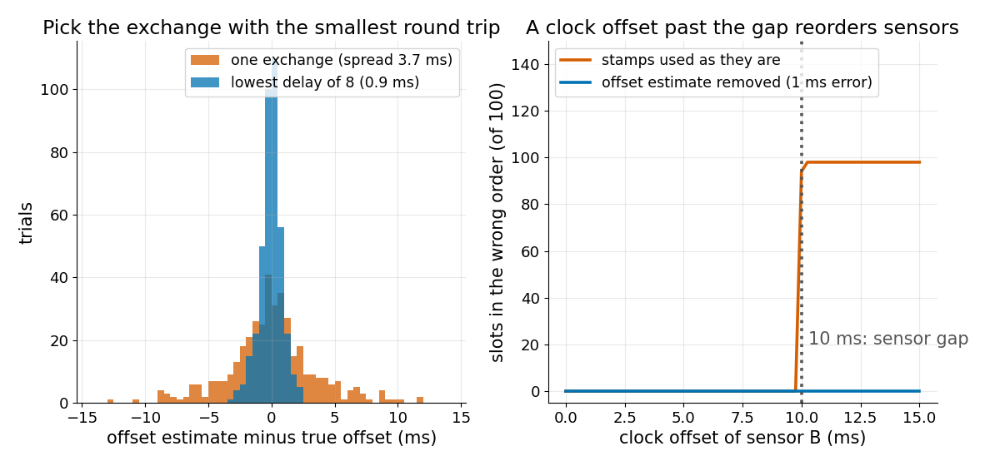
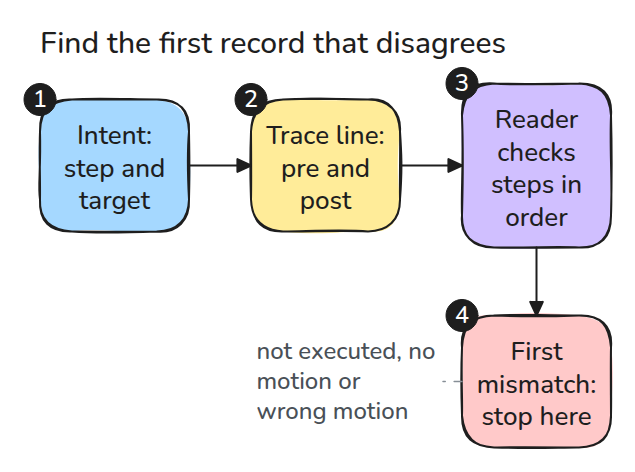

# Time Sync and Traces

> Two clocks that disagree by a few milliseconds put sensor data in the wrong order, and a trace with before and after states shows where a run first went wrong.

**Type:** Build   **Prerequisites:** 05/03 Control Loop Jitter   **Time:** ~15 minutes

## In Plain Words

A car carries an IMU that feels motion and a camera that sees the road, on separate computers. A filter, the program that merges their readings, trusts each reading's time stamp. The camera's clock runs ahead, so its readings carry stamps from the future, the filter sees events in the wrong order, and its idea of where the car is jumps ahead and back. Subtracting the clock offset fixes this. Measuring the offset takes a request and a reply with noted times.

## The Problem

A fusion filter merges camera and IMU samples from two computers, and the car it tracks jumps ahead and back. Every sample is correct, but the camera clock runs 30 ms ahead, so a camera sample taken first can get a later stamp than an IMU sample taken after it. When a run later fails, nobody can tell which step went wrong first, unless each step logged its state.

## The Concept



*Follow the numbers 1 to 5. The offset is half the sum of `t1 - t0` and `t2 - t3`.*

The client sends a request at t0 and gets the reply at t3, on its own clock. The server receives at t1 and replies at t2, on its clock. Example: the server clock is 50 ms ahead and each trip takes 20 ms, so `t1 - t0` is 70 ms and `t2 - t3` is 30 ms. Their average is 50 ms, because the trip time is added once and subtracted once. With 30 ms out and 10 ms back it is 60 ms, off by half the difference of the delays. The error never exceeds half the round trip, so trust the exchange with the smallest round trip.



*Left: the best of 8 exchanges has a tighter error than one. Right: sensors 10 ms apart swap order when the offset exceeds 10 ms; an estimate 1 ms off restores it.*

A trace is a log with one JSON line (a plain-text record) per step, holding the state before (`pre`) and after (`post`). An intent is what the step should achieve. The reader names the first failure: `not_executed`, `no_motion` (state unchanged) or `wrong_motion` (ended elsewhere).



*The reader checks intents in order and stops at the first mismatch.*

Example: three targets, but step 2 leaves `pre` and `post` identical. `first_mismatch()` returns step 2, `no_motion`, and never looks at step 3.


*The arm misses the middle target. The reader turns the first green and the second red, then stops.*

## Build It

```python
def estimate(t0, t1, t2, t3):
    return ((t1 - t0) + (t2 - t3)) / 2, (t3 - t0) - (t2 - t1)
```

`order_errors()` counts slots where sorting by stamp differs from the true order. `trace_line()` writes one JSON object per step. `first_mismatch()` returns the first failing intent.

```bash
cd robotics-engineering-from-scratch
python3 -m pytest phases/05-robot-software/04-time-sync-and-traces -q
```

## Use It

Compare `estimate()` with the offset and delay definitions in the NTP specification.

Sources: RFC 5905 (https://datatracker.ietf.org/doc/html/rfc5905) and ROS 2 design article "Clock and Time" (https://design.ros2.org/articles/clock_and_time.html), both read 2026-11-09.

## Ship It

`outputs/skill-trace-first-mismatch.md` reads a trace and names the first failing step.

## Exercises

1. Make `first_mismatch()` also flag a step whose `pre` differs from the previous step's `post`.
2. Add a per-exchange `proc` time and show that `estimate()` ignores it.
3. Fit a drift rate from offsets measured a minute apart and predict the offset after an hour.
