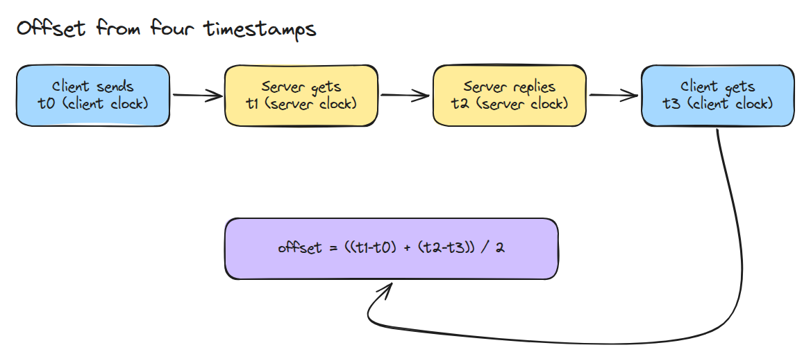
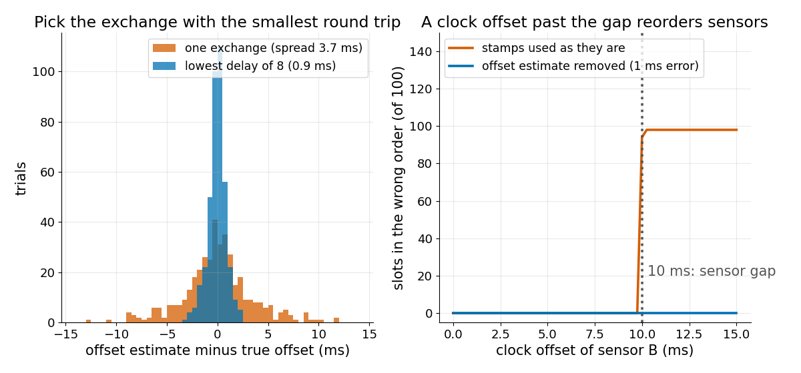
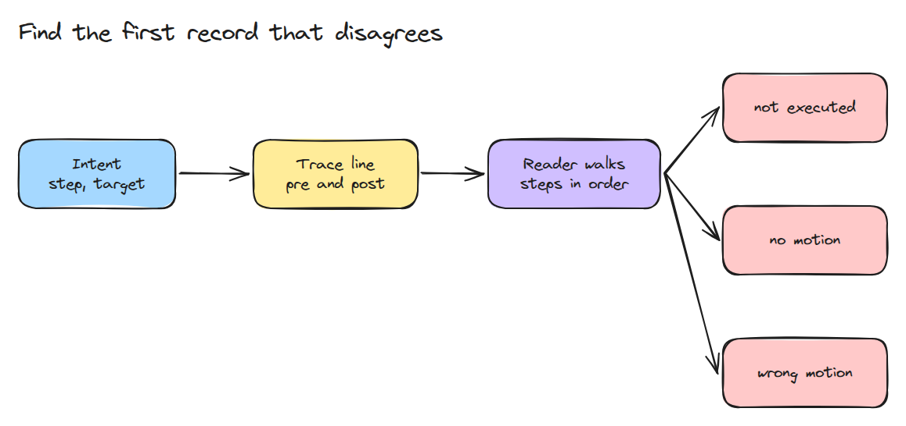

# Time Sync and Traces

> Learn how to line up two clocks, and how a step-by-step log shows where a run first went wrong.

**Type:** Build   **Prerequisites:** 05/03 Control Loop Jitter   **Time:** ~15 minutes

## In Plain Words

A car has an IMU (a motion sensor) and a camera on separate computers. A filter merging their readings trusts each time stamp, so a clock running ahead puts events in the wrong order.

## Key Terms

- **Time stamp**: the time written on a reading by the clock of the computer that took it.
- **Clock offset**: how far one computer's clock runs ahead of another's.
- **Round trip**: the time a request takes to go out plus its reply to come back.
- **Sensor fusion**: merging readings from several sensors into one estimate.
- **Trace**: a log with one record per step, holding the state before and after.
- **Intent**: what a step is supposed to achieve.

## The Problem

A car's tracked position jumps ahead and back. The camera computer's clock runs 30 ms ahead, so a camera sample taken first gets a later stamp than an IMU sample taken after it. And a failed run cannot be traced unless each step logged its state.

## The Concept

A robot understands its sensors only if every reading is placed at the moment it was taken.



*The offset is half of `t1 - t0` plus `t2 - t3`.*

The client sends a request at `t0` and gets the reply at `t3`. The server receives at `t1` and replies at `t2`, on its own clock. If the server clock is 50 ms ahead and each trip takes 20 ms, `t1 - t0` is 70 ms and `t2 - t3` is 30 ms. Their average is 50 ms, because trip time is added once and subtracted once. The error is at most half the round trip, so trust the smallest.



*Left: the best of 8 exchanges beats one. Right: sensors 10 ms apart swap order if the offset exceeds 10 ms.*

A trace has one JSON line per step with the state before (`pre`) and after (`post`). The reader names the first failure: `not_executed`, `no_motion` (state unchanged) or `wrong_motion`.



*The reader checks intents in order and stops at the first mismatch.*

If step 2 leaves `pre` and `post` identical, `first_mismatch()` returns step 2, `no_motion`, and never looks at step 3.


*The arm misses the middle target. The reader turns the first green, the second red, then stops.*

## Build It

```python
def estimate(t0, t1, t2, t3):
    return ((t1 - t0) + (t2 - t3)) / 2, (t3 - t0) - (t2 - t1)
```

`order_errors()` counts slots where sorting by stamp differs from the true order. `first_mismatch()` returns the first failing intent.

```bash
cd robotics-engineering-from-scratch
python3 -m pytest phases/05-robot-software/04-time-sync-and-traces -q
```

## Use It

`estimate()` follows the NTP formulas.

Sources: RFC 5905 (https://datatracker.ietf.org/doc/html/rfc5905) and ROS 2 design article "Clock and Time" (https://design.ros2.org/articles/clock_and_time.html), both read 2026-11-09.

## Ship It

`outputs/skill-trace-first-mismatch.md` names the first failing step of a trace.

## Exercises

1. Flag a step whose `pre` differs from the previous `post`.
2. Add a server processing time and show `estimate()` ignores it.
3. Fit a drift rate from offsets a minute apart.
