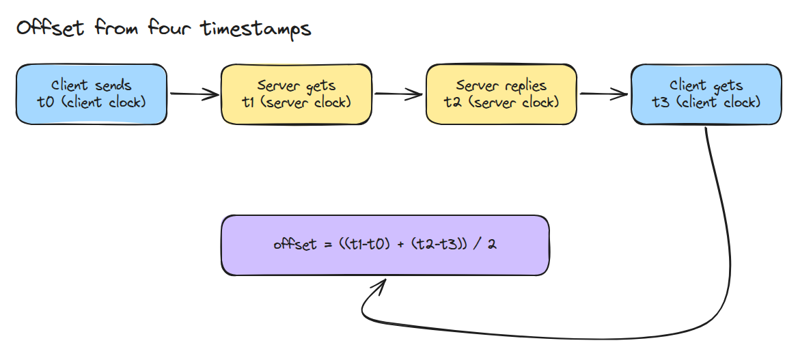
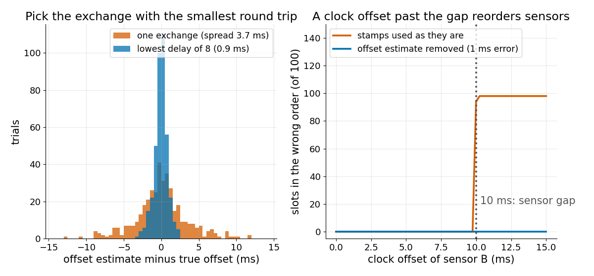
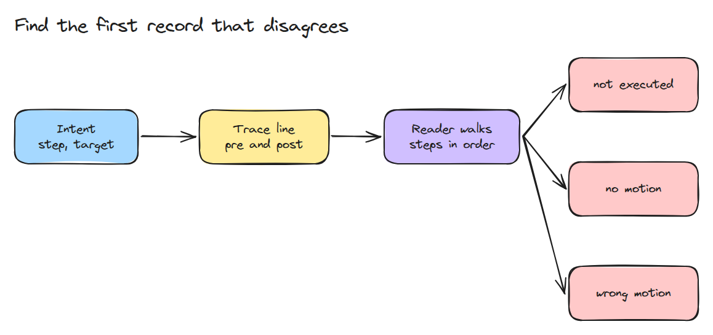

# 시간 동기화와 Trace

> 두 시계를 맞추는 법과 단계별 기록으로 실행이 처음 틀어진 곳을 찾는 법을 배웁니다.

**유형:** 만들기   **선수 지식:** 05/03 제어 Loop Jitter   **시간:** 약 15분

## 쉽게 말하면

자동차에 움직임을 느끼는 IMU와 도로를 보는 카메라가 서로 다른 컴퓨터에 달려 있어요. 두 값을 합치는 filter는 각 값의 time stamp를 믿어서 시계가 앞서가면 사건이 엉뚱한 순서로 들어와요.

## 핵심 용어

- **Time stamp**: 값을 잰 컴퓨터의 시계가 그 값에 적어 넣은 시각입니다.
- **Clock offset**: 한 컴퓨터의 시계가 다른 컴퓨터보다 얼마나 앞서가는지입니다.
- **Round trip**: 요청이 나가고 응답이 돌아오는 데 걸리는 시간입니다.
- **Sensor fusion**: 여러 센서의 값을 합쳐 하나의 추정값을 만드는 일입니다.
- **Trace**: 단계마다 기록 하나를 남기고 그 전후 상태를 담은 로그입니다.
- **Intent**: 한 단계가 이루어야 하는 일입니다.

## 문제

자동차의 추적 위치가 앞뒤로 튑니다. 카메라 컴퓨터의 시계가 30 ms 앞서가서 먼저 찍은 카메라 샘플이 나중에 잰 IMU 샘플보다 늦은 stamp를 받습니다. 그리고 각 단계가 상태를 남기지 않았다면 실패한 실행을 추적할 수 없습니다.

## 개념

로봇은 모든 센서 값이 잰 순간에 놓일 때만 센서를 이해할 수 있습니다.



*offset은 `t1 - t0`와 `t2 - t3`를 더한 값의 절반입니다.*

client는 `t0`에 요청을 보내고 `t3`에 응답을 받습니다. server는 `t1`에 받고 `t2`에 응답하며 자기 시계를 씁니다. server 시계가 50 ms 앞서고 편도가 20 ms이면 `t1 - t0`는 70 ms이고 `t2 - t3`는 30 ms입니다.
평균은 50 ms입니다. 편도 시간이 한 번 더해지고 한 번 빼지기 때문입니다. 오차는 round trip의 절반을 넘지 않으므로 가장 짧은 교환을 믿으세요.



*왼쪽은 8번 교환 중 가장 좋은 것이 한 번보다 낫다는 모습입니다. 오른쪽은 10 ms 간격 센서가 offset이 10 ms를 넘으면 순서가 뒤집히는 모습입니다.*

trace는 단계마다 JSON 한 줄을 갖고 전(`pre`)과 후(`post`)의 상태를 담습니다. reader는 첫 실패를 `not_executed`, `no_motion`(상태가 그대로), `wrong_motion` 중 하나로 알려 줍니다.



*reader는 intent를 순서대로 확인하고 처음 어긋난 곳에서 멈춥니다.*

2단계가 `pre`와 `post`를 똑같이 남기면 `first_mismatch()`는 2단계와 `no_motion`을 돌려주고 3단계는 보지 않습니다.


*팔이 가운데 목표를 놓칩니다. reader는 첫 번째를 초록, 두 번째를 빨강으로 바꾸고 멈춥니다.*

## 만들기

```python
def estimate(t0, t1, t2, t3):
    return ((t1 - t0) + (t2 - t3)) / 2, (t3 - t0) - (t2 - t1)
```

`order_errors()`는 stamp로 정렬한 순서가 실제 순서와 다른 자리를 셉니다. `first_mismatch()`는 처음 실패한 intent를 돌려줍니다.

```bash
cd robotics-engineering-from-scratch
python3 -m pytest phases/05-robot-software/04-time-sync-and-traces -q
```

## 실제 도구로 보기

`estimate()`는 NTP 공식을 따릅니다.

출처: RFC 5905 (https://datatracker.ietf.org/doc/html/rfc5905)와 ROS 2 설계 글 "Clock and Time" (https://design.ros2.org/articles/clock_and_time.html), 둘 다 2026년 11월 9일 확인.

## 결과물

`outputs/skill-trace-first-mismatch.md`는 trace에서 처음 실패한 단계를 알려 줍니다.

## 연습 문제

1. `pre`가 앞 단계의 `post`와 다른 단계를 표시하세요.
2. server 처리 시간을 더하고 `estimate()`가 그것을 무시함을 보이세요.
3. 1분 간격으로 잰 offset에서 drift 비율을 맞춰 보세요.
