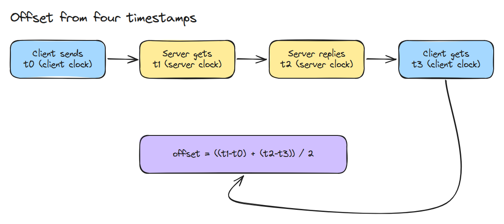
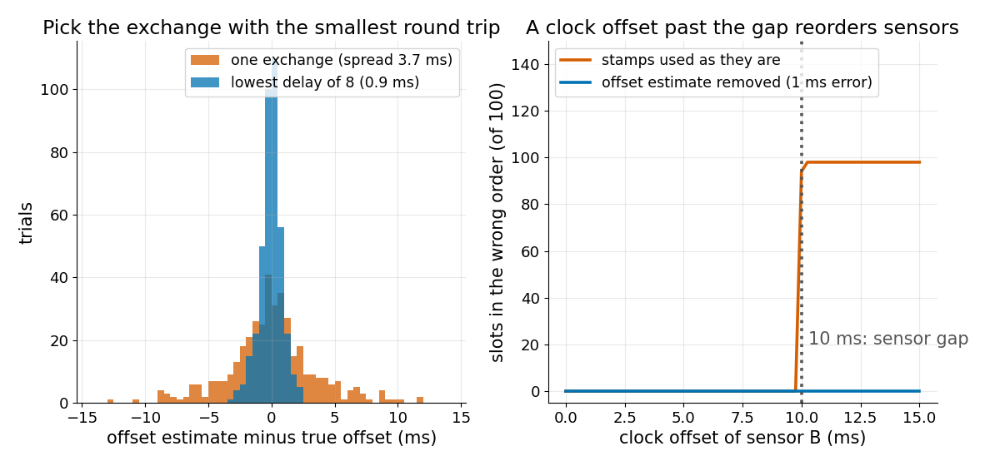
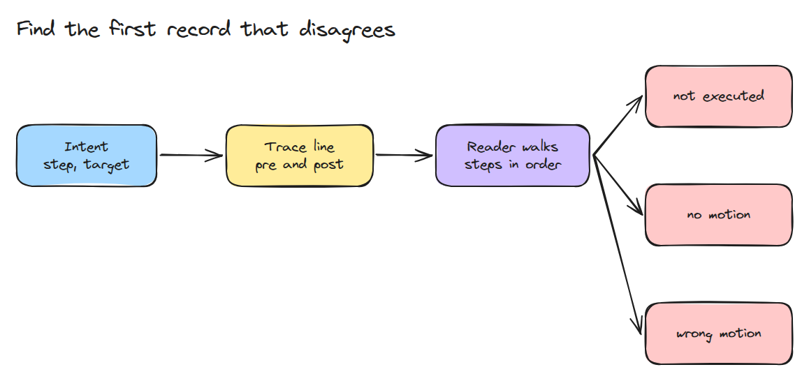

# 시간 동기화와 Trace

> 몇 ms 어긋난 두 시계는 센서 데이터의 순서를 뒤집습니다. 전후 상태가 담긴 trace는 실행이 처음 어디서 틀어졌는지 보여 줍니다.

**유형:** 만들기   **선수 지식:** 05/03 제어 Loop Jitter   **시간:** 약 15분

## 문제

융합 필터가 컴퓨터 두 대에서 오는 카메라와 IMU 샘플을 받는데 로봇이 뒤로 튀는 것처럼 움직입니다. 샘플은 모두 맞지만 카메라 시계가 30 ms 앞서 있어서 필터가 사건을 잘못된 순서로 봅니다. 나중에 실행이 실패해도 어느 step이 처음 틀어졌는지 아무도 모릅니다.

## 개념



*요청과 응답 한 쌍에서 타임스탬프 네 개가 나옵니다. 두 편도 차이의 합을 절반으로 나눈 것이 offset입니다.*

가는 길과 오는 길이 같은 시간이 걸리면 이 식은 정확합니다. 지연이 다르면 오차는 그 차이의 절반이고 왕복 시간의 절반을 넘지 않습니다. 그래서 왕복이 가장 짧은 교환을 믿습니다.



*왼쪽은 8번 중 지연이 가장 낮은 교환이 한 번 잰 값보다 오차가 훨씬 좁은 모습입니다. 오른쪽은 센서 간격이 10 ms일 때 offset이 10 ms를 넘으면 순서가 뒤집히고 1 ms 오차의 추정값을 빼면 순서가 복구되는 모습입니다.*



*trace 한 줄에는 한 step의 전 상태와 후 상태가 들어 있습니다. reader는 intent를 순서대로 확인하고 맞지 않는 첫 기록에서 멈춥니다.*

## 만들기

```python
def estimate(t0, t1, t2, t3):
    return ((t1 - t0) + (t2 - t3)) / 2, (t3 - t0) - (t2 - t1)
```

`order_errors()`는 두 센서 스트림을 스탬프로 정렬하고 실제 순서와 다른 칸을 셉니다. `trace_line()`은 step마다 `pre`와 `post`가 든 JSON 객체 한 줄을 씁니다.

`first_mismatch()`는 처음 실패한 intent에 대해 `not_executed`, `no_motion`, `wrong_motion` 중 하나를 돌려줍니다.

```bash
cd robotics-engineering-from-scratch
python3 -m pytest phases/05-robot-software/04-time-sync-and-traces -q
```

## 실제 도구로 보기

실제로는 NTP 같은 서비스가 시스템 시계를 맞추고 ROS 2도 네트워크 전체에서 시스템 시계가 동기화되어 있기를 요구합니다. `estimate()`를 NTP 규격의 offset과 delay 정의와 비교해 보세요.

출처: RFC 5905와 ROS 2 설계 문서 "Clock and Time".
https://datatracker.ietf.org/doc/html/rfc5905
https://design.ros2.org/articles/clock_and_time.html

둘 다 2026년 11월 9일에 읽었습니다.

## 결과물

`outputs/skill-trace-first-mismatch.md`는 trace를 읽고 의도대로 동작하지 않은 첫 step을 알려 줍니다.

## 연습 문제

1. `first_mismatch()`가 `pre`가 앞 step의 `post`와 다른 step도 표시하게 하세요.
2. 교환마다 `proc` 시간을 넣고 `estimate()`가 그것을 무시한다는 것을 보이세요.
3. 1분 간격으로 잰 offset에서 drift 비율을 맞추고 1시간 뒤의 offset을 예측하세요.
