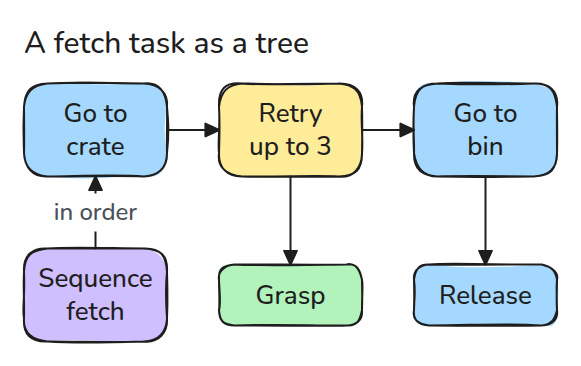
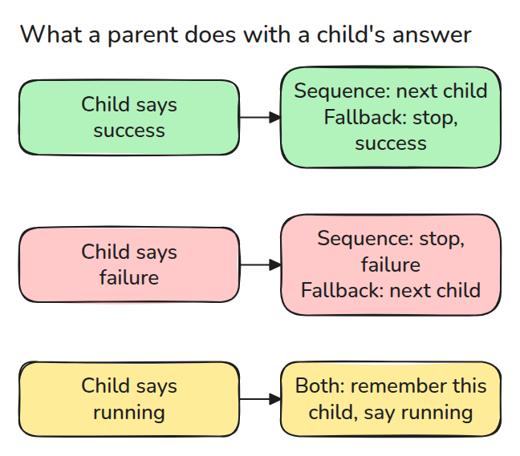
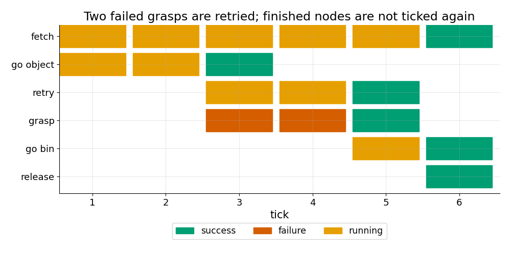

# Behaviour Trees and State Machines

> A robot task is a tree that is ticked every cycle, and every node answers success, failure or running.

**Type:** Build   **Prerequisites:** 05/02 Executors and Callbacks   **Time:** ~15 minutes

## In Plain Words

An arm fetches a crate: reach it, grasp it, carry it to the bin, let go. If the grasp misses, the arm should try again where it is, not drive back to the start. A behaviour tree gives it that memory. Every step answers success, failure or running. A Sequence remembers which step is still running, and a Retry gives a failed step another attempt. A state machine writes the same decisions as named states with arrows between them.

## The Problem

You write a fetch task as nested ifs inside one callback. The grasp fails, the callback runs again next cycle, and it no longer knows whether the arm already reached the crate. So the arm drives there again, or the retry is skipped. Task logic needs a place to keep "where was I" that is not a pile of flags.

## The Concept



*The task is a Sequence of steps. The grasp sits under a Retry, so a failed grasp does not end the task.*

Every cycle the root is ticked, which means the tree is asked to take one small step, and the tick walks down. A leaf does a little work and returns `success`, `failure` or `running`. A parent reads those answers and decides what to do next.



*Sequence stops at the first failure and Fallback stops at the first success. Both remember the child that said running and resume there.*

Example: the arm holds a crate and a Fallback tries bin A, then bin B. Bin A is full, so tick 1 fails the check `A has room` and moves on to `go B`, which answers running. Tick 2 resumes at `go B` without asking about A again, and tick 3 succeeds. The check ran once and `go A` never ran.


*A red frame flashes on the full bin at tick 1. The arm then swings toward bin B over three ticks and drops the crate, never asking about bin A again.*



*The grasp fails twice and the Retry reports running. Once the reach step succeeds, it is never ticked again.*

A state machine is another common tool. It is a table of `state -> event -> next state`. Every state lists its own exits, so adding a retry means editing every state that can fail. In a tree the retry is one node around one child.

## Build It

```python
def tick(self, log):
    for k in range(self.i, len(self.children)):
        s = self.children[k].tick(log)
        if s == RUNNING or s == self.stop:
            self.i = k if s == RUNNING else 0
            return self.done(log, s)
```

`Sequence` and `Fallback` share this walk. They differ only in which answer stops it. `Retry` turns a failure into `running` until it has tried `n` times. `fetch_task()` builds the tree above and `run()` ticks it to the end.

```bash
cd robotics-engineering-from-scratch
python3 -m pytest phases/05-robot-software/05-behaviour-trees-and-state-machines -q
python3 phases/05-robot-software/05-behaviour-trees-and-state-machines/code/main.py
```

## Use It

BehaviorTree.CPP and `py_trees` use the same core answers and add parallel nodes and a blackboard for shared data. Check that your tree gives the same tick log on the same scripted leaves.

## Ship It

`outputs/skill-behaviour-tree-review.md` reviews a task tree for resume, retry and fallback mistakes.

## Exercises

1. Add a Fallback that sends the robot to a safe pose when the Retry gives up.
2. Make a Sequence without memory that rechecks a condition leaf every tick.
3. Write the fetch task as a state machine table and count transitions.
