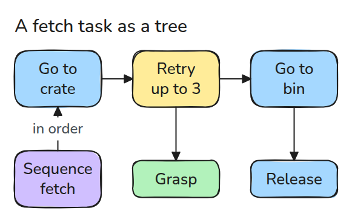
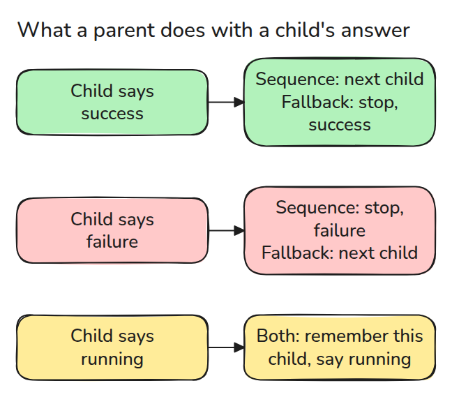
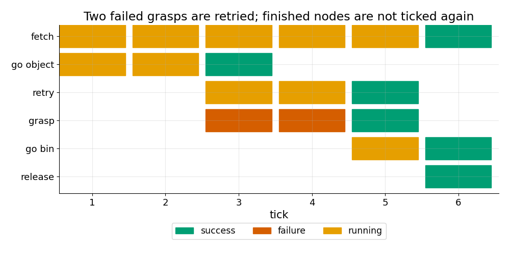

# Behaviour Trees and State Machines

> Learn how a robot task can remember where it is, so a failed step is retried instead of restarted.

**Type:** Build   **Prerequisites:** 05/02 Executors and Callbacks   **Time:** ~15 minutes

## In Plain Words

An arm fetches a crate. If the grasp misses, it should retry where it is, not drive back to the start. A behaviour tree gives it that memory: every step answers success, failure or running, and a Sequence remembers which step is still running.

## Key Terms

- **Behaviour tree**: a task written as a tree of steps and ticked every cycle.
- **Tick**: one small step, where the tree is asked to do a little work and report.
- **Status**: the answer a node gives, `success`, `failure` or `running`.
- **Sequence**: a parent that runs its children in order and stops at the first failure.
- **Fallback**: a parent that tries its children in order and stops at the first success.
- **State machine**: a table of named states with an arrow for each event.

## The Problem

An arm must reach a crate, grasp it, carry it and let go. As nested ifs, a missed grasp makes the code forget whether the arm reached the crate, so it drives there again or skips the retry.

## The Concept

Real tasks fail halfway all the time, so the task needs a place to remember where it was.



*The grasp sits under a Retry, so a failed grasp does not end the task.*



*Sequence stops at the first failure, Fallback at the first success. Both resume at the child that said running.*

A Fallback tries bin A, then bin B. Bin A is full, so tick 1 fails the check `A has room` and moves on to `go B`, which answers running. Tick 2 resumes at `go B` without asking about A again, and tick 3 succeeds.


*A red frame flashes on the full bin at tick 1. The arm then carries the crate to bin B.*



*The grasp fails twice and the Retry reports running. Once reach succeeds, it is never ticked again.*

In a state machine every state lists its own exits, so adding a retry means editing every state that can fail. In a tree the retry is one node around one child.

## Build It

```python
def tick(self, log):
    for k in range(self.i, len(self.children)):
        s = self.children[k].tick(log)
        if s == RUNNING or s == self.stop:
            self.i = k if s == RUNNING else 0
            return self.done(log, s)
```

`Sequence` and `Fallback` share this walk and differ only in which answer stops it. `Retry` turns a failure into `running` until it has tried `n` times.

```bash
cd robotics-engineering-from-scratch
python3 -m pytest phases/05-robot-software/05-behaviour-trees-and-state-machines -q
python3 phases/05-robot-software/05-behaviour-trees-and-state-machines/code/main.py
```

## Use It

BehaviorTree.CPP and `py_trees` use the same answers and add a blackboard (shared data). Check that your tree gives the same tick log on the same scripted leaves.

## Ship It

`outputs/skill-behaviour-tree-review.md` reviews a task tree for resume, retry and fallback mistakes.

## Exercises

1. Add a Fallback that sends the robot to a safe pose when the Retry gives up.
2. Make a Sequence that rechecks a condition every tick.
3. Write the fetch task as a state machine table.
