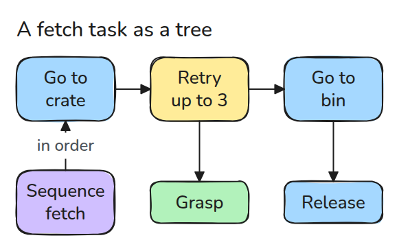
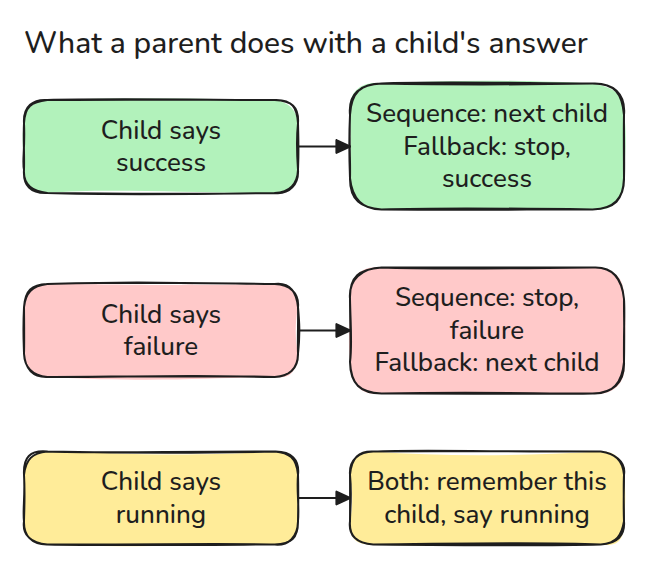
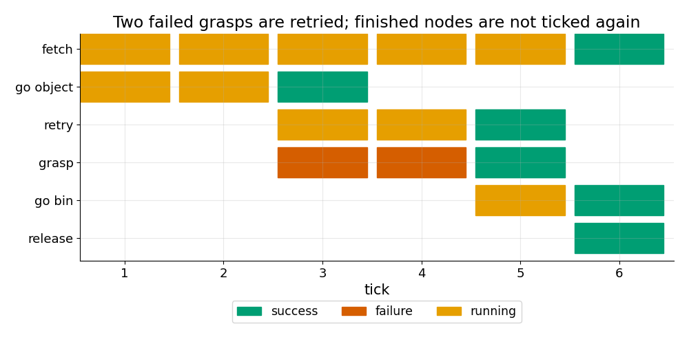

# Behaviour Tree와 상태 기계

> 로봇 작업이 자기가 어디까지 했는지 기억해서 실패한 단계를 처음부터가 아니라 그 자리에서 다시 하는 법을 배웁니다.

**유형:** 만들기   **선수 지식:** 05/02 Executor와 Callback   **시간:** 약 15분

## 쉽게 말하면

팔이 상자를 가져와요. 잡기에 실패하면 시작점으로 돌아가지 않고 그 자리에서 다시 시도해야 해요. behaviour tree는 팔에게 그 기억을 줘요.

## 핵심 용어

- **Behaviour tree**: 작업을 단계의 tree로 적어 두고 매 주기 tick하는 방식입니다.
- **Tick**: 작은 한 걸음입니다. tree에게 일을 조금 하고 보고하라고 시키는 것입니다.
- **Status**: 노드가 내놓는 답으로 `success`, `failure`, `running` 중 하나입니다.
- **Sequence**: 자식을 순서대로 실행하고 처음 실패에서 멈추는 부모입니다.
- **Fallback**: 자식을 순서대로 시도하고 처음 성공에서 멈추는 부모입니다.
- **State machine**: 이름 붙은 상태들과 사건마다 정해진 화살표를 담은 표입니다.

## 문제

팔이 상자에 닿고 잡고 옮깁니다. 중첩된 if로 쓰면 잡기에 실패한 뒤 코드가 팔이 이미 상자에 닿았는지 잊어서 다시 그리로 갑니다.

## 개념

실제 작업은 중간에 자주 실패하므로 작업에는 어디까지 했는지 기억할 자리가 필요합니다.



*잡기가 Retry 아래에 있어서 잡기 실패가 작업을 끝내지 않습니다.*

매 주기 tree를 tick하면 각 단계가 success, failure, running 중 하나로 답합니다. Sequence는 처음 실패에서 멈추고 Fallback은 처음 성공에서 멈추며 둘 다 running이라고 답한 단계에서 이어 갑니다.



*부모가 각 답으로 하는 일입니다.*

Fallback이 통 A를 시도하고 그다음 통 B를 시도합니다. 통 A가 가득 차 있어서 통 B로 넘어가며 통 B는 running이라고 답합니다. 다음 tick은 A를 다시 묻지 않고 통 B에서 이어 갑니다.


*가득 찬 통에 빨간 테두리가 번쩍입니다. 그다음 팔이 상자를 통 B로 옮깁니다.*



*잡기가 두 번 실패하고 Retry는 running이라고 보고합니다. 닿기가 성공하면 다시 tick되지 않습니다.*

state machine에서는 실패할 수 있는 모든 상태에 재시도를 더해야 합니다. tree에서는 자식 하나를 감싼 노드 하나면 됩니다.

<details><summary>The math (optional)</summary>

통 예시에서 tick 1은 `A has room` 확인이 실패하고 `go B`로 넘어가며 `go B`는 running이라고 답합니다. tick 2는 `go B`에서 이어 가고 tick 3에서 성공합니다.
`Retry`는 `n`번 시도할 때까지 failure를 `running`으로 바꿉니다.

</details>

## 만들기

```python
def tick(self, log):
    for k in range(self.i, len(self.children)):
        s = self.children[k].tick(log)
        if s == RUNNING or s == self.stop:
            self.i = k if s == RUNNING else 0
            return self.done(log, s)
```

`Sequence`와 `Fallback`은 이 걷기를 공유하고 어느 답에서 멈추느냐만 다릅니다.

```bash
cd robotics-engineering-from-scratch
python3 -m pytest phases/05-robot-software/05-behaviour-trees-and-state-machines -q
python3 phases/05-robot-software/05-behaviour-trees-and-state-machines/code/main.py
```

## 실제 도구로 보기

BehaviorTree.CPP와 `py_trees`는 같은 답을 쓰고 공유 데이터를 더합니다.

## 결과물

`outputs/skill-behaviour-tree-review.md`는 작업 tree에서 이어 가기, 재시도, fallback 실수를 점검합니다.

## 연습 문제

1. Retry가 포기하면 로봇을 안전 자세로 보내는 Fallback을 더하세요.
2. 매 tick마다 조건을 다시 확인하는 Sequence를 만드세요.
3. 가져오기 작업을 state machine 표로 쓰세요.
