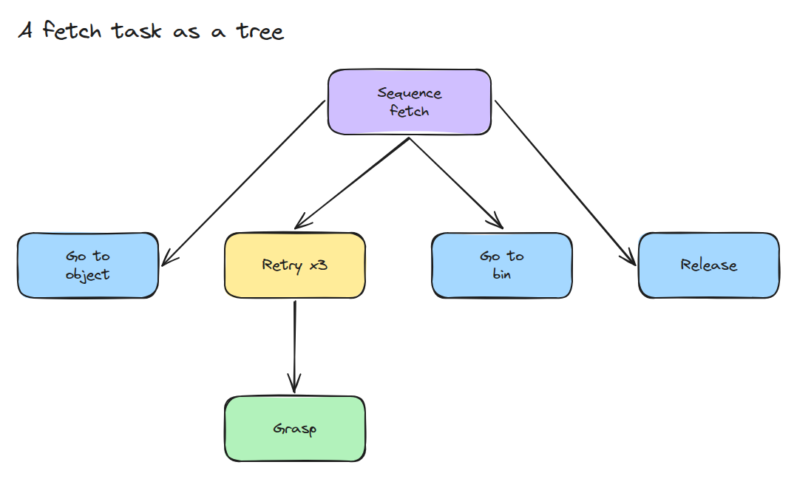
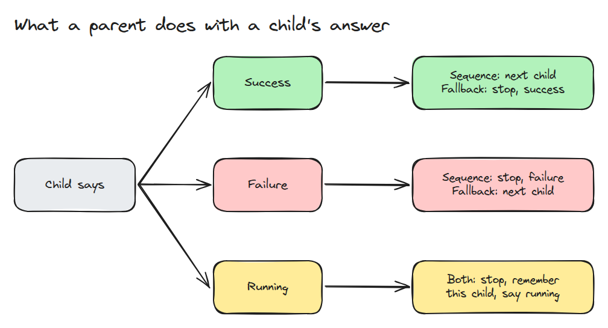
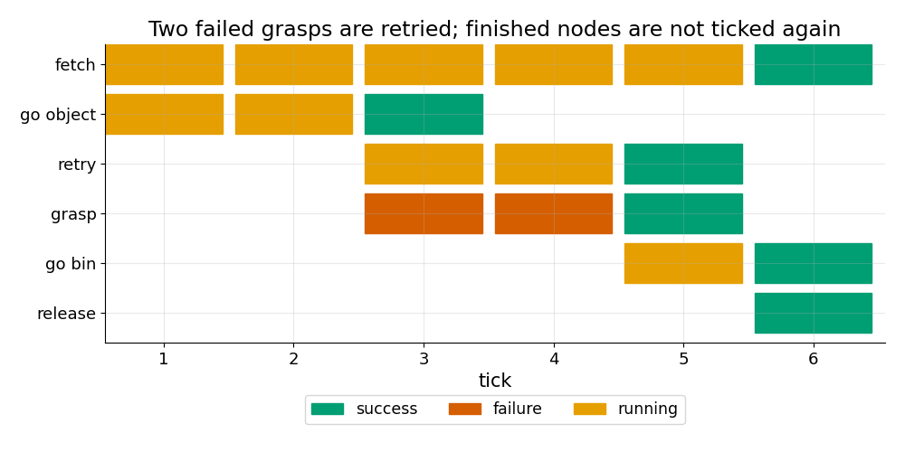

# Behaviour Tree와 상태 기계

> 로봇 작업은 매 주기 tick 되는 트리이고 모든 노드는 success, failure, running 중 하나로 답합니다.

**유형:** 만들기   **선수 지식:** 05/02 Executor와 Callback   **시간:** 약 15분

## 쉽게 말하면

신발을 신고 끈을 묶다가 매듭이 풀리면 매듭을 다시 묶어요. 신발을 벗고 처음부터 시작하지는 않아요. 끝나지 않은 단계를 기억해서 작은 실패 때문에 전체 일을 반복하지 않아요.

behaviour tree는 success와 failure와 running으로 이 흐름을 다뤄요. 이 레슨의 Sequence는 running인 자식을 기억해요. Retry는 실패한 동작을 다시
시도하고 Fallback은 다른 방법을 시도해요. state machine에서는 같은 결정을 이름 붙인 상태 사이의 전이로 적어요.

## 문제

fetch 작업을 callback 하나 안의 중첩 if로 씁니다. 잡기가 실패하면 다음 주기에 callback이 다시 돌고 이때는 로봇이 물체에 도착했는지 모릅니다.
그래서 다시 그쪽으로 가거나 재시도를 건너뜁니다. 작업 논리에는 flag 더미가 아닌 "나는 어디까지 했나"를 둘 자리가 필요합니다.

## 개념



*작업은 단계들의 Sequence입니다. 잡기가 Retry 아래에 있으므로 잡기 한 번의 실패가 작업 전체를 끝내지 않습니다.*

매 주기 root에 tick을 주면 tick이 아래로 내려갑니다. leaf는 일을 조금 하고 `success`, `failure`, `running` 중 하나를 돌려줍니다. 부모는 그 답을 읽고 다음에 할 일을 정합니다.



*Sequence는 첫 failure에서 멈추고 Fallback은 첫 success에서 멈춥니다. 둘 다 running이라고 답한 자식을 기억해 두었다가 거기서 이어갑니다.*



*잡기가 두 번 실패하는 동안 Retry는 running을 돌려줍니다. go object가 성공한 뒤에는 다시 tick 되지 않습니다.*

상태 기계는 또 하나의 흔한 도구입니다. `state -> event -> next state` 표입니다. 상태마다 자기 출구를 적어야 하므로 재시도를 넣으려면 실패할 수 있는 모든 상태를 고쳐야 합니다. 트리에서는 자식 하나를 감싸는 노드 하나면 됩니다.

## 만들기

```python
def tick(self, log):
    for k in range(self.i, len(self.children)):
        s = self.children[k].tick(log)
        if s == RUNNING or s == self.stop:
            self.i = k if s == RUNNING else 0
            return self.done(log, s)
```

`Sequence`와 `Fallback`은 이 순회를 같이 씁니다. 어느 답에서 멈추는지만 다릅니다. `Retry`는 `n`번 시도할 때까지 failure를 `running`으로 바꿉니다. `fetch_task()`는 위 트리를 만들고 `run()`은 끝날 때까지 tick을 줍니다.

```bash
cd robotics-engineering-from-scratch
python3 -m pytest phases/05-robot-software/05-behaviour-trees-and-state-machines -q
python3 phases/05-robot-software/05-behaviour-trees-and-state-machines/code/main.py
```

## 실제 도구로 보기

BehaviorTree.CPP와 `py_trees`도 같은 핵심 답을 쓰고 병렬 노드와 공유 데이터용 blackboard를 더합니다. 같은 scripted leaf에서 tick 기록이 같은지 확인하세요.

## 결과물

`outputs/skill-behaviour-tree-review.md`는 작업 트리에서 재개, 재시도, fallback 실수를 점검합니다.

## 연습 문제

1. Retry가 포기하면 로봇을 안전 자세로 보내는 Fallback을 더하세요.
2. 기억이 없는 Sequence를 만들어 조건 leaf를 매 tick 다시 확인하게 하세요.
3. fetch 작업을 상태 기계 표로 쓰고 전이 수를 세어 보세요.
