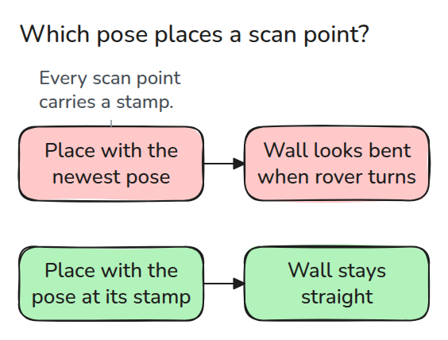
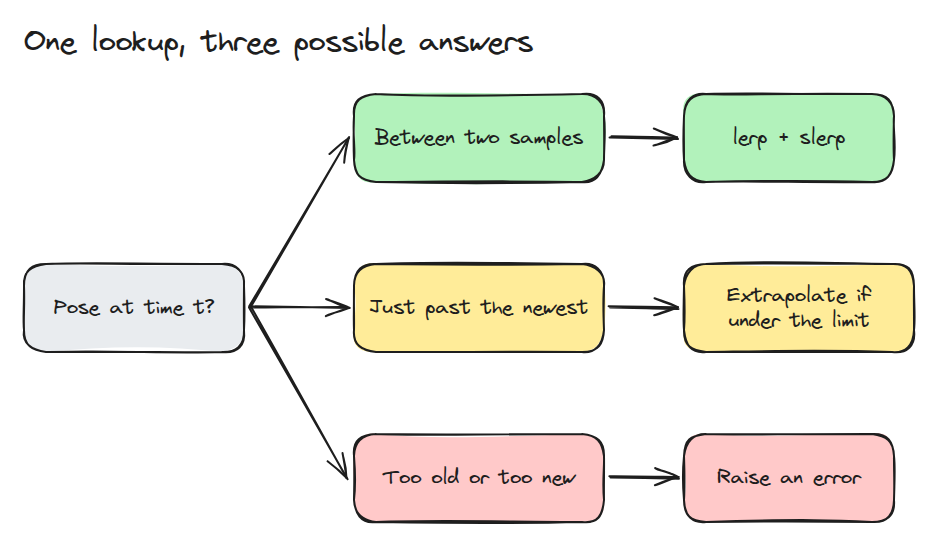
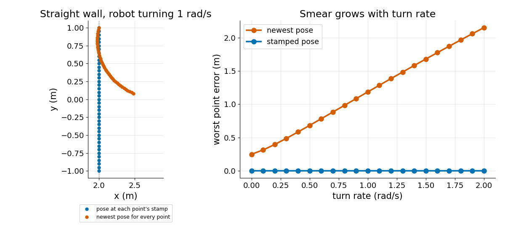

# Transforms at a Time

> Learn why a turning robot's laser scan bends a straight wall, and how timestamps fix it.

**Type:** Build   **Prerequisites:** 01/04 Frames and Transform Trees, 05/04 Time Sync and Traces   **Time:** ~15 minutes

## In Plain Words

A rover turns while its laser scans a straight wall. The rover turned a little between points, so each point needs the rover's pose at its own time. A pose buffer stores past poses and fills the gaps. Use the newest pose for every point and the wall bends.

## Key Terms

- **Frame**: a coordinate system attached to a body, such as the rover or the laser.
- **Pose**: a body's position and direction at one moment.
- **Transform**: the pose of one frame as seen from another.
- **Time stamp**: the moment a measurement was taken.
- **Interpolate**: estimate a value between two known samples.
- **Extrapolate**: guess a value past the newest sample by continuing the last motion.

## The Problem

A rover turns while its laser scans a straight wall for half a second. Using the newest pose for every point bends the wall, more the faster the rover turns.

## The Concept

A robot must know where its body was at the instant of each measurement.



*The newest pose fits only the last point. The pose at the stamp keeps the wall straight.*

A transform tree (01/04) answers "where is frame B in frame A". With time it asks "where was B in A at time t".



*Between samples: interpolate. Slightly past the newest: extrapolate within a limit. Else: error.*

Position is a lerp (straight-line blend). Orientation uses the slerp from 01/03, a blend of two rotations along the shortest arc. The limit is 0 s by default. Refusing is a feature: a guess past the newest sample hides a late message.

Poses at 0 s and 1 s are 1.2 m and 1 rad apart. A lookup at 0.5 s answers 0.6 m and 0.5 rad. At 1.5 s it raises `LookupError`: 0.500 s past the newest sample, and the limit is 0.


*Grey ghosts are stored poses. Amber answers 0.5 s. The red cross, 1.5 s, is refused.*



*Left: a wall scanned for 0.5 s while turning 1 rad/s. Right: the newest-pose error grows with turn rate. The stamped error stays at zero.*

## Build It

```python
i = min(bisect.bisect_right(self.t, t) - 1, len(self.t) - 2)
a = (t - self.t[i]) / (self.t[i + 1] - self.t[i])
return (1 - a) * self.p[i] + a * self.p[i + 1], slerp(self.q[i], self.q[i + 1], a).copy()
```

`lookup()` raises `LookupError` outside the stored times plus `max_extrapolation`. `to_world()` places scan points with stamped or newest poses.

```bash
cd robotics-engineering-from-scratch
python3 -m pytest phases/05-robot-software/06-transforms-at-a-time -q
python3 phases/05-robot-software/06-transforms-at-a-time/code/main.py
```

## Use It

ROS 2's tf2 buffers raise an extrapolation exception for the same reason.

## Ship It

`outputs/skill-timed-transform-check.md` checks that sensor data uses the pose at its stamp.

## Exercises

1. Set `max_extrapolation = 0.1` and find the largest turn rate where the guess stays under 1 cm.
2. Feed samples at 10 Hz and 100 Hz and compare the midpoint error.
3. Compose lookups from two buffers at one stamp.
