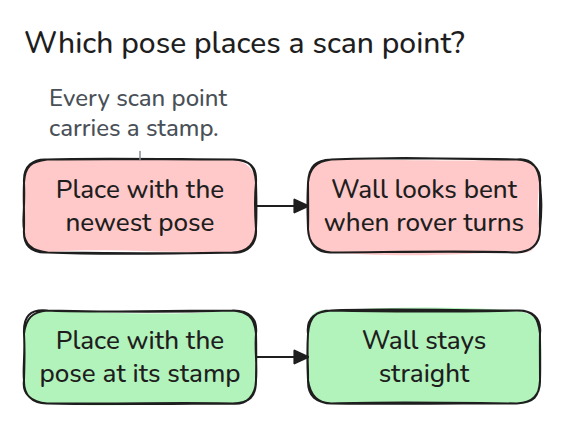
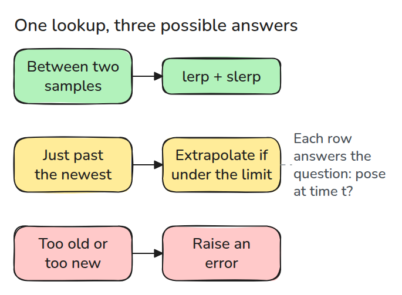
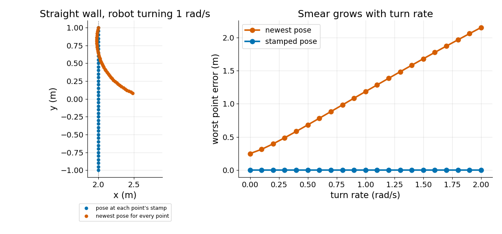

# Transforms at a Time

> A transform lookup is a question about one instant, so the buffer must interpolate between samples or refuse to answer.

**Type:** Build   **Prerequisites:** 01/04 Frames and Transform Trees, 05/04 Time Sync and Traces   **Time:** ~15 minutes

## In Plain Words

A rover turns while its laser scans a straight wall, and each laser point carries the time it was measured. The rover has turned a little between points, so every point needs the rover's pose, its position and direction, at that point's own time. A pose buffer stores past poses and fills the gaps between them. If every point is placed with the newest pose instead, early points are rotated as if the rover already faced its final direction, and the wall bends.

## The Problem

A laser scan takes half a second while the rover turns. You place every point with the newest pose. A straight wall comes out bent, and the faster the rover turns the worse it gets.

## The Concept



*Each point has a time stamp. The newest pose bends the wall and fits only the last point. The pose at the stamp keeps it straight.*

A transform tree (01/04) answers "where is frame B in frame A", a frame being a coordinate system attached to a body. Add time and the question becomes "where was B in A at time t". Poses arrive at discrete times, so the buffer has three cases.



*Between two samples it interpolates. Slightly past the newest it may extrapolate, continuing the last motion, within a set limit. Anything else raises an error.*

Position is a plain lerp, a straight-line blend. Orientation uses the slerp from 01/03, which blends two rotations along the shortest arc. The limit is 0 s by default. Refusing is a feature: a guess past the newest sample looks like data and hides a late message.

Example: the buffer holds the rover's poses at 0 s and 1 s, 1.2 m and 1 rad apart. A lookup at 0.5 s answers 0.6 m and 0.5 rad, where the rover was. A lookup at 1.5 s raises `LookupError`: 0.500 s newer than the newest sample, and the limit is 0.


*Grey ghosts are the stored poses. The amber ghost answers 0.5 s, between them. The red cross marks 1.5 s, which is refused.*



*Left: a straight wall scanned for 0.5 s while turning 1 rad/s. Right: the newest-pose error grows with turn rate and starts at 0.25 m, driving 0.5 m/s for 0.5 s. The stamped error stays at zero.*

## Build It

```python
i = min(bisect.bisect_right(self.t, t) - 1, len(self.t) - 2)
a = (t - self.t[i]) / (self.t[i + 1] - self.t[i])
return (1 - a) * self.p[i] + a * self.p[i + 1], slerp(self.q[i], self.q[i + 1], a).copy()
```

`lookup()` raises `LookupError` for a time older than the oldest sample or newer than the newest plus `max_extrapolation`. `add()` accepts late samples in any order and drops history beyond `window`. `to_world()` places scan points with stamped or newest poses.

```bash
cd robotics-engineering-from-scratch
python3 -m pytest phases/05-robot-software/06-transforms-at-a-time -q
python3 phases/05-robot-software/06-transforms-at-a-time/code/main.py
```

## Use It

ROS 2's tf2 buffers answer the same question and raise an extrapolation exception for the same reason. Read the tf2 "Using time" tutorial, then ask a buffer for a pose slightly in the future.

## Ship It

`outputs/skill-timed-transform-check.md` checks that sensor data uses the pose at its own stamp.

## Exercises

1. Set `max_extrapolation = 0.1` and find the largest turn rate where the guess stays under 1 cm.
2. Feed samples at 10 Hz and 100 Hz and compare the midpoint error for an accelerating robot.
3. Add a second buffer for another frame and compose the two lookups at one stamp.
