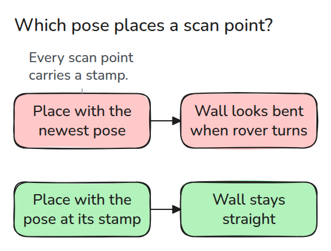
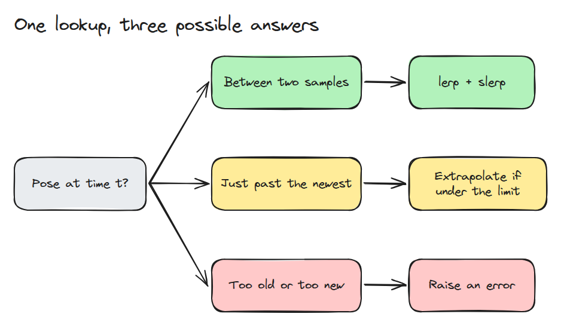
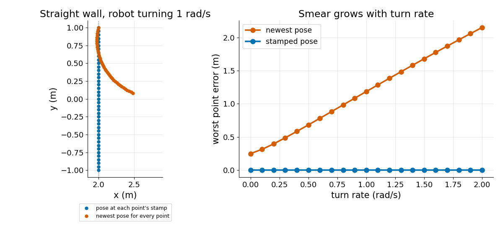

# 시각이 붙은 Transform

> 도는 로봇의 레이저 스캔이 곧은 벽을 휘게 만드는 이유와 timestamp로 고치는 법을 배웁니다.

**유형:** 만들기   **선수 지식:** 05/04 시간 동기화와 Trace   **시간:** 약 15분

## 쉽게 말하면

로버가 돌면서 레이저로 곧은 벽을 훑어요. 점과 점 사이에 로버가 조금 돌았으니 각 점에는 그 점을 잰 시각의 로버 pose가 필요해요.

pose buffer는 지난 pose를 저장하고 그 사이를 채워 줘요. 모든 점에 가장 최신 pose를 쓰면 벽이 휘어요.

## 핵심 용어

- **Frame**: 로버나 레이저 같은 물체에 붙인 좌표계입니다.
- **Pose**: 한 순간의 물체의 위치와 방향입니다.
- **Transform**: 한 frame이 어디에 있고 어느 쪽을 향하는지를 다른 frame에서 잰 값입니다.
- **Time stamp**: 측정이 이루어진 순간입니다.
- **Interpolate**: 알고 있는 두 샘플 사이의 값을 추정하는 일입니다.
- **Extrapolate**: 가장 최신 샘플 너머의 값을 마지막 움직임을 이어서 짐작하는 일입니다.

## 문제

로버가 도는 동안 레이저가 곧은 벽을 0.5초 동안 스캔합니다. 모든 점에 가장 최신 pose를 쓰면 벽이 휩니다.

## 개념

로봇은 측정마다 그 순간에 자기 몸이 어디에 있었는지 알아야 합니다.



*가장 최신 pose는 마지막 점에만 맞습니다. stamp 시각의 pose는 벽을 곧게 유지합니다.*

transform tree(로봇의 부분들이 서로에 대해 어떻게 놓였는지)는 한 부분이 다른 부분에서 어디에 보이는지 알려 줍니다. 시간을 더하면 그 순간에 어디에 있었는지 알려 줍니다. buffer는 세 가지로 답합니다.
저장된 두 pose 사이는 섞어서(interpolate) 답합니다.
최신 pose를 조금 넘으면 한도 안에서 짐작할 수 있습니다(extrapolate). 그 밖에는 오류입니다.



*샘플 사이는 섞고 최신 샘플을 조금 넘으면 한도 안에서 짐작하고 그 밖에는 오류입니다.*


*회색 유령은 저장된 pose입니다. 주황색이 그 사이의 한 순간에 답합니다. 빨간 십자는 너무 새로워서 거부됩니다.*



*오른쪽은 최신 pose의 오차가 회전 속도에 따라 커지고 stamp를 쓴 오차는 0에 머무는 모습입니다.*

<details><summary>The math (optional)</summary>

위치는 lerp(직선 혼합)입니다. 방향은 01/03의 slerp를 쓰고 이것은 두 회전을 가장 짧은 호를 따라 섞습니다. 짐작 한도는 기본 0초입니다. 거부하는 것이 기능입니다. 짐작하면 데이터가 늦게 도착했다는 사실이 숨습니다.
0초와 1초의 pose는 1.2 m와 1 rad 떨어져 있습니다. 0.5초 조회는 0.6 m와 0.5 rad로 답합니다.
1.5초에서는 최신 샘플보다 0.500초 뒤이고 한도가 0이어서 `LookupError`를 일으킵니다. 벽은 1 rad/s로 돌면서 0.5초 동안 스캔합니다.

</details>

## 만들기

```python
i = min(bisect.bisect_right(self.t, t) - 1, len(self.t) - 2)
a = (t - self.t[i]) / (self.t[i + 1] - self.t[i])
return (1 - a) * self.p[i] + a * self.p[i + 1], slerp(self.q[i], self.q[i + 1], a).copy()
```

`lookup()`은 저장된 pose 밖의 시각이면 `LookupError`를 일으키고 가장 최신 pose 뒤로 `max_extrapolation`까지만 허용합니다. `to_world()`는 stamp 시각의 pose나 최신 pose로 스캔 점을 놓습니다.

```bash
cd robotics-engineering-from-scratch
python3 -m pytest phases/05-robot-software/06-transforms-at-a-time -q
python3 phases/05-robot-software/06-transforms-at-a-time/code/main.py
```

## 실제 도구로 보기

ROS 2의 변환 라이브러리 tf2도 같은 이유로 오류를 일으킵니다.

## 결과물

`outputs/skill-timed-transform-check.md`는 센서 데이터가 자기 stamp 시각의 pose를 쓰는지 확인합니다.

## 연습 문제

1. `max_extrapolation`을 조금 올리고 짐작이 언제까지 좋은지 보세요.
2. pose를 더 느리게 넣고 중간 지점의 오차를 비교하세요.
3. frame마다 `PoseBuffer`를 하나씩 두 개 만들고 한 stamp에서 둘의 답을 합치세요.
