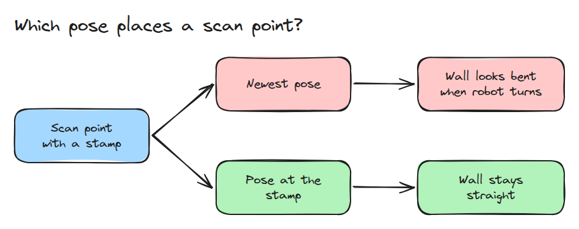
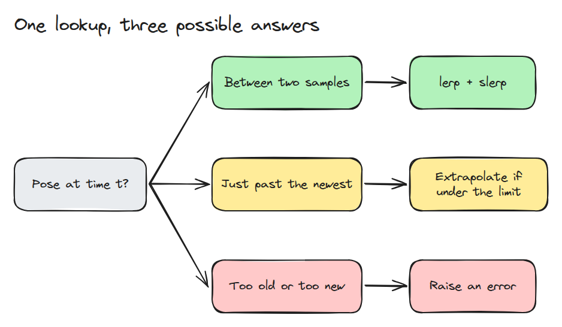
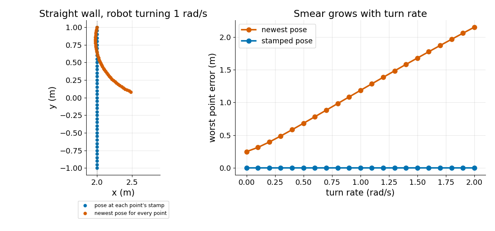

# 시각이 붙은 Transform

> transform 조회는 한 순간에 대한 질문이므로 buffer는 sample 사이를 보간하거나 답을 거부해야 합니다.

**유형:** 만들기   **선수 지식:** 01/04 Frame과 Transform 트리, 05/04 시간 동기화와 Trace   **시간:** 약 15분

## 쉽게 말하면

휴대전화를 돌리며 panorama를 찍으면 화면 조각마다 방을 보는 방향이 달라요. 모든 조각을 마지막 방향에서 찍은 것처럼 놓으면 방의 모습과 맞게 이어지지 않아요.

움직이는 scanner도 점마다 측정 시각의 transform이 필요해요. buffer는 그 시각을 둘러싼 pose 사이를 보간해요. 모든 점에 최신 pose만 쓰면 복원한 scan에서 곧은 벽이
휘어 보일 수 있어요.

## 문제

레이저 스캔 한 번이 0.5초 걸리는 동안 로봇이 돕니다. 가장 쉬운 조회라서 모든 점을 최신 pose로 놓습니다. 곧은 벽이 휘어 보이고 로봇이 빨리 돌수록 더 심해집니다. 스캔 점에는 측정된 시각이 붙어 있었는데 조회가 그것을 무시한 것입니다.

## 개념



*점마다 자기 stamp의 pose로 놓아야 합니다. 최신 pose가 맞는 점은 마지막 점 하나뿐입니다.*

transform 트리(01/04)는 "A frame에서 B frame이 어디 있나"에 답합니다. 시간을 더하면 질문이 "시각 t에 A에서 B가 어디 있었나"가 됩니다. pose는 띄엄띄엄한 시각에 도착하므로 buffer가 맞닥뜨리는 경우는 세 가지입니다.



*두 sample 사이면 보간합니다. 최신 sample을 조금 넘으면 정해 둔 한도 안에서 외삽할 수 있습니다. 그 밖은 오류를 냅니다.*

위치는 단순한 lerp입니다. 자세는 01/03의 slerp를 쓰고 부호가 뒤집힌 quaternion도 바로잡습니다. 거부는 기능입니다. 최신 sample 너머의 추측은 데이터처럼 보여서 늦게 오는 메시지를 가립니다.



*왼쪽은 1 rad/s로 도는 0.5초 동안 스캔한 곧은 벽입니다. 오른쪽은 최신 pose의 오차가 회전 속도에 따라 커지고 주행만으로도 0.25 m에서 시작하는 모습이며 stamp를 쓴 오차는 0으로 유지됩니다.*

## 만들기

```python
i = min(bisect.bisect_right(self.t, t) - 1, len(self.t) - 2)
a = (t - self.t[i]) / (self.t[i + 1] - self.t[i])
return (1 - a) * self.p[i] + a * self.p[i + 1], slerp(self.q[i], self.q[i + 1], a).copy()
```

`lookup()`은 가장 오래된 sample보다 이르거나 최신 sample에 `max_extrapolation`을 더한 것보다 늦은 시각에 `LookupError`를 냅니다. `add()`는 늦게 온 sample을 순서와 상관없이 받고 `window`를 넘은 기록을 버립니다. `to_world()`는 스캔 점을 stamp의 pose 또는 최신 pose로 놓습니다.

```bash
cd robotics-engineering-from-scratch
python3 -m pytest phases/05-robot-software/06-transforms-at-a-time -q
python3 phases/05-robot-software/06-transforms-at-a-time/code/main.py
```

## 실제 도구로 보기

ROS 2의 tf2 buffer도 같은 질문에 답하고 같은 이유로 extrapolation 예외를 냅니다. tf2 "Using time" 튜토리얼을 읽고 buffer에 미래 시각의 pose를 물어서 어떻게 되는지 보세요.

## 결과물

`outputs/skill-timed-transform-check.md`는 센서 데이터가 자기 stamp의 pose로 놓이는지 점검합니다.

## 연습 문제

1. `max_extrapolation = 0.1`로 두고 추측 오차가 1 cm 아래로 유지되는 가장 큰 회전 속도를 찾으세요.
2. sample을 10 Hz와 100 Hz로 넣고 가속하는 로봇의 중간 시각 오차를 비교하세요.
3. 다른 frame의 buffer를 하나 더 만들고 한 stamp에서 두 조회를 합성하세요.
