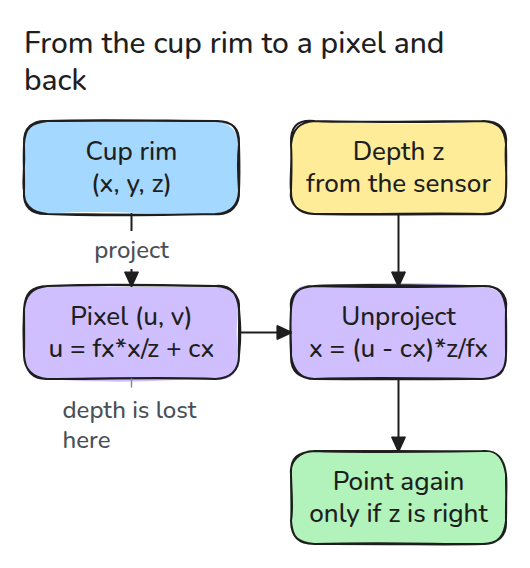
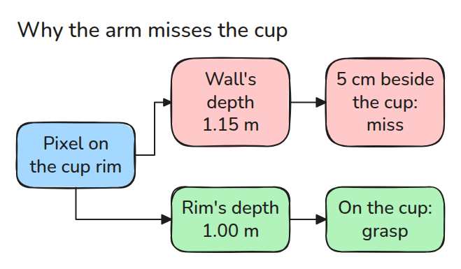
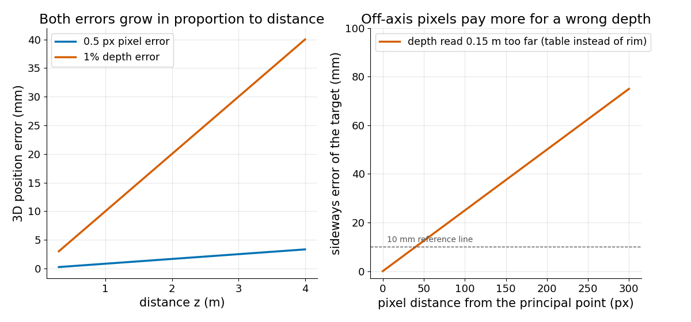

# Pinhole Camera

> A pixel is a ray. Depth picks the point on it, so a depth error moves the point along the ray and the cost grows with distance.

**Type:** Build   **Prerequisites:** 01/01 Rotations and SE(3)   **Time:** ~15 minutes

## In Plain Words

A camera on a stand sees a cup in front of a wall. The cup's rim and a spot on the wall lie on one line of sight, so they land on the same pixel. A pixel gives a direction, not a distance.

The robot also needs the distance, called depth. If it uses the wall's depth for the rim's pixel, the point slides back along that line. The cup is off the camera's centre line, so farther along is also farther sideways, and the arm misses the cup.

## The Problem

A vision system reports a cup at pixel (520, 240) and the planner reaches there. The gripper closes a few centimetres to the side. The pixel was on the cup rim, but the depth value came from the wall behind it, so the 3D point slid along its line of sight.

## The Concept



*Projection (left) divides by `z` and throws depth away. Going back (right) needs a depth.*

The camera frame has `x` to the right, `y` down and `z` forward, so `z` is the depth. The focal lengths `fx, fy` (in pixels) say how strongly the lens zooms in. The principal point `cx, cy` is the pixel where the camera's centre line lands. So `u = fx*x/z + cx` and `v = fy*y/z + cy`.

A pixel error `du` moves the point sideways by `z*du/fx`, a bigger step the farther away it is. A depth error `dz` moves it along the ray (the line of sight), which is sideways by `dz*(u-cx)/fx`: nothing at the centre pixel, more toward the edge.

Example: pixel `(520, 240)`, `fx = 600`, `cx = 320`. At the rim's depth, 1.00 m, the point is 0.33 m right of the centre line. At the wall's depth, 1.15 m, it is 0.38 m: the arm is 5 cm off to the side. A cup on the centre line is not shifted sideways.


*Same 0.15 m mistake for both cups. The blue ball slides straight back for the centre cup but also 5 cm sideways for the edge cup.*



*The same pixel gives the cup or a spot beside it, depending on where its depth was read.*



*Left: 0.5 px and 1% depth give errors proportional to distance. Right: a depth 0.15 m too far costs more sideways error farther from the centre.*

## Build It

```python
def project(P, fx, fy, cx, cy):
    return np.stack([fx*P[:,0]/P[:,2] + cx, fy*P[:,1]/P[:,2] + cy], axis=1)

def unproject(uv, z, fx, fy, cx, cy):
    return np.stack([(uv[:,0]-cx)*z/fx, (uv[:,1]-cy)*z/fy, z], axis=1)
```

`position_error()` unprojects a pixel twice, with and without `du` and `dz`, and returns the difference. `project()` raises for `z <= 0`.

```bash
cd robotics-engineering-from-scratch
python3 -m pytest phases/06-perception-and-calibration/01-pinhole-camera -q
```

## Use It

Compare `project` with `cv2.projectPoints` on the same points, with zero rotation, zero translation and no distortion. The test skips if OpenCV is missing.

Sources: the [OpenCV calibration tutorial](https://opencv24-python-tutorials.readthedocs.io/en/latest/py_tutorials/py_calib3d/py_calibration/py_calibration.html) (an older version) uses `cv2.projectPoints` for reprojection error.

## Ship It

`outputs/skill-pixel-depth-check.md` checks that a pixel and its depth belong to the same surface.

## Exercises

1. Add a lens distortion term and see how far the unprojected point moves at the image corner.
2. Sample depth at the median of a 5x5 window and find the edge pixel where it still fails.
3. Express the error budget for a target at 2 m with `fx = 600` in millimetres.
