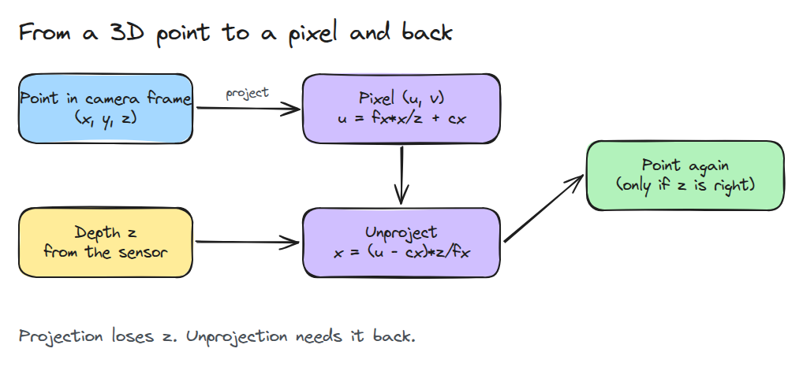
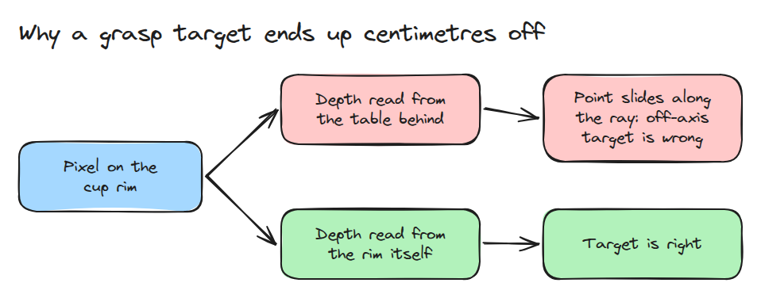
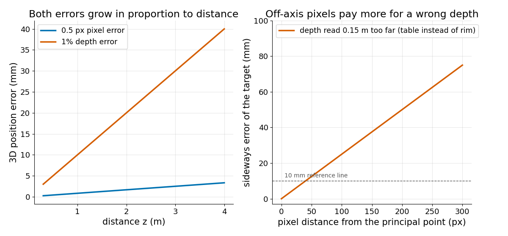

# 핀홀 카메라 (Pinhole Camera)

> 카메라가 컵의 방향은 알려 주지만 거리는 알려 주지 않는 이유와 그 대가를 배웁니다.

**유형:** 만들기   **선수 지식:** 01/01 회전과 SE(3)   **시간:** 약 15분

## 쉽게 말하면

카메라가 벽 앞에 놓인 컵을 봐요. 컵 가장자리와 벽의 한 점은 같은 시선 위에 있어서 같은 pixel에 찍혀요. pixel은 방향만 알려 주고 거리는 알려 주지 않아요.

그래서 벽의 depth를 쓰면 로봇 팔이 컵을 지나쳐 버려요.

## 핵심 용어

- **Pixel**: 카메라 이미지의 점 하나입니다.
- **Depth (`z`)**: 카메라 앞에서 점까지의 거리입니다.
- **Ray**: pixel을 지나는 시선입니다. 그 위의 모든 점이 같은 pixel에 찍힙니다.
- **Focal length (`fx, fy`)**: 렌즈가 얼마나 확대하는지를 pixel 단위로 나타낸 값입니다.
- **Principal point (`cx, cy`)**: 카메라의 중심선이 닿는 pixel입니다.
- **Projection**: 3D 점을 pixel로 바꾸는 일입니다.

## 문제

카메라가 컵을 pixel (520, 240)에서 보는데 gripper는 몇 센티미터 옆에서 닫힙니다. depth 값이 가장자리 뒤의 벽에서 왔기 때문입니다.

## 개념

보이는 것을 집으려면 로봇은 pixel을 3D 점으로 바꿔야 하고 그러려면 거리가 필요합니다.



*projection(왼쪽)은 `z`로 나누고 depth를 잃습니다. 되돌리기(오른쪽)에는 depth가 필요합니다.*

카메라 frame은 `x`가 오른쪽, `y`가 아래, `z`가 앞입니다. 그래서 `u = fx*x/z + cx`이고 `v = fy*y/z + cy`입니다.

pixel 오차 `du`는 점을 옆으로 `z*du/fx`만큼 움직이고 멀수록 더 큽니다. depth 오차 `dz`는 점을 ray를 따라 밀며 옆으로는 `dz*(u-cx)/fx`입니다. 중심 pixel에서는 0이고 가장자리로 갈수록 커집니다.

pixel `(520, 240)`, `fx = 600`, `cx = 320`을 예로 듭니다. 가장자리의 depth 1.00 m에서 점은 중심선 오른쪽 0.33 m에 있습니다. 벽의 depth 1.15 m에서는 0.38 m이므로 5 cm 어긋납니다.


*두 컵에 같은 0.15 m 실수를 줍니다. 가장자리 컵의 공은 옆으로도 5 cm 밀립니다.*



*depth를 어디서 읽느냐가 pixel이 어느 점을 주는지 정합니다.*



*왼쪽은 0.5 px와 1% depth 오차가 거리에 따라 커지는 모습입니다. 오른쪽은 0.15 m depth 오차가 가장자리에서 더 크게 작용하는 모습입니다.*

## 만들기

```python
def project(P, fx, fy, cx, cy):
    return np.stack([fx*P[:,0]/P[:,2] + cx, fy*P[:,1]/P[:,2] + cy], axis=1)

def unproject(uv, z, fx, fy, cx, cy):
    return np.stack([(uv[:,0]-cx)*z/fx, (uv[:,1]-cy)*z/fy, z], axis=1)
```

`position_error()`는 pixel을 `du`, `dz`가 있을 때와 없을 때 unproject해서 차이를 돌려줍니다.

```bash
cd robotics-engineering-from-scratch
python3 -m pytest phases/06-perception-and-calibration/01-pinhole-camera -q
```

## 실제 도구로 보기

같은 점에서 `project`를 `cv2.projectPoints`와 비교해 보세요.

출처: [OpenCV calibration tutorial](https://opencv24-python-tutorials.readthedocs.io/en/latest/py_tutorials/py_calib3d/py_calibration/py_calibration.html)(옛 버전)은 reprojection 오차에 `cv2.projectPoints`를 씁니다.

## 결과물

`outputs/skill-pixel-depth-check.md`는 pixel과 depth가 같은 표면에 속하는지 확인합니다.

## 연습 문제

1. 렌즈 왜곡 항을 더하세요.
2. 5x5 창의 median으로 depth를 뽑고 그래도 실패하는 곳을 찾으세요.
3. `fx = 600`에서 2 m 거리 목표의 오차 예산을 밀리미터로 구하세요.
