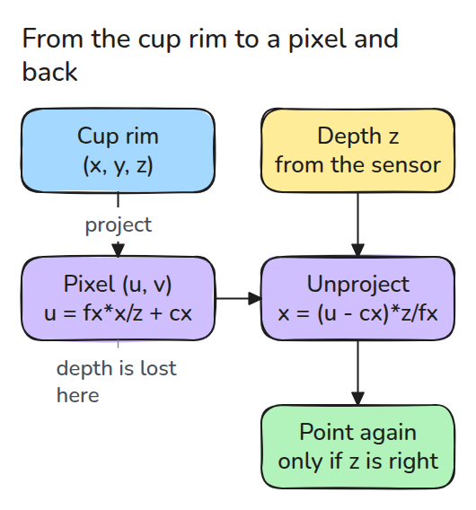
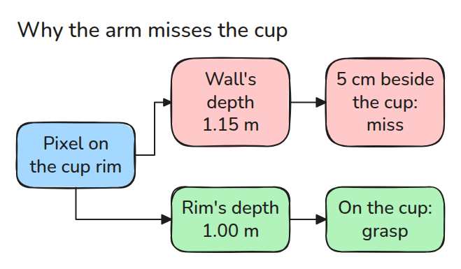
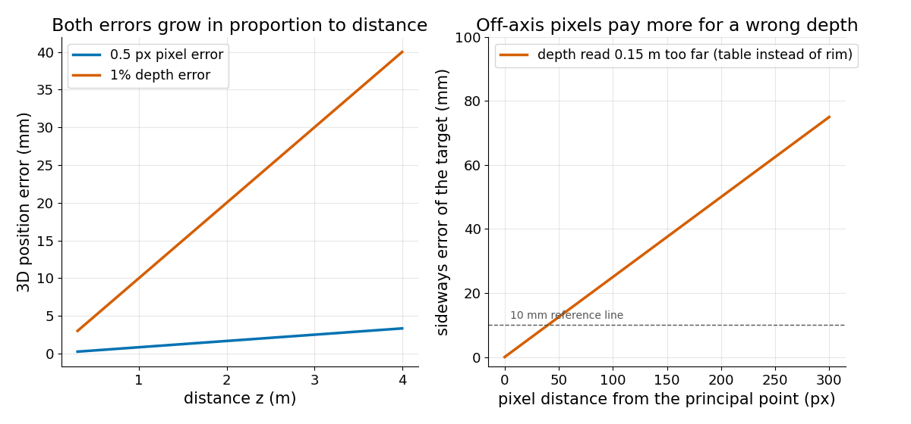

# 핀홀 카메라 (Pinhole Camera)

> pixel 하나는 ray 하나입니다. depth가 그 ray 위의 점을 정하므로 depth가 틀리면 점이 ray를 따라 밀리고 오차는 거리에 비례해 커집니다.

**유형:** 만들기   **선수 지식:** 01/01 회전과 SE(3)   **시간:** 약 15분

## 쉽게 말하면

스탠드 위의 카메라가 벽 앞에 놓인 컵을 봐요. 컵 테두리와 벽의 한 지점은 같은 시선 위에 있어서 같은 pixel에 찍혀요. pixel은 방향만 알려 주고 거리는 알려 주지 않아요.

로봇은 거리도 알아야 하고 그 거리를 depth라고 불러요. 컵 테두리 pixel에 벽의 depth를 쓰면 계산한 점이 그 시선을 따라 뒤로 미끄러져요. 컵은 카메라 중심선에서 옆으로 벗어나 있어서 멀리 갈수록 옆으로도 멀어지고 팔은 컵을 빗나가요.

## 문제

비전 시스템이 컵을 pixel (520, 240)에 있다고 알려 주고 planner가 그곳으로 팔을 뻗습니다. 그런데 gripper는 옆으로 몇 cm 어긋난 곳을 잡습니다.
pixel은 컵 테두리에 있었지만 depth 값은 뒤쪽 벽에서 읽혔기 때문에 3D 점이 시선을 따라 미끄러진 것입니다.

## 개념



*투영(왼쪽)은 `z`로 나누면서 depth를 버립니다. 되돌아가려면(오른쪽) depth가 필요합니다.*

카메라 frame에서 `x`는 오른쪽, `y`는 아래, `z`는 앞쪽이고 `z`가 depth입니다. focal length `fx, fy`는 pixel 단위이며 렌즈가 얼마나 강하게 확대하는지를 나타냅니다. principal point `cx, cy`는 카메라 중심선이 닿는 pixel입니다. 그러면 `u = fx*x/z + cx`이고 `v = fy*y/z + cy`입니다.

pixel 오차 `du`는 점을 옆으로 `z*du/fx`만큼 움직이고 멀수록 1 px가 더 긴 거리가 됩니다. depth 오차 `dz`는 점을 ray(시선)를 따라 움직이고 옆으로는 `dz*(u-cx)/fx`만큼 벗어납니다. 중심 pixel에서는 0이고 영상 가장자리로 갈수록 커집니다.

예를 들어 pixel `(520, 240)`, `fx = 600`, `cx = 320`인 경우를 계산해 봅니다. 컵 테두리의 depth 1.00 m에서 점은 중심선의 오른쪽 0.33 m에 있습니다. 벽의 depth 1.15 m에서는 0.38 m이므로 팔은 옆으로 5 cm 벗어납니다. 중심선 위의 컵은 옆으로 전혀 벗어나지 않습니다.


*두 컵에 같은 0.15 m 실수를 했습니다. 파란 공은 중심 컵에서는 곧장 뒤로 밀리고 영상 가장자리 쪽 컵에서는 옆으로도 5 cm 밀립니다.*



*같은 pixel도 depth를 어디서 읽었는지에 따라 컵이 되기도 하고 컵 옆의 빈 곳이 되기도 합니다.*



*왼쪽은 0.5 px 오차와 1% depth 오차가 거리에 비례하는 모습입니다. 오른쪽은 0.15 m 멀리 읽은 depth가 중심에서 멀수록 옆 오차를 더 크게 만드는 모습입니다.*

## 만들기

```python
def project(P, fx, fy, cx, cy):
    return np.stack([fx*P[:,0]/P[:,2] + cx, fy*P[:,1]/P[:,2] + cy], axis=1)

def unproject(uv, z, fx, fy, cx, cy):
    return np.stack([(uv[:,0]-cx)*z/fx, (uv[:,1]-cy)*z/fy, z], axis=1)
```

`position_error()`는 `du`와 `dz`를 넣은 경우와 뺀 경우로 pixel을 두 번 역투영해서 그 차이를 돌려줍니다. `project()`는 `z <= 0`이면 예외를 냅니다.

```bash
cd robotics-engineering-from-scratch
python3 -m pytest phases/06-perception-and-calibration/01-pinhole-camera -q
```

## 실제 도구로 보기

같은 점에 대해 회전 0, 이동 0, 왜곡 없음으로 `project`와 `cv2.projectPoints`를 비교합니다. OpenCV가 없으면 이 테스트는 건너뜁니다.

출처는 [OpenCV 캘리브레이션 튜토리얼](https://opencv24-python-tutorials.readthedocs.io/en/latest/py_tutorials/py_calib3d/py_calibration/py_calibration.html)(구버전)입니다.
이 문서는 `cv2.projectPoints`로 reprojection error를 계산합니다.

## 결과물

`outputs/skill-pixel-depth-check.md`는 pixel과 depth가 같은 표면에서 나왔는지 확인합니다.

## 연습 문제

1. 렌즈 왜곡 항을 추가하고 영상 모서리에서 역투영한 점이 얼마나 움직이는지 보세요.
2. depth를 5x5 창의 median에서 읽고 그래도 실패하는 가장자리 pixel을 찾으세요.
3. `fx = 600`이고 거리 2 m인 목표의 오차 예산을 mm로 계산하세요.
