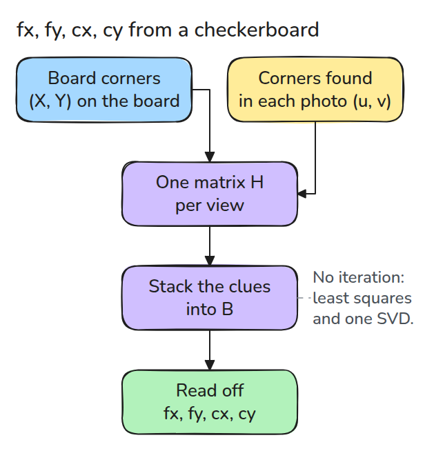
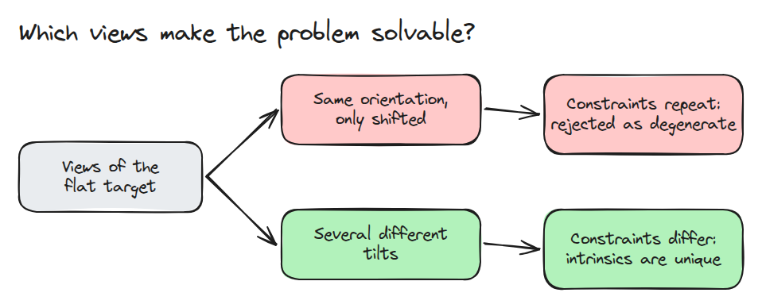
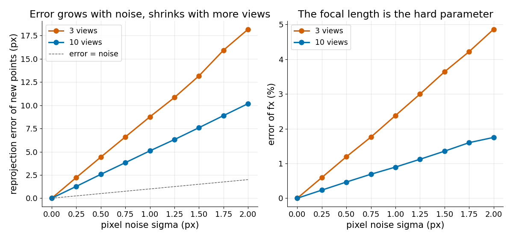

# Camera Calibration

> Learn how to measure a camera's own zoom and centre from a checkerboard and a few tilted photos.

**Type:** Build   **Prerequisites:** 06/01 Pinhole Camera   **Time:** ~15 minutes

## In Plain Words

A camera looks at a checkerboard. Every square has the same size and square corners, so squashed squares in the photo come from the board's tilt and the lens. Each new tilt is a fresh clue. Sliding the board adds no clue.

## Key Terms

- **Calibration**: measuring a camera's own numbers, such as zoom and centre, from a target you know.
- **Intrinsics (`K`)**: the matrix (a grid of numbers) holding `fx, fy, cx, cy`.
- **Homography (`H`)**: a 3x3 matrix that maps points on the flat board to pixels.
- **Degenerate views**: views that repeat the same clue, so they cannot be solved.
- **SVD**: a matrix tool. Its smallest singular vector solves "make this product as close to zero as possible".
- **Reprojection error**: how far corners projected with your numbers land from the corners seen.

## The Problem

A robot reaches for what its camera sees and misses by a few centimetres near the image edge. The datasheet's focal length is not your camera's, so measure `fx` and `cx` from a known target.

## The Concept

Every camera differs a little, and a robot that trusts the datasheet misjudges where things are.



*Each view gives `H`, the `H`s give `B`, and `B` gives `fx, fy, cx, cy`.*

Board corners are `(X, Y)` with `Z = 0`. Each view gives a 3x3 `H = K [r1 r2 t]` mapping `(X, Y, 1)` to pixels (`r1, r2` are the board's edge directions, `t` its position), so `h1 = K r1` and `h2 = K r2`.

The edges are perpendicular and equally long, so `h1' B h2 = 0` and `h1' B h1 = h2' B h2` (`'` is transpose), with `B = K^-T K^-1` holding the unknowns: two equations per view. `B` is symmetric (six numbers), zero skew (the pixel grid's slant) removes one, and scale is unknown, so four equations suffice: two tilted views.

With `fx = 620`, `fy = 580`, `cx = 330`, `cy = 235`, `make_views(K, 4, 0.0, 3)` makes 4 views (no noise, seed 3). Tilted 28 to 42 degrees, they return exactly that `K`. Only slid, they add the same clue and `calibrate()` raises `degenerate views`.


*Blue only slides: red cross (rejected). Green tilts each time: green ball (solved).*



*Sliding repeats a clue; tilting adds new ones.*



*Median of 100 runs: 3 views give several times the pixel noise, more views halve it.*

## Build It

```python
A = np.array([r for H in Hs for r in (_v(H, 0, 1), _v(H, 0, 0) - _v(H, 1, 1))])
b = np.linalg.svd(A)[2][-1]          # smallest singular vector = [B11, B22, B13, B23, B33]
cx, cy = -B13 / B11, -B23 / B22
fx, fy = np.sqrt(lam / B11), np.sqrt(lam / B22)   # lam = B33 - B13^2/B11 - B23^2/B22
```

`homography_dlt()` normalises the points and takes the smallest singular vector. `calibrate()` raises for degenerate or unphysical results.

```bash
cd robotics-engineering-from-scratch
python3 -m pytest phases/06-perception-and-calibration/02-camera-calibration -q
```

## Use It

Compare with `cv2.calibrateCamera` on the same views.

Sources: the [OpenCV calibration tutorial](https://opencv24-python-tutorials.readthedocs.io/en/latest/py_tutorials/py_calib3d/py_calibration/py_calibration.html) (an older version) describes `cv2.calibrateCamera` and reprojection error.

## Ship It

`outputs/skill-intrinsics-calibration-check.md` reviews view diversity, error size and plausibility.

## Exercises

1. Drop the zero-skew assumption by adding `B12`.
2. Find the fewest views that survive 1 px noise.
3. Add a refinement with `scipy.optimize.least_squares`.
