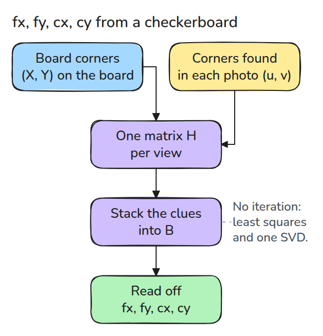
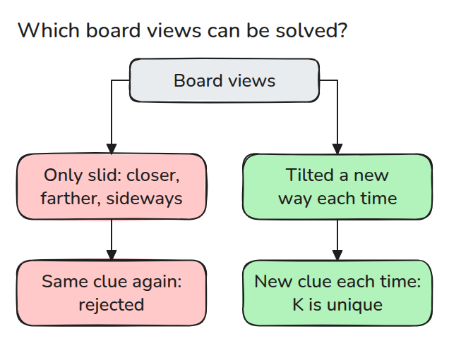
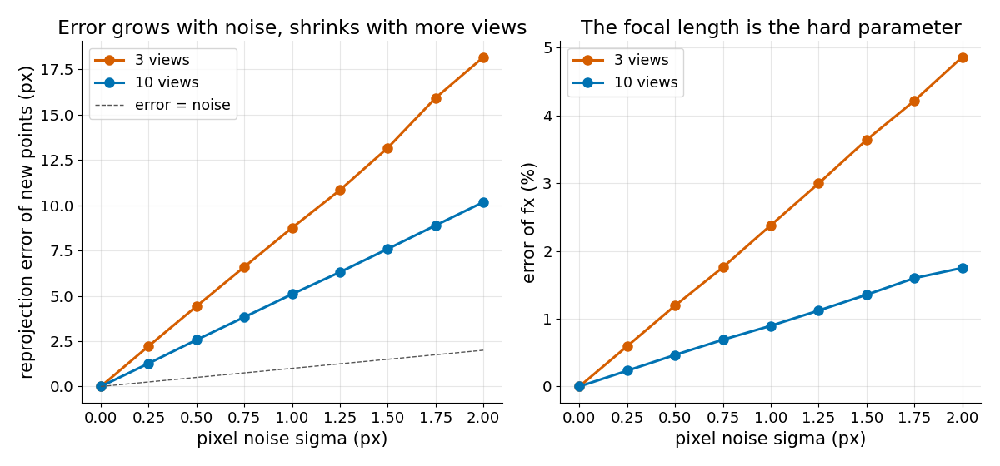

# Camera Calibration

> A flat grid seen from a few tilted views is enough to solve for `fx, fy, cx, cy` with linear algebra alone, but the answer is only as good as the views.

**Type:** Build   **Prerequisites:** 06/01 Pinhole Camera   **Time:** ~15 minutes

## In Plain Words

A camera on a stand looks at a checkerboard on a paddle. Every square is the same size with square corners, so squashed squares in the photo come from the board's tilt and the camera's lens. A new tilt squashes them in a new pattern, a fresh clue.

Sliding the board without tilting keeps the pattern, so it adds no clue. Several tilts let you solve for the focal length, how strongly the lens zooms, and the principal point, the pixel where the camera's centre line lands.

## The Problem

You trust the datasheet's focal length, unproject an edge pixel, and the point is a few centimetres off. The real `fx` and `cx` differ and nothing in the image says so. Measure them from a target you know.

## The Concept



*Left to right: each view gives a matrix `H`, the `H`s give a matrix `B`, and `B` gives `fx, fy, cx, cy`.*

The board is flat, so each corner has board coordinates `(X, Y)` with `Z = 0`. The matrix `K` holds `fx, fy, cx, cy`. Each view gives a 3x3 matrix `H = K [r1 r2 t]` (a homography) that maps `(X, Y, 1)` to pixels. `r1, r2` are the board's edge directions and `t` is where it sits, so the first columns of `H` are `h1 = K r1` and `h2 = K r2`.

The edges are perpendicular and equally long. Writing `r = K^-1 h` (`'` and `T` mean transpose) turns that into `h1' B h2 = 0` and `h1' B h1 = h2' B h2`, where `B = K^-T K^-1` collects the unknowns: two linear equations per view. `B` is symmetric (six numbers), zero skew (the slant of the pixel grid) removes one, and it is known only up to scale, so four equations suffice: two tilted views.

Example: for the `K` with `fx = 620`, `fy = 580`, `cx = 330`, `cy = 235`, `make_views(K, 4, 0.0, 3)` makes 4 views, no pixel noise, seed 3. Tilted 28 to 42 degrees, they return exactly that `K`. Slid the same way but never tilted, every view adds the same clue, so `calibrate()` raises `degenerate views`.


*Blue board only slides: red cross (rejected). Green board tilts a new way each time: green ball (solved).*



*Sliding repeats the same clue and is rejected; different tilts add new ones.*



*Median of 100 runs: 3 views give several times the pixel noise, and more views halve it.*

## Build It

```python
A = np.array([r for H in Hs for r in (_v(H, 0, 1), _v(H, 0, 0) - _v(H, 1, 1))])
b = np.linalg.svd(A)[2][-1]          # smallest singular vector = [B11, B22, B13, B23, B33]
cx, cy = -B13 / B11, -B23 / B22
fx, fy = np.sqrt(lam / B11), np.sqrt(lam / B22)   # lam = B33 - B13^2/B11 - B23^2/B22
```

`homography_dlt()` normalises the points, stacks two rows per point and takes the smallest singular vector. `calibrate()` raises for degenerate or unphysical results.

```bash
cd robotics-engineering-from-scratch
python3 -m pytest phases/06-perception-and-calibration/02-camera-calibration -q
```

## Use It

Run `cv2.calibrateCamera` on the same views with distortion terms fixed and compare `fx` and `cy`. Production tools refine it by minimising reprojection error.

Sources: the [OpenCV calibration tutorial](https://opencv24-python-tutorials.readthedocs.io/en/latest/py_tutorials/py_calib3d/py_calibration/py_calibration.html) (an older version) describes `cv2.calibrateCamera` and uses reprojection error to check it.

## Ship It

`outputs/skill-intrinsics-calibration-check.md` reviews a calibration run: view diversity, error size and plausibility.

## Exercises

1. Drop the zero-skew assumption by adding `B12` and compare the error.
2. Find the smallest number of views that never fails at 1 px noise.
3. Add a refinement step with `scipy.optimize.least_squares` and compare the error.
