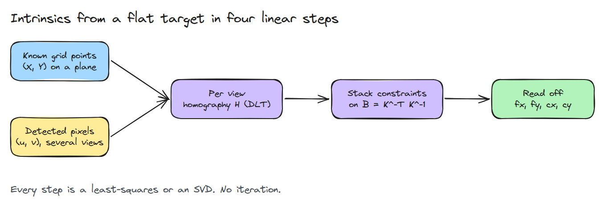
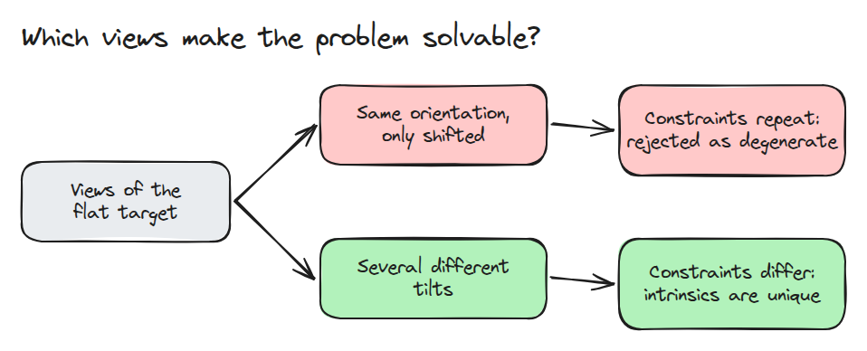
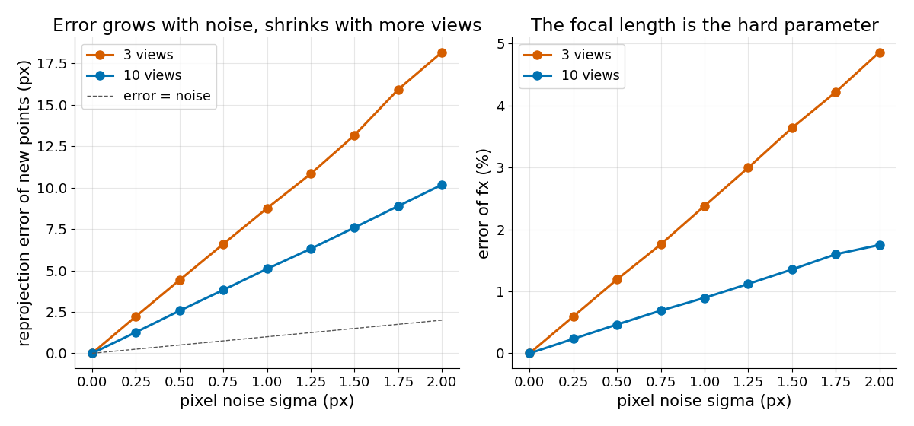

# 카메라 캘리브레이션 (Camera Calibration)

> 기울인 평면 격자를 몇 장 찍으면 선형 대수만으로 `fx, fy, cx, cy`를 풀 수 있지만 답의 품질은 시점이 얼마나 다양한지에 달려 있습니다.

**유형:** 만들기   **선수 지식:** 06/01 핀홀 카메라   **시간:** 약 15분

## 문제

datasheet에 적힌 focal length를 믿고 영상 가장자리 픽셀을 역투영했더니 점이 몇 cm 어긋납니다. 실제 `fx`와 `cx`는 공칭값과 다른데 영상만 봐서는 알 수 없습니다.
그래서 기하를 아는 타깃으로 직접 재야 합니다.

## 개념



*평면 격자를 한 장 찍을 때마다 homography가 하나 나옵니다. 그 열들이 `B = K^-T K^-1`을 제약하고 `B`에서 `K`가 나옵니다.*

`Z = 0` 평면에서 픽셀은 `(X, Y, 1)`에 `K [r1 r2 t]`를 곱한 값이므로 시점마다 3x3 homography `H = K [r1 r2 t]`가 생깁니다.

`r1`과 `r2`가 정규직교이므로 `h1' B h2 = 0`과 `h1' B h1 = h2' B h2`가 성립합니다.
시점 하나가 선형 식 두 개를 주고 skew가 0이면 `B`의 미지수는 다섯 개입니다.



*타깃을 옆으로 밀기만 한 시점들은 같은 제약을 반복하므로 solver가 거부합니다.*



*seed를 고정한 100회 실행의 median입니다. 시점이 3장이면 선형 해의 오차가 픽셀 잡음의 몇 배가 되고 시점을 늘리면 대략 절반으로 줄어듭니다.*

## 만들기

```python
A = np.array([r for H in Hs for r in (_v(H, 0, 1), _v(H, 0, 0) - _v(H, 1, 1))])
b = np.linalg.svd(A)[2][-1]          # smallest singular vector = [B11, B22, B13, B23, B33]
cx, cy = -B13 / B11, -B23 / B22
fx, fy = np.sqrt(lam / B11), np.sqrt(lam / B22)   # lam = B33 - B13^2/B11 - B23^2/B22
```

`homography_dlt()`는 두 점 집합을 정규화하고 점마다 행을 두 개씩 쌓아 가장 작은 singular vector를 취합니다. `calibrate()`는 퇴화했거나 물리적으로 말이 안 되는 결과에서 예외를 냅니다.

```bash
cd robotics-engineering-from-scratch
python3 -m pytest phases/06-perception-and-calibration/02-camera-calibration -q
```

## 실제 도구로 보기

같은 합성 시점에 distortion 항을 고정하고 `cv2.calibrateCamera`를 돌려서 `fx`와 `cy`를 비교합니다. 실제 도구는 이 선형 해를 시작점으로 삼아 reprojection error를 줄이는 비선형 최소제곱으로 다듬습니다.

출처는 [OpenCV 캘리브레이션 튜토리얼](https://opencv24-python-tutorials.readthedocs.io/en/latest/py_tutorials/py_calib3d/py_calibration/py_calibration.html)(구버전)입니다.

이 문서는 `cv2.calibrateCamera`가 camera matrix, distortion 계수, pose를 돌려준다고 설명하고 reprojection error로 그 결과를 확인합니다.

## 결과물

`outputs/skill-intrinsics-calibration-check.md`는 캘리브레이션 결과를 시점 다양성, 오차 크기, 그럴듯함의 세 가지로 검토합니다.

## 연습 문제

1. zero-skew 가정을 빼고 `B12`를 추가해서 오차가 어떻게 달라지는지 보세요.
2. 잡음 1 px에서 한 번도 실패하지 않는 최소 시점 수를 찾으세요.
3. `scipy.optimize.least_squares`로 비선형 보정 단계를 넣고 오차를 비교하세요.
