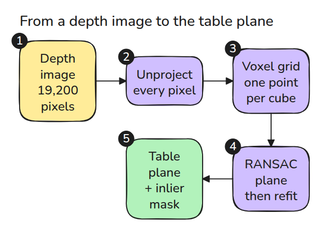
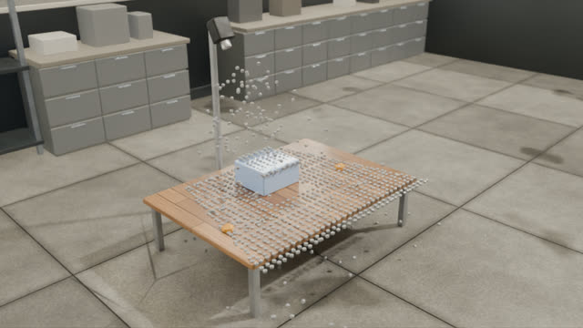
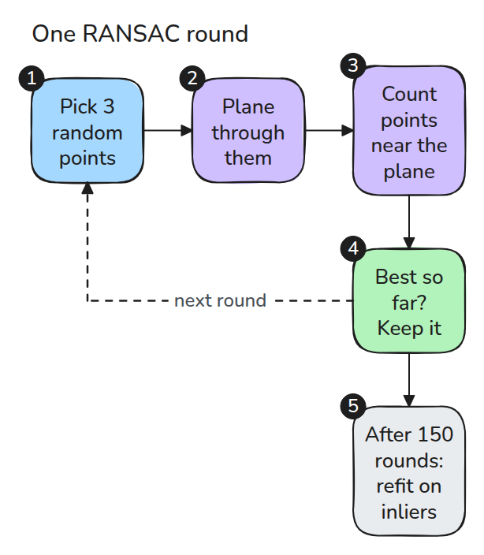
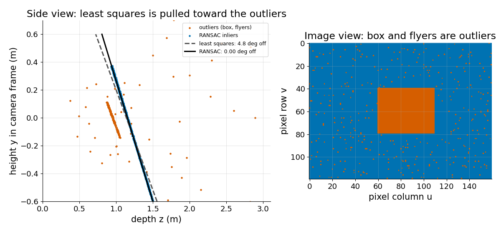

# Depth and Point Clouds

> Learn how a robot finds a flat table in a messy 3D scan, even with a box and stray dots.

**Type:** Build   **Prerequisites:** 06/01 Pinhole Camera   **Time:** ~15 minutes

## In Plain Words

A depth camera looks down at a table with a box on it. The arm needs the table's plane to set a block down level. A best-fit rule that counts every point gets pulled toward the box and tilts. RANSAC tries planes through three random points and keeps the one most points agree with: the table.

## Key Terms

- **Depth image**: a photo whose pixels store a distance instead of a colour.
- **Point cloud**: a set of 3D points, here made by turning every depth pixel back into a 3D point.
- **Voxel grid**: small cubes cutting up space. Keeping one averaged point per cube thins the cloud.
- **Least squares**: a best-fit rule where every point pulls on the plane, and far points pull hardest.
- **RANSAC**: try planes from random points and keep the one with the most points near it.
- **Inlier**: a point close enough to a plane to count as lying on it.

## The Problem

A robot sets a block on a table seen by a depth camera, and the block leans. A box and stray pixels pulled the fitted table plane a few degrees off.

## The Concept

A robot needs the table's exact tilt to place things level, and a few bad points spoil it.



*Pixels become points, voxels thin them, RANSAC returns the plane.*

A depth image becomes a cloud of 3D points. A voxel grid keeps one averaged point per small cube, so the table stays and the cloud shrinks. A plain best-fit plane gets pulled hard by points that are off the plane, such as the box. RANSAC instead tries planes through three random points, counts the points near each, and keeps the best.

[](../assets/clip-example.mp4)

*Amber balls are the picks, green points are near the plane. Only the last round finds the table.*



*Each round: pick, plane, count.*



*Left: the best-fit plane tilts toward the box, RANSAC follows the table. Right: the box and stray pixels sit off the plane.*

<details><summary>The math (optional)</summary>

Least squares squares each distance, so a box 0.2 m closer than the table pulls the plane hard. A round helps only if all three picks lie on the table: chance `w^3` for a table share `w`. Success chance `p` takes `N = log(1 - p) / log(1 - w^3)` rounds: `w = 0.88`, `p = 0.99` give 5, so 150 is a cheap margin, and half the points as inliers (`w = 0.5`) needs 35. With a 1.2 cm threshold, two box points and one table point catch only 1,142 of 19,200 points and tilt the plane 30 degrees. Three table points catch 16,836 (0.3 degrees off). A 0.05 m voxel keeps under a fifth of the points.

</details>

## Build It

```python
key = np.floor(P / size).astype(np.int64)
_, inv, cnt = np.unique(key, axis=0, return_inverse=True, return_counts=True)
n = np.cross(b - a, c - a); n /= np.linalg.norm(n)
inl = np.abs((P - a) @ n) < thr
```

`voxel_downsample()` averages the points in each cell. `ransac_plane()` skips picks that lie on a single line, and refits using the points near the plane.

```bash
cd robotics-engineering-from-scratch
python3 -m pytest phases/06-perception-and-calibration/03-depth-and-point-clouds -q
```

## Use It

Open3D, a 3D-data library, has `voxel_down_sample` and `segment_plane`.

Sources: [Open3D point cloud tutorial](https://www.open3d.org/docs/release/tutorial/geometry/pointcloud.html), checked for both functions.

## Ship It

`outputs/skill-plane-fit-check.md` checks how far stray points move a plane.

## Exercises

1. Add stray pixels until RANSAC fails.
2. Use the helper `ransac_iters` in the code to choose the number of rounds for 60% inliers.
3. Fit the box top as a second plane.
