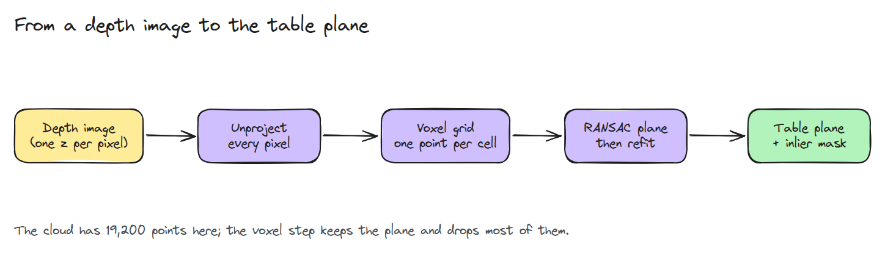
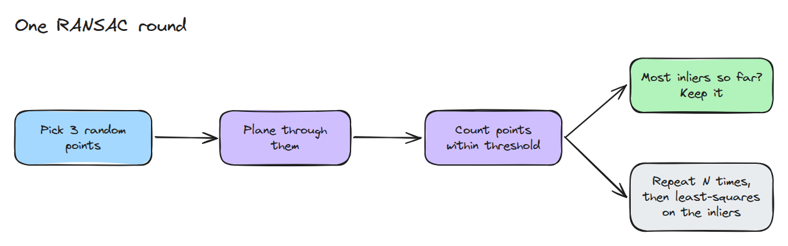
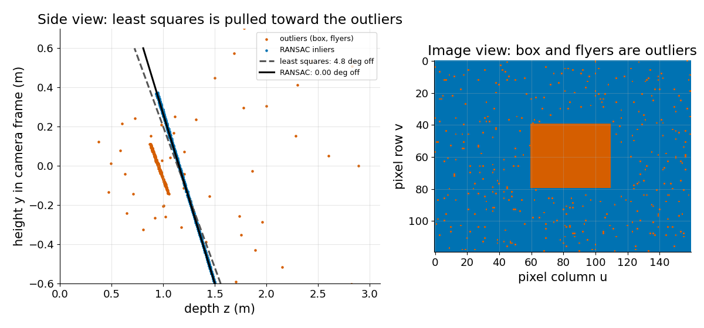

# Depth and Point Clouds

> A depth image is a cloud waiting to be unprojected. Thin it with a voxel grid, then find the table with RANSAC because a plain least-squares plane believes every outlier.

**Type:** Build   **Prerequisites:** 06/01 Pinhole Camera   **Time:** ~15 minutes

## The Problem

You fit a plane to the table in a depth image so the arm can place objects on it. A box sits on the table and a few pixels return garbage depth. The fitted plane tilts by a few degrees, and a "flat" place pose now leans.

## The Concept



*Every valid pixel becomes a point, the voxel step thins the cloud, and RANSAC returns the plane and a mask.*

Unproject each pixel with its depth as in lesson 01. A least-squares plane minimises squared distances, so a box 0.2 m closer than the table pulls it hard. RANSAC picks three random points, builds a plane, counts the points within a threshold and keeps the best plane. The number of samples it needs is `N = log(1 - p) / log(1 - w^3)`, where `w` is the inlier fraction and `p` is the success probability.



*The winning plane is refit by least squares on its own inliers.*



*Left: the least-squares plane tilts toward the box and flyers; the RANSAC plane follows the table. Right: the outliers are exactly the box and the garbage pixels.*

## Build It

```python
key = np.floor(P / size).astype(np.int64)
_, inv, cnt = np.unique(key, axis=0, return_inverse=True, return_counts=True)
n = np.cross(b - a, c - a); n /= np.linalg.norm(n)
inl = np.abs((P - a) @ n) < thr
```

`voxel_downsample()` averages the points in each occupied cell. `ransac_plane()` skips collinear samples, then refits on the inliers. The tests show a voxel size of 0.05 m keeps fewer than a fifth of the points and the same plane.

```bash
cd robotics-engineering-from-scratch
python3 -m pytest phases/06-perception-and-calibration/03-depth-and-point-clouds -q
```

## Use It

Open3D has `PointCloud.voxel_down_sample(voxel_size)` and `PointCloud.segment_plane(distance_threshold, ransac_n, num_iterations)`, which returns the plane coefficients and the inlier indices. The test compares normals when Open3D is installed.

Sources: [Open3D point cloud tutorial](https://www.open3d.org/docs/release/tutorial/geometry/pointcloud.html), checked for both function names and their parameters.

## Ship It

`outputs/skill-plane-fit-check.md` checks a plane fit for outlier sensitivity before the plane is used for placing.

## Exercises

1. Raise the flyer rate and find where the RANSAC plane at 150 iterations starts to fail.
2. Use `ransac_iters` to choose the iteration count for 60% inliers.
3. Fit the box top as a second plane after removing the table inliers.
