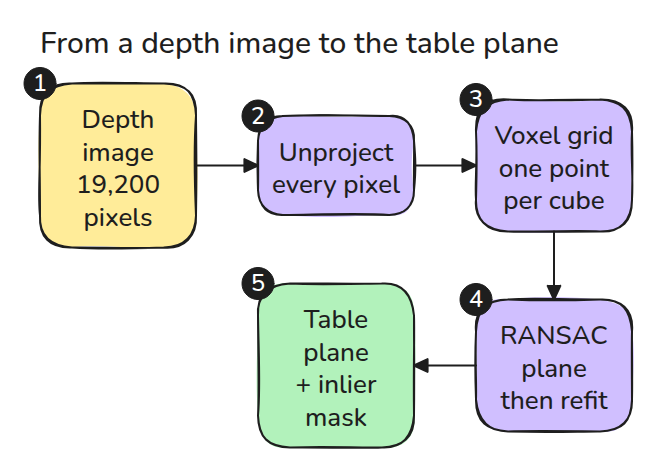
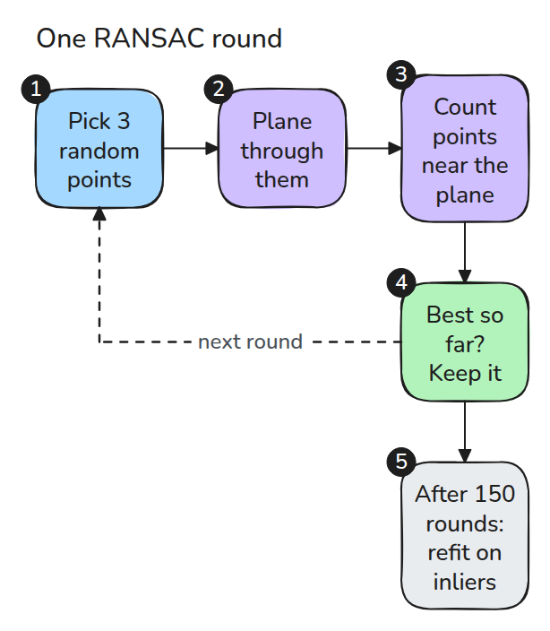
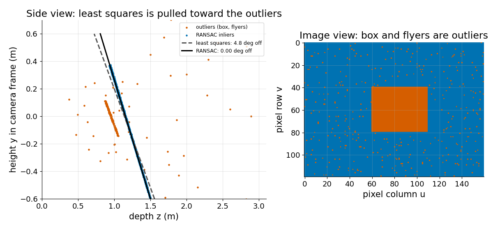

# depth와 점군 (Depth and Point Clouds)

> 상자와 엉뚱한 점이 섞인 지저분한 3D 스캔에서도 로봇이 평평한 테이블을 찾는 법을 배웁니다.

**유형:** 만들기   **선수 지식:** 06/01 핀홀 카메라   **시간:** 약 15분

## 쉽게 말하면

depth 카메라가 상자가 놓인 테이블을 내려다봐요. 팔은 블록을 수평으로 내려놓으려고 테이블의 평면이 필요해요.

모든 점을 똑같이 세는 best-fit 규칙은 상자 쪽으로 끌려가서 기울어요. RANSAC은 무작위 세 점으로 평면을 여러 번 만들어 보고 가장 많은 점이 동의하는 평면을 골라요. 그 평면이 테이블이에요.

## 핵심 용어

- **Depth image**: 픽셀마다 색 대신 거리를 담은 사진입니다.
- **Point cloud**: 3D 점의 모음입니다. 여기서는 depth 픽셀마다 3D 점으로 되돌려서 만듭니다.
- **Voxel grid**: 공간을 작은 정육면체로 나눈 것입니다. 정육면체마다 평균 점 하나만 남기면 점이 줄어듭니다.
- **Least squares**: 모든 점이 평면을 당기는 best-fit 규칙입니다. 멀리 있는 점이 가장 세게 당깁니다.
- **RANSAC**: 무작위 점으로 평면을 여러 번 만들어 보고 가까운 점이 가장 많은 평면을 고르는 방법입니다.
- **Inlier**: 평면 위에 있다고 볼 만큼 평면에 가까운 점입니다.

## 문제

로봇이 depth 카메라로 본 테이블에 블록을 놓는데 블록이 기웁니다. 상자와 엉뚱한 픽셀이 fit한 테이블 평면을 몇 도 틀어 놓았기 때문입니다.

## 개념

로봇은 물건을 수평으로 놓으려면 테이블의 정확한 기울기가 필요하고 나쁜 점 몇 개가 그것을 망칩니다.



*픽셀이 점이 되고 voxel이 점을 줄이고 RANSAC이 평면을 돌려줍니다.*

depth 이미지는 3D 점의 구름이 됩니다. voxel grid는 작은 정육면체마다 평균 점 하나만 남기므로 테이블은 남고 점군은 줄어듭니다. 단순한 best-fit 평면은 상자처럼 평면에서 벗어난 점에 세게 끌려갑니다.
RANSAC은 대신 무작위 세 점으로 평면을 만들고 가까운 점을 세어 가장 좋은 것을 남깁니다.


*주황 공이 뽑힌 점이고 초록 점은 평면 가까이에 있는 점입니다. 마지막 회차만 테이블을 찾습니다.*



*회차마다 뽑고 평면을 만들고 셉니다.*



*왼쪽은 best-fit 평면이 상자 쪽으로 기울고 RANSAC이 테이블을 따르는 모습입니다. 오른쪽은 상자와 엉뚱한 픽셀이 평면에서 벗어나 있음을 보여 줍니다.*

<details><summary>The math (optional)</summary>

최소제곱은 거리를 제곱하므로 테이블보다 0.2 m 가까운 상자가 평면을 세게 끌어당깁니다. 회차가 도움이 되려면 세 점이 모두 테이블 위에 있어야 하고 그 확률은 테이블 비율 `w`일 때 `w^3`입니다.
성공 확률 `p`에는 `N = log(1 - p) / log(1 - w^3)`회가 필요합니다. `w = 0.88`, `p = 0.99`이면 5회이므로 150회는 값싼 여유이고 inlier가 절반(`w = 0.5`)이면 35회가 필요합니다.
임계값 1.2 cm에서 상자 점 둘과 테이블 점 하나는 19,200개 중 1,142개만 잡고 평면을 30도 기울입니다. 테이블 점 셋은 16,836개를 잡습니다(0.3도 어긋남). 0.05 m voxel은 점을 5분의 1보다 적게 남깁니다.

</details>

## 만들기

```python
key = np.floor(P / size).astype(np.int64)
_, inv, cnt = np.unique(key, axis=0, return_inverse=True, return_counts=True)
n = np.cross(b - a, c - a); n /= np.linalg.norm(n)
inl = np.abs((P - a) @ n) < thr
```

`voxel_downsample()`은 칸마다 점을 평균합니다. `ransac_plane()`은 한 직선 위에 놓인 점 뽑기를 건너뛰고 평면 가까이의 점으로 다시 맞춥니다.

```bash
cd robotics-engineering-from-scratch
python3 -m pytest phases/06-perception-and-calibration/03-depth-and-point-clouds -q
```

## 실제 도구로 보기

3D 데이터 라이브러리 Open3D에는 `voxel_down_sample`과 `segment_plane`이 있습니다.

출처: [Open3D point cloud tutorial](https://www.open3d.org/docs/release/tutorial/geometry/pointcloud.html), 두 함수를 확인했습니다.

## 결과물

`outputs/skill-plane-fit-check.md`는 엉뚱한 점이 평면을 얼마나 움직이는지 점검합니다.

## 연습 문제

1. RANSAC이 실패할 때까지 엉뚱한 픽셀을 늘려 보세요.
2. 코드의 도우미 함수 `ransac_iters`로 inlier가 60%일 때의 회차 수를 고르세요.
3. 상자 윗면을 두 번째 평면으로 fit하세요.
