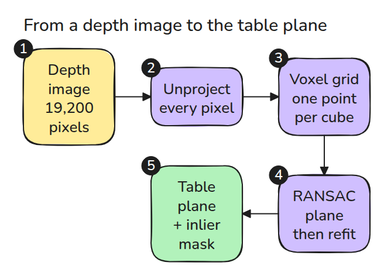
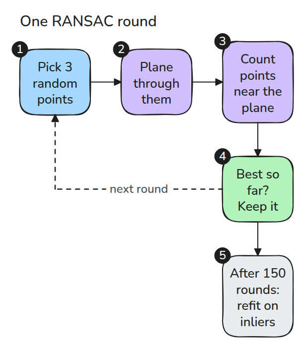
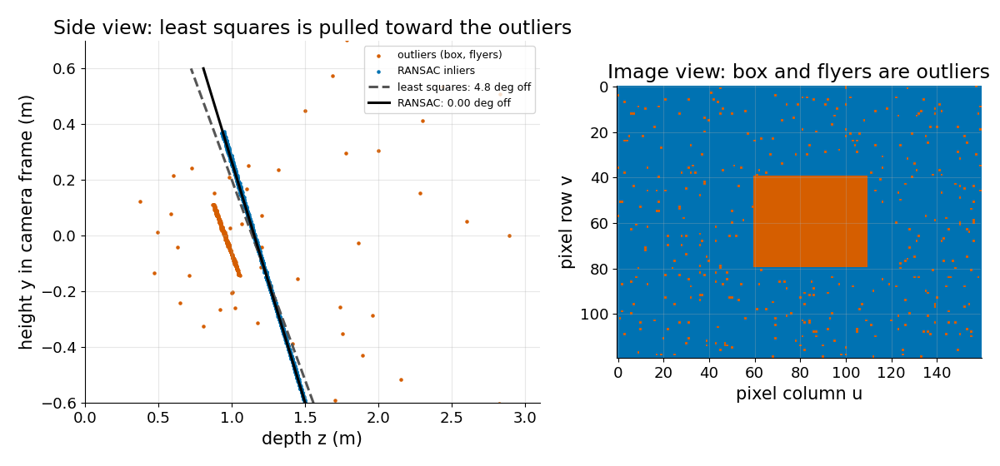

# depth와 점군 (Depth and Point Clouds)

> depth 이미지는 역투영을 기다리는 점군입니다. voxel grid로 점을 줄이고 테이블은 RANSAC으로 찾습니다. 단순한 최소제곱 평면은 엉뚱한 점을 전부 믿기 때문입니다.

**유형:** 만들기   **선수 지식:** 06/01 핀홀 카메라   **시간:** 약 15분

## 쉽게 말하면

depth 카메라가 스탠드 위에서 상자가 놓인 테이블을 내려다봐요. 팔이 블록을 수평으로 내려놓으려면 테이블의 평평한 면이 필요해요. 모든 점을 믿고 맞추면 상자와 엉뚱한 측정값 쪽으로 끌려가서 평면이 기울고 블록도 비스듬해져요.

RANSAC은 무작위로 뽑은 세 점으로 평면을 만들고 가까운 점이 몇 개인지 세어요. 점이 가장 많이 맞는 평면이 테이블이고 상자와 엉뚱한 측정값은 그 평면 밖에 남아요.

## 문제

depth 이미지에 상자가 놓인 테이블이 찍혀 있고 몇몇 pixel은 엉뚱한 값을 돌려줍니다. 팔이 물건을 올려놓을 수 있도록 평면을 맞춥니다.
평면이 몇 도 기울어서 "수평"이어야 할 놓기 자세가 비스듬해집니다.

## 개념



*depth가 있는 pixel이 모두 점이 되고 voxel 단계가 점군을 줄이고 RANSAC이 평면과 mask(어느 점이 평면 위에 있는지)를 돌려줍니다.*

01번 레슨처럼 각 pixel을 depth로 역투영합니다. 그다음 voxel grid가 공간을 작은 정육면체로 나누고 칸마다 평균 점 하나만 남기므로 점군은 줄어들고 평면은 그대로입니다.

최소제곱 평면은 거리 제곱의 합을 줄이는 평면이고 제곱하면 먼 점이 훨씬 크게 반영되므로 테이블보다 0.2 m 가까운 상자가 평면을 크게 끌어당깁니다.

RANSAC은 무작위 점 세 개로(점 세 개가 평면 하나를 정합니다) 평면을 만들고 문턱 안에 드는 점(inlier)을 세어 가장 좋은 평면을 남깁니다.
세 점이 모두 테이블 위에 있어야 그 회차가 쓸모 있고 그 확률은 테이블 점의 비율 `w`에 대해 `w^3`입니다.
이런 세 점을 확률 `p`로 한 번 뽑으려면 `N = log(1 - p) / log(1 - w^3)`번이 필요합니다. `w = 0.88`이고 `p = 0.99`이면 `N = 5`이므로 150회는 넉넉한 여유입니다.

예를 들어 문턱 1.2 cm에서 상자 점 두 개와 테이블 점 한 개를 뽑은 회차는 19,200개(depth pixel마다 하나) 중 1,142개만 문턱 안에 듭니다.
상자 윗면이 테이블보다 0.2 m 높아서 평면이 30도 기울기 때문입니다. 테이블 점 세 개를 뽑은 회차는 16,836개가 들고 0.3도만 틀어집니다.


*세 회차입니다. 주황 공은 뽑힌 점이고 옅은 판은 그 점들의 평면이며 초록 점은 1.2 cm 안에 드는 점입니다. 마지막 회차만 테이블을 찾습니다.*



*한 회차는 점을 뽑고 평면을 만들고 점을 세는 단계입니다. 이긴 평면은 다시 맞춥니다.*



*왼쪽은 최소제곱이 상자와 엉뚱한 점 쪽으로 기울고 RANSAC은 테이블을 따라가는 모습입니다. 오른쪽은 평면에서 벗어난 점이 상자와 엉뚱한 pixel인 모습입니다.*

## 만들기

```python
key = np.floor(P / size).astype(np.int64)
_, inv, cnt = np.unique(key, axis=0, return_inverse=True, return_counts=True)
n = np.cross(b - a, c - a); n /= np.linalg.norm(n)
inl = np.abs((P - a) @ n) < thr
```

`voxel_downsample()`은 칸마다 평균 점 하나를 만듭니다. `ransac_plane()`은 일직선에 놓인 표본을 건너뛰고 inlier로 재적합합니다.
voxel 크기 0.05 m는 점을 5분의 1 아래로 줄이면서 같은 평면을 유지합니다.

```bash
cd robotics-engineering-from-scratch
python3 -m pytest phases/06-perception-and-calibration/03-depth-and-point-clouds -q
```

## 실제 도구로 보기

Open3D에는 `PointCloud.voxel_down_sample(voxel_size)`와 `PointCloud.segment_plane(distance_threshold, ransac_n, num_iterations)`가 있고 후자는 평면 계수와 inlier 인덱스를 돌려줍니다.

두 평면의 법선을 비교하세요.

출처는 [Open3D 점군 튜토리얼](https://www.open3d.org/docs/release/tutorial/geometry/pointcloud.html)이며 두 함수의 이름과 인자를 확인했습니다.

## 결과물

`outputs/skill-plane-fit-check.md`는 평면을 놓기에 쓰기 전에 엉뚱한 점이 평면을 얼마나 움직이는지 확인합니다.

## 연습 문제

1. 엉뚱한 pixel의 비율(`flyers`)을 올려서 반복 150회의 RANSAC 평면이 실패할 때까지 가 보세요.
2. inlier가 60%일 때 `ransac_iters`로 반복 횟수를 고르세요.
3. 테이블 inlier를 제거한 뒤 상자 윗면을 두 번째 평면으로 맞추세요.
