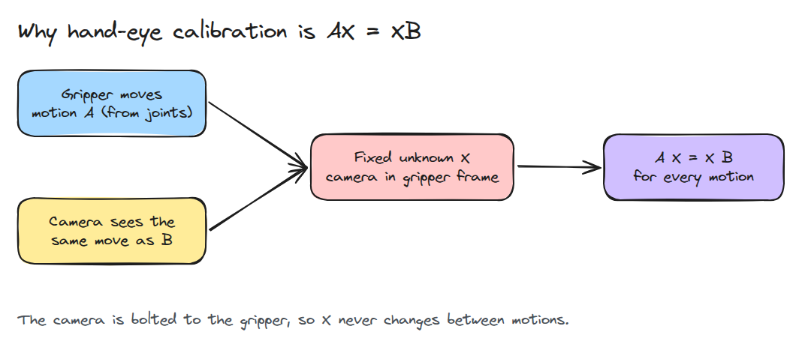
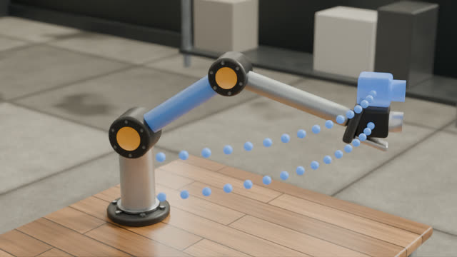
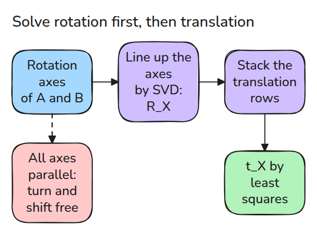
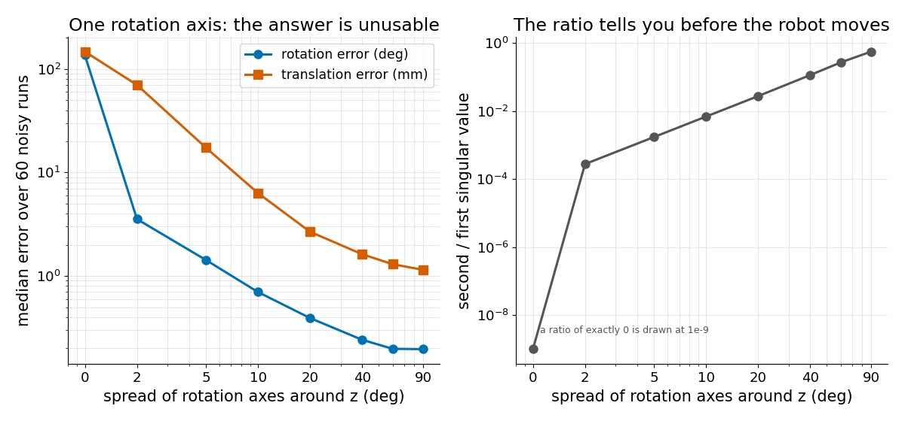

# Hand-Eye Calibration

> Learn how to find where a camera is mounted on a robot's hand, and why the arm must turn about different axes.

**Type:** Build   **Prerequisites:** none   **Time:** ~15 minutes

## In Plain Words

A camera is bolted to a robot arm's hand. The arm must know where the camera sits on the hand, called X. Turn the hand about more than one line (axis). With one axis, a camera slid along that line sees the same thing, so part of its place stays unknown.

## Key Terms

- **Hand-eye calibration**: finding where a camera sits on the robot's hand (its gripper).
- **Rotation axis**: the line a rotation spins about.
- **Translation**: a straight-line shift, as opposed to a turn.
- **Transform (`X`)**: how the camera is turned and shifted relative to the gripper.
- **Spread**: how far apart the motions' axes point.

## The Problem

A camera on a robot's hand sees a cup ahead, yet the gripper misses it, because where the camera sits is unknown.

## The Concept

Without knowing where the camera sits, a robot cannot turn what it sees into a place to reach.



*Each motion is measured twice, by the joints (A) and by the camera (B). The fixed mounting X links the two.*

Compare how the hand moved (joint angles) with how the world seemed to move in the camera.

With one axis, two things stay hidden: how the camera is turned about that line, and where it sits along it.

[](../assets/clip-example.mp4)

*The arm spins about its upright axis. A camera higher up (ghost) sees the same motion.*



*Red: when all axes point the same way, the camera's turn about that line and its position along it stay hidden.*



*Left: error is huge with one axis and falls as axes differ. Right: a warning number shows this before the robot moves.*

<details><summary>The math (optional)</summary>

Write the hand motion as `A`, the camera motion as `B` and the unknown mounting as `X`, so `A X = X B`. Each motion is a rotation `R` plus a translation `t`. Rotation: `log(R_A) = R_X log(R_B)` (`log(R)` is axis times angle), and an SVD (a matrix tool that lines up two sets of axes) gives `R_X`. Translation: `(R_A - I) t_X = R_X t_B - t_A`. At spread 0 every axis is `z`, so `R_A z = z`, `R_A - I` sends `z` to zero and shifting `t_X` along `z` breaks no equation. With noise, 12 motions give 121 mm and 136 degrees of error at spread 0 and 4.9 mm and 1.3 degrees at 15 (one run, seed 1). The warning is the ratio of the axes' second to first singular value, an SVD number near zero when the axes are parallel. In the clip, the cup is 0.3 m ahead of the camera.

</details>

## Build It

```python
U, s, Vt = np.linalg.svd(alpha.T @ beta)       # alpha = log(R_A), beta = log(R_B)
R = U @ np.diag([1, 1, np.linalg.det(U @ Vt)]) @ Vt
t = np.linalg.lstsq(M, y, rcond=None)[0]       # M stacks (R_A - I), y stacks R_X t_B - t_A
```

`make_motions()` builds test motions. `solve_hand_eye()` also returns a few warning numbers (singular values); small ones mean the motions are too alike.

```bash
cd robotics-engineering-from-scratch
python3 -m pytest phases/06-perception-and-calibration/04-hand-eye-calibration -q
```

## Use It

`cv2.calibrateHandEye`, from the computer-vision library OpenCV, offers five methods and wants many more than 3 poses.

Sources: [OpenCV calibration module](https://docs.opencv.org/5.0/main_modules/calib.html) and [OpenCV 3.4.20 calib3d reference](https://docs.opencv.org/3.4.20/d9/d0c/group__calib3d.html), found by search 2026-11-09 (fetch returned HTTP 403).

## Ship It

`outputs/skill-hand-eye-check.md` checks motions for axis variety.

## Exercises

1. Add noise only to the shifts (translations).
2. Replace the axis-lining-up step with a plain average of rotations.
3. Plot error against the number of motions.
