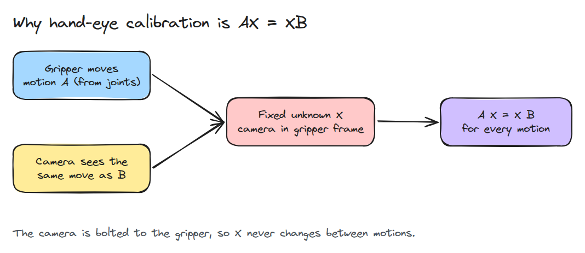
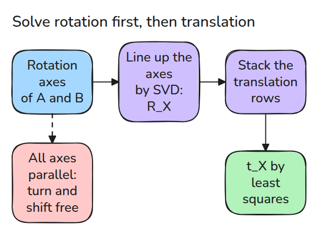
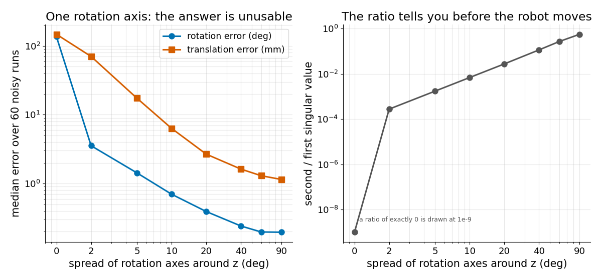

# Hand-Eye Calibration

> A camera bolted to a gripper gives two views of every motion. `A X = X B` finds where the camera sits, but only if the robot rotates about more than one axis.

**Type:** Build   **Prerequisites:** 01/04 Frames and Transform Trees, 06/01 Pinhole Camera   **Time:** ~15 minutes

## In Plain Words

Strap a phone to your forearm and film a fixed poster while moving your arm. The arm and camera describe the
same motion from different frames, linked by their fixed mounting offset.

Hand-eye calibration finds that link. Panning only about a vertical axis leaves part of it unknown. Sliding
the camera along that axis leaves those relative motions unchanged. Rotating about different axes supplies the
missing clues, allowing the fixed camera-to-arm orientation and position to be recovered.

## The Problem

The camera sees a cup 0.4 m ahead in its own frame, and the gripper must go there. Without the camera-to-gripper transform `X`, the target lands in the wrong place by exactly the unknown offset. You calibrate by waving the arm in front of a fixed target, but if every wave is a pan about one axis, the result looks fine and is wrong.

## The Concept



*The robot knows each gripper motion `A`. The camera measures the same motion as `B`. `X` is fixed, so `A X = X B` holds for every motion.*

The rotation part gives `log(R_A) = R_X log(R_B)`: `R_X` turns the camera's rotation axes into the gripper's. Align the two axis sets by SVD. Then the translation part `(R_A - I) t_X = R_X t_B - t_A` is linear in `t_X`.



*When all axes are parallel, the twist about that axis is undetermined, and so is the offset along it.*



*Median of 60 seeded runs with 0.2 degrees and 1 mm of noise. Left: one axis gives a useless answer, and a few degrees of axis spread already helps a lot. Right: the singular-value ratio measures this before any motion is run.*

## Build It

```python
U, s, Vt = np.linalg.svd(alpha.T @ beta)       # alpha = log(R_A), beta = log(R_B)
R = U @ np.diag([1, 1, np.linalg.det(U @ Vt)]) @ Vt
t = np.linalg.lstsq(M, y, rcond=None)[0]       # M stacks (R_A - I), y stacks R_X t_B - t_A
```

`make_motions()` builds `A` with rotation axes inside a cone around `z`, then `B = X^-1 A X` plus noise. `solve_hand_eye()` also returns the singular values `s`.

```bash
cd robotics-engineering-from-scratch
python3 -m pytest phases/06-perception-and-calibration/04-hand-eye-calibration -q
```

## Use It

OpenCV has `cv2.calibrateHandEye(R_gripper2base, t_gripper2base, R_target2cam, t_target2cam, method=...)`, with Tsai, Park, Horaud, Andreff and Daniilidis methods and a recommendation of many more than 3 poses. The test feeds it the same poses and checks that the rotation is close to the true `X`.

Sources: [OpenCV calibration module](https://docs.opencv.org/5.0/main_modules/calib.html) and [OpenCV 3.4.20 calib3d reference](https://docs.opencv.org/3.4.20/d9/d0c/group__calib3d.html), as listed by search results on 2026-11-09. The pages themselves returned HTTP 403 to automated fetch.

## Ship It

`outputs/skill-hand-eye-check.md` checks a set of calibration motions for axis diversity before they are run on a robot.

## Exercises

1. Add noise only to the translations and see which part of `X` suffers.
2. Replace the SVD step with an average of axis-pair rotations and compare.
3. Plot error against the number of motions at 60 degrees of spread.
