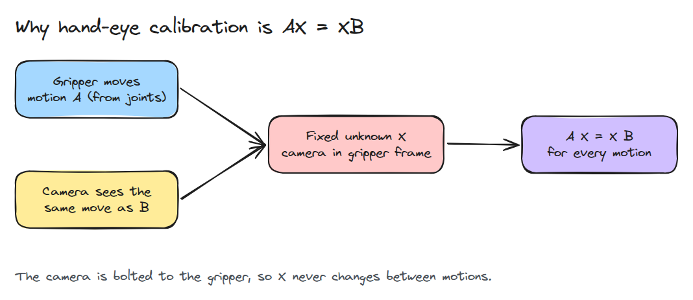
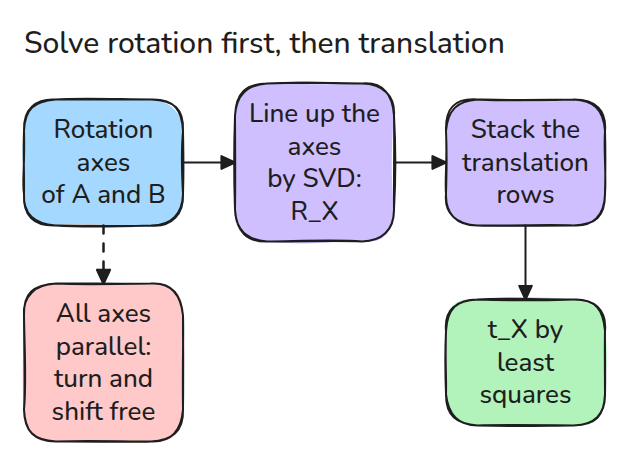
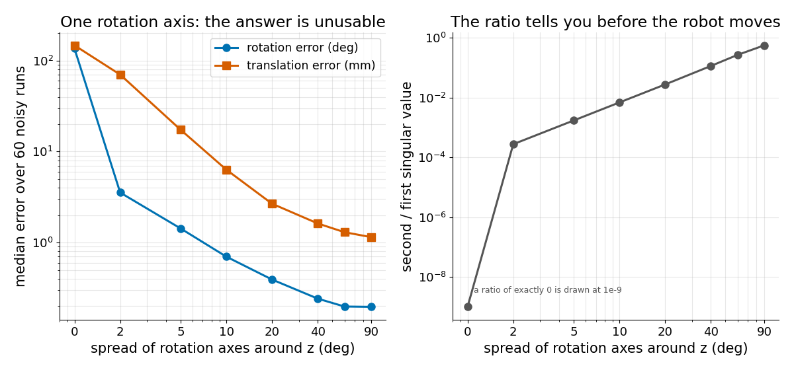

# 손-눈 보정 (Hand-Eye Calibration)

> gripper에 고정한 카메라는 모든 움직임을 두 번 봅니다. `A X = X B`로 카메라 위치를 찾지만 로봇이 한 축만이 아니라 여러 축으로 회전해야 풀립니다.

**유형:** 만들기   **선수 지식:** 01/04 Frame과 Transform 트리, 06/01 핀홀 카메라   **시간:** 약 15분

## 쉽게 말하면

팔에 휴대전화를 고정하고 팔을 움직이며 벽의 포스터를 찍어 보세요. 팔과 카메라는 같은 움직임을 서로 다른 frame에서 나타내요. 둘 사이에는 고정된 장착 위치와 방향이 있어요.

hand-eye calibration은 이 관계를 구해요. 수직축으로만 돌리면 카메라를 그 축 방향으로 옮겨도 상대 운동이 같아서 관계를 전부 알아낼 수 없어요. 서로 다른 축으로 돌려야 빠진
단서를 얻어 카메라와 팔 사이의 고정된 위치와 방향을 구할 수 있어요.

## 문제

카메라 frame에서 컵이 0.4 m 앞에 보이고 gripper가 거기로 가야 합니다. 카메라에서 gripper로 가는 변환 `X`를 모르면 목표는 그 미지의 오프셋만큼 틀린 곳에 놓입니다.
고정된 타깃 앞에서 팔을 흔들어 보정하는데 매번 한 축 주위로만 돌리면 결과가 멀쩡해 보이지만 틀립니다.

## 개념



*로봇은 gripper 움직임 `A`를 압니다. 카메라는 같은 움직임을 `B`로 잽니다. `X`는 고정이므로 모든 움직임에서 `A X = X B`가 성립합니다.*

회전 부분은 `log(R_A) = R_X log(R_B)`입니다. `R_X`가 카메라의 회전축을 gripper의 회전축으로 돌려 놓는다는 뜻입니다. 두 축 집합을 SVD로 정렬해 풉니다.
그다음 이동 부분 `(R_A - I) t_X = R_X t_B - t_A`는 `t_X`에 대해 선형입니다.



*축이 모두 평행하면 그 축 주위의 비틀림이 정해지지 않고 그 축 방향의 오프셋도 정해지지 않습니다.*



*잡음 0.2도와 1 mm에서 seed를 고정한 60회 실행의 median입니다. 왼쪽은 한 축이면 답이 쓸모없고 축이 몇 도만 퍼져도 크게 나아지는 모습입니다. 오른쪽은 singular value 비율이 움직이기 전에 이 상태를 알려 주는 모습입니다.*

## 만들기

```python
U, s, Vt = np.linalg.svd(alpha.T @ beta)       # alpha = log(R_A), beta = log(R_B)
R = U @ np.diag([1, 1, np.linalg.det(U @ Vt)]) @ Vt
t = np.linalg.lstsq(M, y, rcond=None)[0]       # M stacks (R_A - I), y stacks R_X t_B - t_A
```

`make_motions()`는 회전축이 `z` 주위의 원뿔 안에 있는 `A`를 만들고 `B = X^-1 A X`에 잡음을 더합니다. `solve_hand_eye()`는 singular value `s`도 함께 돌려줍니다.

```bash
cd robotics-engineering-from-scratch
python3 -m pytest phases/06-perception-and-calibration/04-hand-eye-calibration -q
```

## 실제 도구로 보기

OpenCV에는 `cv2.calibrateHandEye(R_gripper2base, t_gripper2base, R_target2cam, t_target2cam, method=...)`가 있습니다.

Tsai, Park, Horaud, Andreff, Daniilidis 방법을 지원합니다.
자세는 3개보다 훨씬 많이 쓰라고 권장합니다.
테스트는 같은 자세를 넣어서 회전이 정답 `X`에 가까운지 확인합니다.

출처는 [OpenCV calibration 모듈](https://docs.opencv.org/5.0/main_modules/calib.html)과 [OpenCV 3.4.20 calib3d
레퍼런스](https://docs.opencv.org/3.4.20/d9/d0c/group__calib3d.html)입니다.
내용은 2026년 11월 9일 검색 결과에서 가져왔고 페이지 자체는 자동 fetch에서 HTTP 403을 돌려주었습니다.

## 결과물

`outputs/skill-hand-eye-check.md`는 로봇으로 돌리기 전에 보정 움직임의 축 다양성을 확인합니다.

## 연습 문제

1. 이동에만 잡음을 넣고 `X`의 어느 부분이 나빠지는지 보세요.
2. SVD 단계를 축 쌍 회전의 평균으로 바꾸고 비교하세요.
3. 축 퍼짐 60도에서 움직임 수에 따른 오차를 그리세요.
