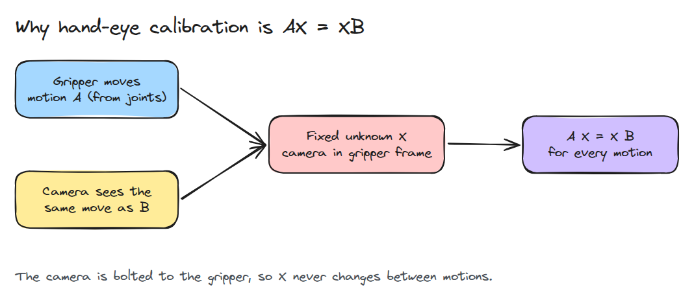
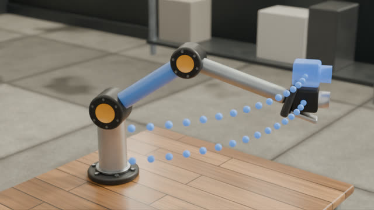
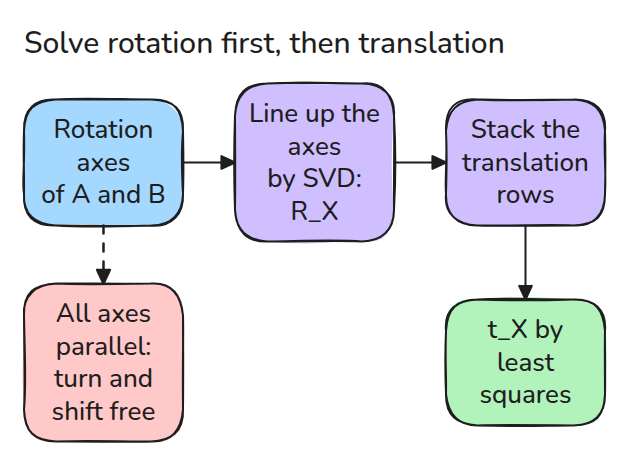
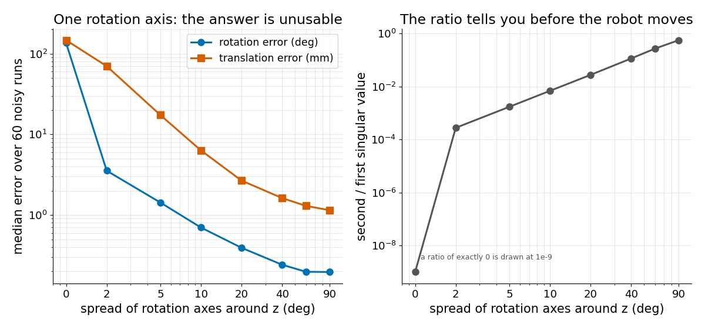

# 손-눈 보정 (Hand-Eye Calibration)

> 로봇 손에 달린 카메라의 위치를 찾는 법과 팔이 서로 다른 축으로 돌아야 하는 이유를 배웁니다.

**유형:** 만들기   **선수 지식:** 없음   **시간:** 약 15분

## 쉽게 말하면

카메라가 로봇 팔의 손에 고정되어 있어요. 팔은 카메라가 손의 어디에 있는지 알아야 하고 그것을 X라고 불러요.

손을 한 줄(축)이 아니라 여러 줄을 중심으로 돌려 보세요. 축이 하나면 그 줄을 따라 민 카메라도 똑같은 것을 보기 때문에 위치의 일부를 알 수 없어요.

## 핵심 용어

- **Hand-eye calibration**: 카메라가 로봇 손(gripper)의 어디에 붙어 있는지 찾는 일입니다.
- **Rotation axis**: 회전이 도는 중심선입니다.
- **Translation**: 돌림이 아니라 직선으로 옮기는 이동입니다.
- **Transform (`X`)**: gripper를 기준으로 카메라가 어느 쪽으로 돌아 있고 얼마나 떨어져 있는지입니다.
- **Spread**: 움직임의 축들이 서로 얼마나 다른 쪽을 가리키는지입니다.

## 문제

로봇 손의 카메라가 앞의 컵을 보는데 gripper가 컵을 놓칩니다. 카메라가 어디에 달렸는지 모르기 때문입니다.

## 개념

카메라가 어디에 있는지 모르면 로봇은 본 것을 손이 닿을 곳으로 바꿀 수 없습니다.



*움직임마다 관절(A)과 카메라(B)로 두 번 잽니다. 고정된 장착 위치 X가 둘을 잇습니다.*

손의 움직임(관절 각도)과 카메라에 보인 세상의 움직임을 비교합니다.

한 축이면 두 가지가 가려집니다. 카메라가 그 줄을 중심으로 얼마나 돌아 있는지와 그 줄을 따라 어디에 있는지입니다.

[](../assets/clip-example.mp4)

*팔이 수직 축을 중심으로 돕니다. 더 높이 달린 카메라(유령)도 같은 움직임을 봅니다.*



*빨강: 축이 모두 같은 쪽을 가리키면 카메라가 그 줄을 중심으로 돌아 있는 정도와 그 줄을 따라 놓인 위치는 가려집니다.*



*왼쪽은 축이 하나일 때 오차가 크고 축이 다를수록 줄어드는 모습입니다. 오른쪽은 경고용 숫자가 로봇이 움직이기 전에 이를 보여 주는 모습입니다.*

<details><summary>The math (optional)</summary>

손의 움직임을 `A`, 카메라의 움직임을 `B`, 모르는 장착 위치를 `X`라 하면 `A X = X B`입니다. 움직임 하나는 회전 `R`과 이동 `t`입니다.
회전은 `log(R_A) = R_X log(R_B)`(`log(R)`은 축 곱하기 각도)이고 SVD(두 축 묶음을 맞추는 matrix 도구)가 `R_X`를 줍니다.
이동은 `(R_A - I) t_X = R_X t_B - t_A`입니다. spread가 0이면 모든 축이 `z`이므로 `R_A z = z`이고 `R_A - I`가 `z`를 0으로 보내서 `t_X`를 `z`를 따라 옮겨도 어떤 식도 깨지지 않습니다.
노이즈가 있을 때 움직임 12개는 spread 0에서 121 mm와 136도의 오차를 주고 15에서 4.9 mm와 1.3도를 줍니다(seed 1로 한 번 실행). 경고는 축들의 둘째 대 첫째 singular value(SVD가 내놓는 숫자로 축이 평행하면 0에 가까움)의 비율입니다.
영상에서 컵은 카메라 앞 0.3 m에 있습니다.

</details>

## 만들기

```python
U, s, Vt = np.linalg.svd(alpha.T @ beta)       # alpha = log(R_A), beta = log(R_B)
R = U @ np.diag([1, 1, np.linalg.det(U @ Vt)]) @ Vt
t = np.linalg.lstsq(M, y, rcond=None)[0]       # M stacks (R_A - I), y stacks R_X t_B - t_A
```

`make_motions()`는 시험용 움직임을 만듭니다. `solve_hand_eye()`는 경고용 숫자(singular value)도 돌려줍니다. 작은 값은 움직임들이 너무 비슷하다는 뜻입니다.

```bash
cd robotics-engineering-from-scratch
python3 -m pytest phases/06-perception-and-calibration/04-hand-eye-calibration -q
```

## 실제 도구로 보기

컴퓨터 비전 라이브러리 OpenCV의 `cv2.calibrateHandEye`는 다섯 가지 방법을 제공하고 자세가 3개보다 훨씬 많아야 합니다.

출처: [OpenCV calibration module](https://docs.opencv.org/5.0/main_modules/calib.html)과 [OpenCV 3.4.20 calib3d reference](https://docs.opencv.org/3.4.20/d9/d0c/group__calib3d.html), 2026년 11월 9일 검색으로 찾았고 페이지를 직접 가져오려 하자 HTTP 403이 돌아왔습니다.

## 결과물

`outputs/skill-hand-eye-check.md`는 움직임의 축 다양성을 점검합니다.

## 연습 문제

1. 이동(translation)에만 노이즈를 더해 보세요.
2. 축을 맞추는 단계를 회전의 단순 평균으로 바꿔 보세요.
3. 움직임 개수에 따른 오차를 그리세요.
