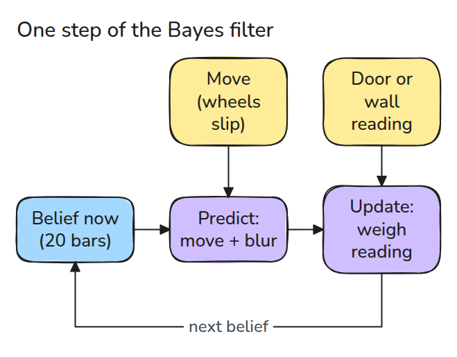
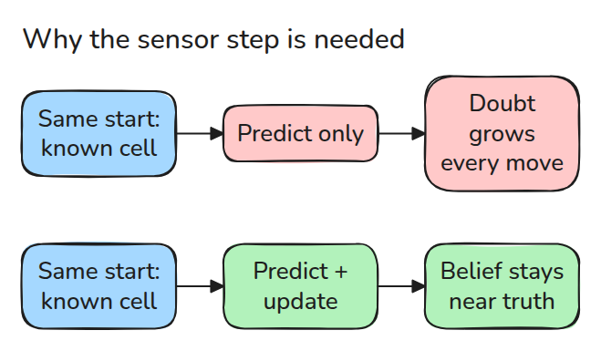
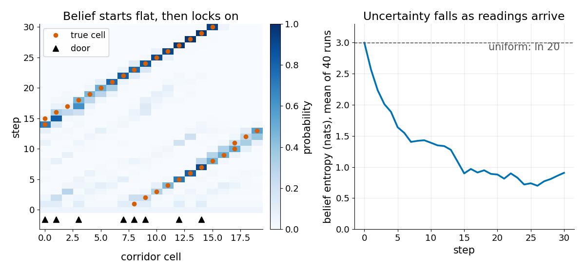
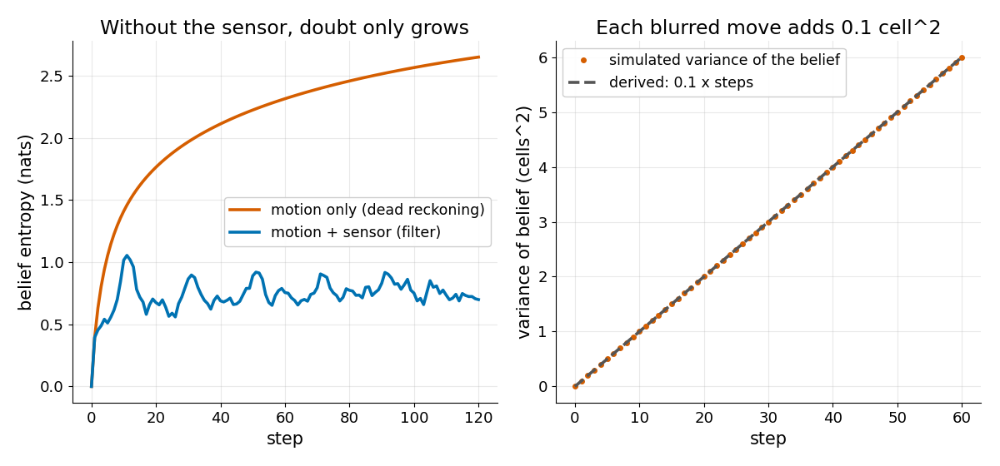

# Bayes Filter

> Learn how a robot keeps track of where it is when its wheels slip and its sensors are vague.

**Type:** Build   **Prerequisites:** 01/04 Frames and Transform Trees   **Time:** ~15 minutes

## In Plain Words

A robot rolls around a ring corridor. Its wheels slip, so it grows less sure where it is. Picture a bar over each spot, taller where the robot is more likely to be. A "door" reading raises the bars over doors.

## Key Terms

- **Belief**: how likely the robot thinks each place is, one probability per place.
- **Predict**: the step that slides and blurs the belief by the move, adding doubt.
- **Update**: the step that reweights the belief by how well each place explains a reading.
- **Prior / posterior**: the belief before and after a reading.
- **Likelihood**: how well a place explains a sensor reading.
- **Entropy**: a score of doubt, high when all places look equally likely.

## The Problem

A robot counts wheel turns to find its place in a corridor. After a hundred steps the slipping count is a guess and it walks into the wrong door, and one "door" reading fits several places.

## The Concept

A robot never knows its position for sure, so it tracks how likely each place is.



*Predict shifts and blurs. Update reweights by the reading.*

The belief is a histogram, one bar per corridor cell. Predict slides the bars by the move and blurs them: 5% short, 90% exact, 5% long. Update applies Bayes' rule, `posterior = prior * likelihood / sum`. A cell that agrees with the reading gets weight `p_hit = 0.9`, one that disagrees `0.1`, and dividing by the sum makes the total 1.

With all 20 cells at 0.05 and 8 doors, "door" makes a door cell `0.05 * 0.9 = 0.045` and a wall cell `0.05 * 0.1 = 0.005`. The sum is `8 * 0.045 + 12 * 0.005 = 0.42`, so a door cell ends at 0.107 and a wall cell at 0.012.


*Moves slide and blur the green bars, readings (door: amber lamp) make them jump. After five moves the rover's cell holds 0.86.*



*Dead reckoning (no sensor step): the belief keeps spreading.*



*Left: probability gathers on the true cell after a few doors. Right: entropy falls from ln 20 (about 3) toward 1.*



*Left: motion-only doubt keeps rising. Right: each predict adds `0.05 + 0.05 = 0.1` cell^2 of variance (spread).*

## Build It

```python
def predict(bel, move, kernel=KERNEL):
    return sum(p * np.roll(bel, move + k) for k, p in zip((-1, 0, 1), kernel))

def update(bel, z, doors=DOORS, p_hit=P_HIT):
    post = bel * np.where(doors == z, p_hit, 1 - p_hit)
    return post / post.sum()
```

The corridor is a ring of 20 cells, so `np.roll` handles the ends.

```bash
cd robotics-engineering-from-scratch
python3 -m pytest phases/07-state-estimation/01-bayes-filter -q
```

## Use It

Nav2's AMCL stores the same belief as samples (a particle filter) to localize a robot in a known map.

Sources: Nav2 AMCL README, https://github.com/ros-navigation/navigation2/blob/main/nav2_amcl/README.md (2026-11-09).

## Ship It

`outputs/skill-bayes-filter-check.md` reviews a localizer for a missing step.

## Exercises

1. Set `KERNEL` to `(0.2, 0.6, 0.2)` and predict the variance after 10 steps.
2. Use `p_hit = 0.99` and see what one bad reading does.
3. Use a walled corridor.
