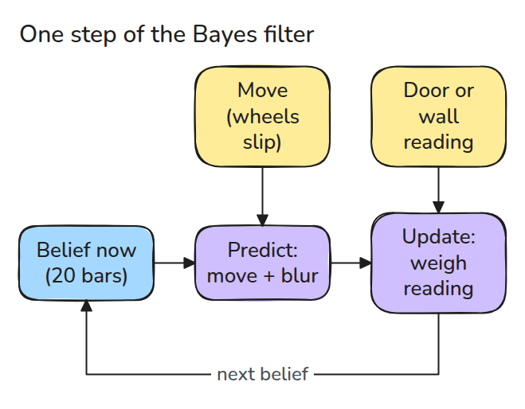
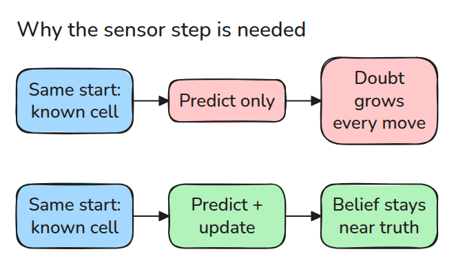
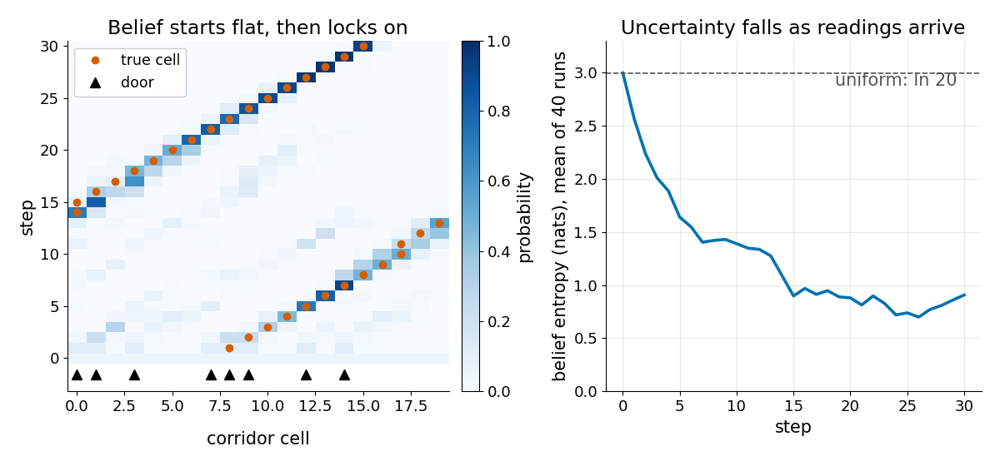
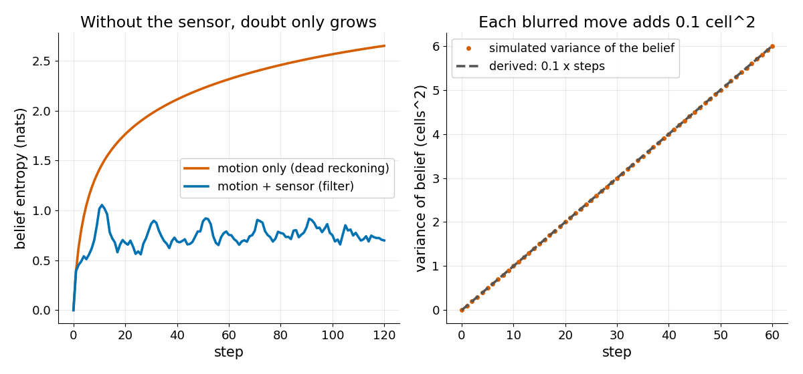

# Bayes Filter

> A robot never knows where it is, only how likely each place is, and two steps keep that belief honest: predict adds doubt, update removes it.

**Type:** Build   **Prerequisites:** 01/04 Frames and Transform Trees   **Time:** ~15 minutes

## In Plain Words

A small robot rolls around a ring corridor, counting wheel turns. The wheels slip, so after every move it is less sure which spot it is on. Picture a bar over each spot, taller where the robot is more likely to be. As it rolls, the bars spread out and shrink.

When the door sensor says "door", the robot raises the bars over spots with doors and lowers the rest. Only the bars, the robot's belief, change; the robot and corridor stay put.

## The Problem

A robot rolls down a corridor, counting wheel turns to know where it is. Wheels slip, so after a hundred steps the count is a guess and it walks into the wrong door. Discarding the count is no better: one "door" reading fits several places.

## The Concept



*Predict shifts and blurs the belief. Update multiplies it by how well each cell explains the reading.*

The belief is a histogram: one bar of probability per corridor cell. Predict slides the bars by the move and blurs them, because wheels slip: 5% short, 90% exact, 5% long. Update applies Bayes' rule, `posterior = prior * likelihood / sum`. The prior is the belief before the reading, the likelihood is how well a cell explains it, and the posterior is the new belief.

A cell that agrees with the reading is weighted by `p_hit = 0.9`, one that disagrees by `0.1`. Dividing by the sum makes the probabilities add to 1.

A robot that knows nothing gives all 20 cells 0.05, and 8 have doors. It reads "door". A door cell becomes `0.05 * 0.9 = 0.045` and a wall cell `0.05 * 0.1 = 0.005`. The sum is `8 * 0.045 + 12 * 0.005 = 0.42`, so a door cell ends at 0.107 and a wall cell at 0.012.


*Watch the green bars. Each move slides and blurs them, each reading (door: amber lamp, wall: grey) makes them jump. After five moves the rover's cell holds 0.86.*



*Without the sensor step (dead reckoning: wheel counting only) the belief keeps spreading. With it the belief stays near the truth.*



*Left: from a flat belief, probability gathers on the true cell after a few doors. Right: entropy, a score of doubt, falls from ln 20 (about 3, all cells equal) toward 1.*



*Left: motion-only doubt keeps rising, the filter's stays flat. Right: a one-cell slip happens 10% of the time, so each predict adds `0.05 + 0.05 = 0.1` cell^2 of variance (spread), matched by simulation.*

## Build It

```python
def predict(bel, move, kernel=KERNEL):
    return sum(p * np.roll(bel, move + k) for k, p in zip((-1, 0, 1), kernel))

def update(bel, z, doors=DOORS, p_hit=P_HIT):
    post = bel * np.where(doors == z, p_hit, 1 - p_hit)
    return post / post.sum()
```

The corridor is a ring of 20 cells, so `np.roll` handles the ends.

```bash
cd robotics-engineering-from-scratch
python3 -m pytest phases/07-state-estimation/01-bayes-filter -q
```

## Use It

A particle filter stores the same belief as samples. Nav2's AMCL (Adaptive Monte Carlo Localization) uses one to find a robot's pose in a known map with a 2D laser scanner.

Sources: Nav2 AMCL README, https://github.com/ros-navigation/navigation2/blob/main/nav2_amcl/README.md (opened 2026-11-09).

## Ship It

`outputs/skill-bayes-filter-check.md` reviews a localizer for a missing predict or update step.

## Exercises

1. Set `KERNEL` to `(0.2, 0.6, 0.2)` and predict the variance after 10 steps.
2. Use a wrong `p_hit` of 0.99 and watch what one bad reading does.
3. Replace the ring with a walled corridor and decide where the lost mass goes.
