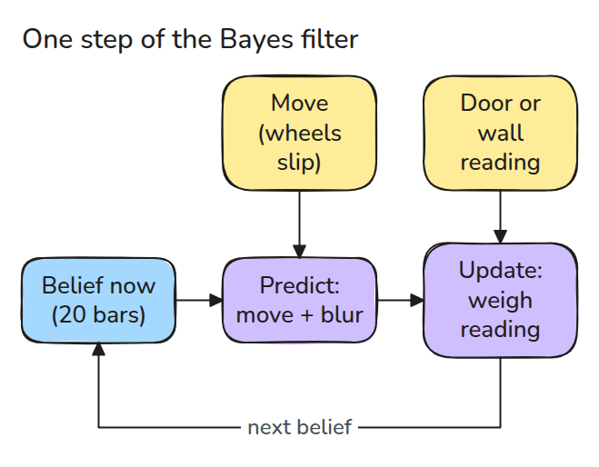
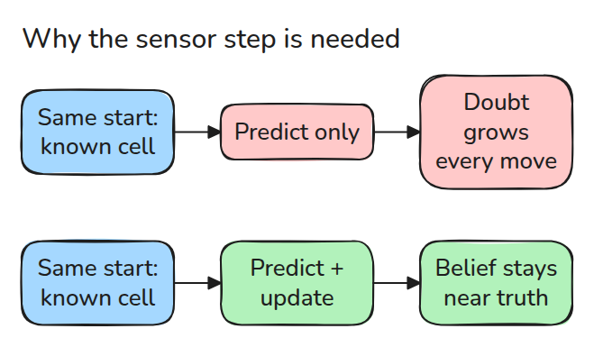
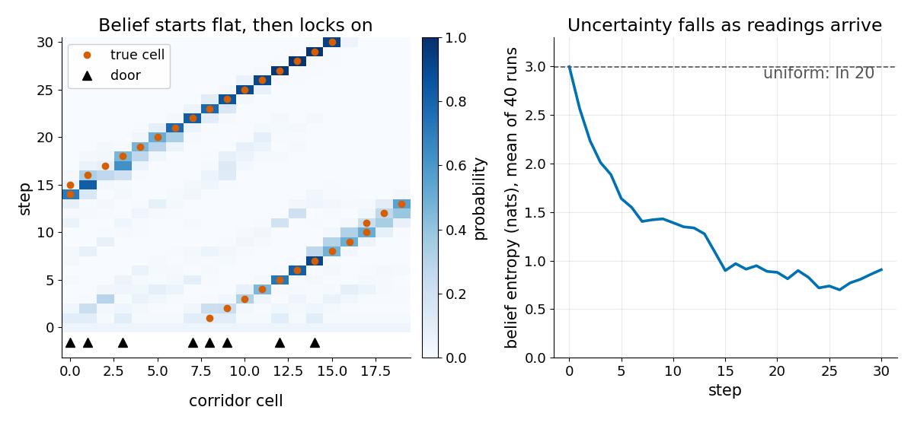

# Bayes Filter

> 바퀴가 미끄러지고 센서가 모호해도 로봇이 자기 위치를 추적하는 법을 배웁니다.

**유형:** 만들기   **선수 지식:** 01/04 Frame과 Transform 트리   **시간:** 약 15분

## 쉽게 말하면

로봇이 고리 모양 복도를 돌아요. 바퀴가 미끄러져서 어디 있는지 점점 덜 확실해져요.

각 지점 위에 막대를 세워 보세요. 로봇이 있을 가능성이 클수록 막대가 높아요. "문" 신호가 들어오면 문이 있는 지점의 막대가 올라가요.

## 핵심 용어

- **Belief**: 로봇이 각 장소가 얼마나 그럴듯하다고 믿는지입니다. 장소마다 확률 하나를 가집니다.
- **Predict**: 움직임만큼 belief를 밀고 퍼뜨려서 불확실성을 더하는 단계입니다.
- **Update**: 각 장소가 센서 값을 얼마나 잘 설명하는지에 따라 belief의 가중치를 다시 매기는 단계입니다.
- **Prior / posterior**: 센서 값을 보기 전의 belief와 본 뒤의 belief입니다.
- **Likelihood**: 한 장소가 센서 값을 얼마나 잘 설명하는지입니다.
- **Entropy**: 불확실성의 점수입니다. 모든 장소가 똑같이 그럴듯하면 큽니다.

## 문제

로봇이 바퀴 횟수를 세어 복도에서 자기 자리를 찾습니다. 백 걸음 뒤에는 미끄러진 횟수가 추측일 뿐이어서 엉뚱한 문으로 들어가고 "문" 신호 하나는 여러 장소와 들어맞습니다.

## 개념

로봇은 자기 위치를 확실히 알 수 없으므로 각 장소가 얼마나 그럴듯한지를 추적합니다.



*predict는 밀고 퍼뜨립니다. update는 센서 값으로 가중치를 다시 매깁니다.*

belief는 corridor 칸마다 막대 하나인 histogram입니다. predict는 움직임만큼 막대를 밀고 퍼뜨립니다. 5%는 모자라고 90%는 정확하고 5%는 넘칩니다.
update는 Bayes 규칙 `posterior = prior * likelihood / sum`을 적용합니다. 센서 값과 맞는 칸은 가중치 `p_hit = 0.9`를 받고 맞지 않는 칸은 `0.1`을 받으며 합으로 나누면 전체가 1이 됩니다.

칸 20개가 모두 0.05이고 문이 8개일 때 "문"은 문 칸을 `0.05 * 0.9 = 0.045`로, 벽 칸을 `0.05 * 0.1 = 0.005`로 만듭니다. 합은 `8 * 0.045 + 12 * 0.005 = 0.42`이므로 문 칸은 0.107, 벽 칸은 0.012가 됩니다.


*움직임은 초록 막대를 밀고 퍼뜨리고 센서 값(문은 주황 램프)은 막대를 튀게 합니다. 다섯 번 움직인 뒤 로버의 칸은 0.86을 가집니다.*



*dead reckoning(센서 단계 없음)에서는 belief가 계속 퍼집니다.*



*왼쪽은 문을 몇 번 지나면 확률이 참 칸에 모이는 모습입니다. 오른쪽은 entropy가 ln 20(약 3)에서 1 쪽으로 떨어지는 모습입니다.*


*왼쪽은 움직임만 쓰면 불확실성이 계속 오르는 모습입니다. 오른쪽은 predict마다 분산(퍼짐) `0.05 + 0.05 = 0.1` cell^2이 더해지는 것입니다.*

## 만들기

```python
def predict(bel, move, kernel=KERNEL):
    return sum(p * np.roll(bel, move + k) for k, p in zip((-1, 0, 1), kernel))

def update(bel, z, doors=DOORS, p_hit=P_HIT):
    post = bel * np.where(doors == z, p_hit, 1 - p_hit)
    return post / post.sum()
```

복도는 칸 20개의 고리라서 `np.roll`이 끝을 처리합니다.

```bash
cd robotics-engineering-from-scratch
python3 -m pytest phases/07-state-estimation/01-bayes-filter -q
```

## 실제 도구로 보기

Nav2의 AMCL은 같은 belief를 샘플로 저장해서(particle filter) 알려진 map 안에서 로봇의 위치를 찾습니다.

출처: Nav2 AMCL README, https://github.com/ros-navigation/navigation2/blob/main/nav2_amcl/README.md (2026년 11월 9일 확인).

## 결과물

`outputs/skill-bayes-filter-check.md`는 localizer에서 빠진 단계가 있는지 점검합니다.

## 연습 문제

1. `KERNEL`을 `(0.2, 0.6, 0.2)`로 바꾸고 10걸음 뒤의 분산을 예측하세요.
2. `p_hit = 0.99`를 쓰고 잘못된 센서 값 하나가 무엇을 하는지 보세요.
3. 벽이 있는 복도를 쓰세요.
