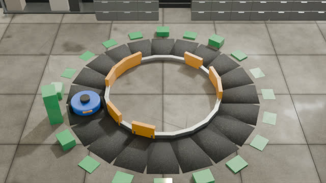
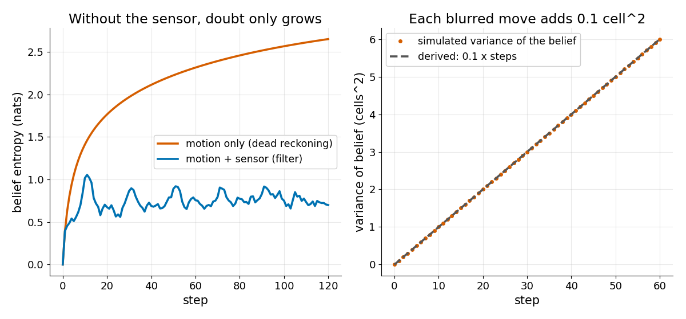

# 베이즈 필터 (Bayes Filter)

> 바퀴가 미끄러지고 센서가 모호해도 로봇이 자기 위치를 추적하는 법을 배웁니다.

**유형:** 만들기   **선수 지식:** 없음   **시간:** 약 15분

## 쉽게 말하면

로봇이 고리 모양 복도를 돌아요. 바퀴가 미끄러져서 어디 있는지 점점 덜 확실해져요.

각 지점 위에 막대를 세워 보세요. 로봇이 있을 가능성이 클수록 막대가 높아요. "문" 신호가 들어오면 문이 있는 지점의 막대가 올라가요.

## 핵심 용어

- **Belief**: 로봇이 각 장소가 얼마나 그럴듯하다고 믿는지입니다. 장소마다 확률 하나씩입니다.
- **Predict**: 움직임만큼 belief를 밀고 퍼뜨려서 불확실성을 더하는 단계입니다.
- **Update**: 각 장소가 센서 값을 얼마나 잘 설명하는지에 따라 belief의 가중치를 다시 매기는 단계입니다.
- **Prior / posterior**: 센서 값을 보기 전의 belief와 본 뒤의 belief입니다.
- **Likelihood**: 한 장소가 센서 값을 얼마나 잘 설명하는지입니다.
- **Entropy**: 불확실성의 점수입니다. 모든 장소가 똑같이 그럴듯하면 큽니다.

## 문제

로봇이 바퀴 횟수를 세어 복도에서 자기 자리를 찾습니다. 백 걸음 뒤에는 미끄러진 횟수가 추측일 뿐이어서 엉뚱한 문으로 들어가고 "문" 신호 하나는 여러 장소와 들어맞습니다.

## 개념

로봇은 자기 위치를 확실히 알 수 없으므로 각 장소가 얼마나 그럴듯한지를 추적합니다.


*predict는 밀고 퍼뜨립니다. update는 센서 값으로 가중치를 다시 매깁니다.*

belief는 복도 칸마다 막대 하나씩 늘어선 줄이고 로봇이 있을 가능성이 큰 칸일수록 막대가 높습니다. predict는 움직임만큼 막대를 밀고 퍼뜨립니다. 바퀴가 미끄러지기 때문입니다. update는 센서 값과 맞는 칸의 막대를 올리고 나머지를 낮춘 뒤 막대의 합이 1이 되게 다시 맞춥니다.
이 단계가 Bayes 규칙입니다.

[](../assets/clip-example.mp4)

*움직임은 초록 막대를 밀고 퍼뜨리고 센서 값(문은 주황 램프)은 막대를 튀게 합니다. 로버의 칸이 belief 대부분을 차지하게 됩니다.*


*dead reckoning(바퀴 횟수만, 센서 단계 없음)에서는 belief가 퍼집니다.*


*왼쪽은 문을 몇 번 지나면 확률이 로봇의 실제 칸에 모이는 모습입니다. 오른쪽은 불확실성이 줄어드는 모습입니다.*



*왼쪽은 움직임만 쓰면 불확실성이 갈수록 느리게 올라 최대치에 다가가는 모습입니다. 오른쪽은 시뮬레이션이 공식이 주는 증가와 맞는 모습입니다.*

<details><summary>The math (optional)</summary>

predict는 바퀴 미끄러짐만큼 퍼뜨립니다. 5%는 모자라고 90%는 정확하고 5%는 넘칩니다. update는 `posterior = prior * likelihood / sum`입니다.
센서 값과 맞는 칸은 가중치 `p_hit = 0.9`를 받고 맞지 않는 칸은 `0.1`을 받습니다. 칸 20개가 모두 0.05이고 문이 8개일 때 "문"은 문 칸을 `0.05 * 0.9 = 0.045`로, 벽 칸을 `0.05 * 0.1 = 0.005`로 만듭니다.
합은 `8 * 0.045 + 12 * 0.005 = 0.42`이므로 문 칸은 0.107, 벽 칸은 0.012가 됩니다. 예시 영상에서는 출발 전 측정 한 번과 이동 뒤의 정확한 측정 다섯 번으로 로버의 칸에 0.86이 모입니다. entropy는 ln 20(약 3)에서 1 가까이로 떨어집니다.
predict마다 분산 `0.05 + 0.05 = 0.1` cell^2이 더해집니다.

</details>

## 만들기

```python
def predict(bel, move, kernel=KERNEL):
    return sum(p * np.roll(bel, move + k) for k, p in zip((-1, 0, 1), kernel))

def update(bel, z, doors=DOORS, p_hit=P_HIT):
    post = bel * np.where(doors == z, p_hit, 1 - p_hit)
    return post / post.sum()
```

복도는 칸 20개의 고리라서 `np.roll`이 끝을 이어 붙입니다.

```bash
cd robotics-engineering-from-scratch
python3 -m pytest phases/07-state-estimation/01-bayes-filter -q
```

## 실제 도구로 보기

Nav2(ROS 2의 navigation 패키지)의 AMCL은 같은 belief를 여러 샘플 점으로 저장합니다(particle filter).

출처: Nav2 AMCL README, https://github.com/ros-navigation/navigation2/blob/main/nav2_amcl/README.md (2026년 11월 9일 확인).

## 결과물

`outputs/skill-bayes-filter-check.md`는 localizer를 점검합니다.

## 연습 문제

1. 미끄러질 확률을 바꾸고 퍼짐이 어떻게 변하는지 보세요.
2. 문 신호가 맞을 확률(`p_hit`)을 1에 가깝게 두고 잘못된 센서 값 하나를 넣어 보세요.
3. 벽이 있는 복도를 써 보세요.
