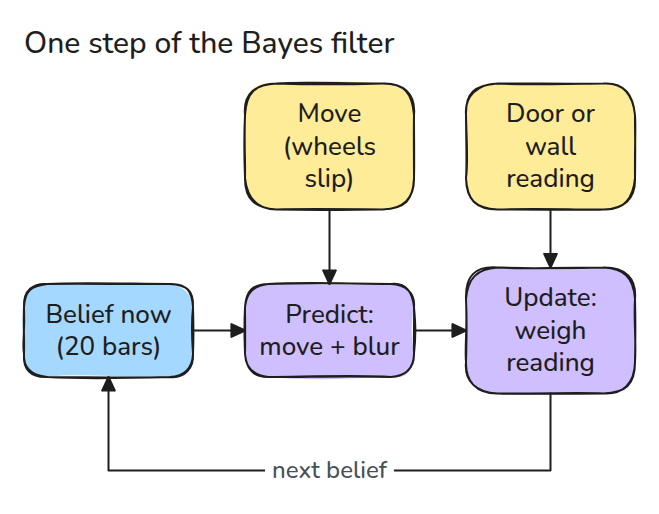
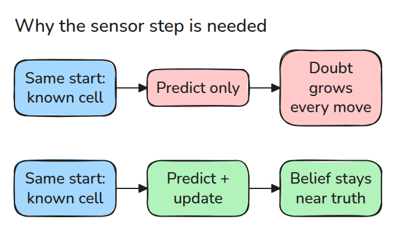
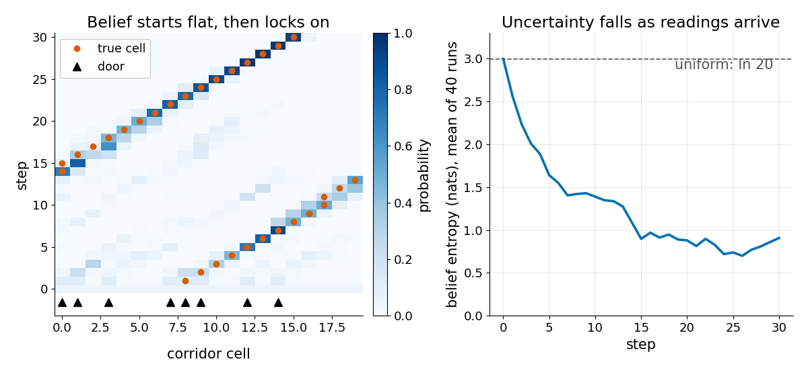
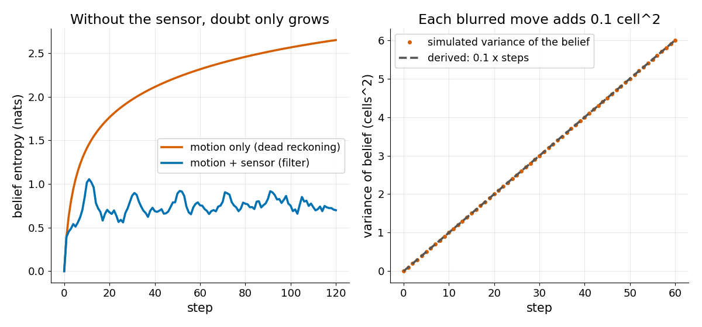

# Bayes Filter

> 로봇은 자신이 어디 있는지 알지 못하고 각 장소의 확률만 압니다. predict는 불확실성을 더하고 update는 그것을 덜어 냅니다. 이 두 단계가 belief를 정직하게 유지합니다.

**유형:** 만들기   **선수 지식:** 01/04 Frame과 Transform 트리   **시간:** 약 15분

## 쉽게 말하면

작은 로봇이 고리 모양 복도를 돌면서 바퀴가 돈 횟수를 세어요. 바퀴가 미끄러져서 움직일 때마다 어느 자리에 있는지 덜 확실해져요. 각 자리 위에 막대가 하나씩 있고 로봇이 있을 가능성이 클수록 막대가 높다고 해 보세요. 로봇이 굴러갈수록 막대는 옆으로 퍼지면서 낮아져요.

문 센서가 "문"이라고 하면 로봇은 문이 있는 자리의 막대를 올리고 나머지는 낮춰요. 바뀌는 것은 막대, 곧 로봇의 belief뿐이에요. 로봇과 복도는 그대로예요.

## 문제

로봇이 복도를 따라 굴러가면서 바퀴가 돈 횟수로 자기 위치를 셉니다. 바퀴가 미끄러져서 백 걸음쯤 지나면 그 숫자는 추측일 뿐이고 로봇은 엉뚱한 문으로 들어갑니다. 숫자를 버리는 것도 답이 아닙니다. "문"이라는 센서값 하나는 여러 장소와 맞기 때문입니다.

## 개념



*predict는 belief를 옮기고 번지게 합니다. update는 각 셀이 센서값을 얼마나 잘 설명하는지를 곱합니다.*

belief는 histogram입니다. 복도 셀 하나마다 확률을 나타내는 막대가 하나씩 있습니다.

predict는 막대를 이동량만큼 밀고 번지게 합니다. 바퀴가 미끄러져서 로봇이 5% 확률로 짧게, 90% 확률로 정확히, 5% 확률로 길게 가기 때문입니다.

update는 Bayes 법칙 `posterior = prior * likelihood / sum`을 씁니다. prior는 센서값을 받기 전의 belief이고 likelihood는 각 셀이 센서값을 얼마나 잘 설명하는지이며 posterior는 새 belief입니다.

센서값과 일치하는 셀에는 `p_hit = 0.9`를, 어긋나는 셀에는 `0.1`을 곱합니다. 그다음 합으로 나누면 확률의 합이 다시 1이 됩니다.

아무것도 모르는 로봇은 셀 20개 모두에 0.05를 줍니다. 그중 8개 셀에 문이 있습니다.

로봇이 "문"을 읽으면 문 셀은 `0.05 * 0.9 = 0.045`가 되고 벽 셀은 `0.05 * 0.1 = 0.005`가 됩니다. 합은 `8 * 0.045 + 12 * 0.005 = 0.42`이므로 문 셀은 0.107, 벽 셀은 0.012가 됩니다.


*초록 막대를 보세요. rover가 한 칸 굴러갈 때마다 막대가 옆으로 밀리며 번집니다. 그다음 문(호박색 램프)이나 벽(회색 램프)을 읽으면 막대가 뛰어오릅니다. 이동 다섯 번 뒤에는 rover가 있는 칸의 막대가 0.86이 됩니다.*



*센서 단계가 없으면(dead reckoning, 바퀴 수만 세는 방식) belief는 계속 퍼집니다. 센서 단계가 있으면 belief가 진짜 위치 근처에 남습니다.*



*왼쪽은 평평한 belief에서 시작해 문을 몇 개 지나면 확률이 실제 셀에 모이는 모습입니다. 오른쪽은 불확실성 점수인 entropy가 ln 20(약 3, 모든 셀이 같을 때)에서 1 근처까지 내려가는 모습입니다.*



*왼쪽은 모션만 쓴 belief의 불확실성이 계속 오르고 filter의 불확실성은 일정하게 머무는 모습입니다. 오른쪽은 한 칸 미끄러짐이 10% 확률로 생겨서 predict마다 분산(퍼짐)이 `0.05 + 0.05 = 0.1` cell^2씩 늘고 시뮬레이션이 그 값과 일치하는 모습입니다.*

## 만들기

```python
def predict(bel, move, kernel=KERNEL):
    return sum(p * np.roll(bel, move + k) for k, p in zip((-1, 0, 1), kernel))

def update(bel, z, doors=DOORS, p_hit=P_HIT):
    post = bel * np.where(doors == z, p_hit, 1 - p_hit)
    return post / post.sum()
```

복도는 셀 20개짜리 고리라서 `np.roll`이 양 끝을 처리합니다.

```bash
cd robotics-engineering-from-scratch
python3 -m pytest phases/07-state-estimation/01-bayes-filter -q
```

## 실제 도구로 보기

particle filter는 같은 belief를 histogram 대신 샘플로 저장합니다. Nav2의 AMCL(Adaptive Monte Carlo Localization)은 2D 레이저 스캐너로 알려진 지도 안에서 로봇의 pose를 추정합니다.

출처: Nav2 AMCL README, https://github.com/ros-navigation/navigation2/blob/main/nav2_amcl/README.md (2026년 11월 9일 확인).

## 결과물

`outputs/skill-bayes-filter-check.md`는 localizer에서 predict나 update 단계가 빠졌는지 검토합니다.

## 연습 문제

1. `KERNEL`을 `(0.2, 0.6, 0.2)`로 바꾸고 실행하기 전에 10스텝 뒤 분산을 예측하세요.
2. filter에 잘못된 `p_hit` 0.99를 넣고 나쁜 센서값 하나가 어떤 영향을 주는지 보세요.
3. 고리를 양 끝이 벽인 복도로 바꾸고 벽 밖으로 나간 확률이 어디로 가야 하는지 정하세요.
