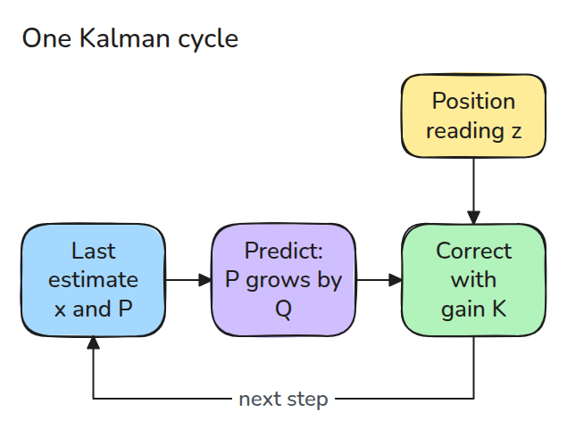
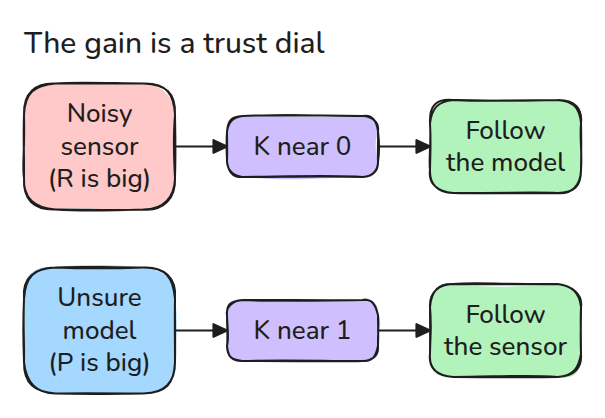
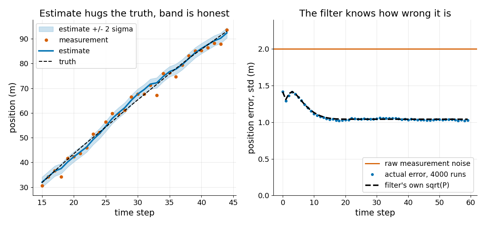

# Kalman Filter

> Learn how to blend a noisy sensor with a motion prediction into a steadier estimate.

**Type:** Build   **Prerequisites:** 07/01 Bayes Filter   **Time:** ~15 minutes

## In Plain Words

A car's position sensor is off by a couple of metres. You also roughly know its speed, so you can predict where it goes next. If the sensor is very noisy, move your estimate only a little toward its report. If your prediction is shakier, move more.

## Key Terms

- **State (`x`)**: the numbers the filter tracks, here position and velocity.
- **Covariance (`P`)**: how unsure the estimate is. For one number it is the variance, the spread squared.
- **Kalman gain (`K`)**: how far the estimate moves toward a new reading, from 0 (ignore it) to 1 (trust it fully).
- **Process noise (`Q`)**: doubt added each step because the real motion may differ from the model.
- **Measurement noise (`R`)**: the variance of the sensor's error.
- **Innovation**: the surprise `z - H x`, the reading minus what the model expected.

## The Problem

A robot's position sensor is off by about 2 m on every reading, so on a plot the robot jitters. Averaging removes the jitter but shows every turn late.

## The Concept

A robot needs a position it can trust more than any single sensor reading.



*Predict with the model, then correct with the reading.*

The state `x` is `[position, velocity]`, and 2 m of doubt is `P = 4`.

Predict: `x = F x` and `P = F P F^T + Q` (`F` is one step of motion).

A reading `z = H x + noise` sees only the position. Correct: `x = x + K (z - H x)`. The best `K = P H^T (H P H^T + R)^-1` leaves the least doubt, and `P` is updated in Joseph form.

For position alone, `K = P / (P + R)`. From 0 with `P = 4` and a reading of 3 m, `R = 4` gives `K = 0.5`: the estimate moves 1.5 m and `P` falls to 2. A sensor with 6 m of noise has `R = 36`, so `K = 4 / 40 = 0.1` and it moves only 0.3 m.


*Blue road: noisy sensor (6 m), the pin barely moves. Green road: it moves halfway.*



*Noisy sensor: small K. Shaky model: large K.*



*Left: estimate inside its 2-sigma band. Right: over 4000 runs the error settles near 1.0 m, not 2.0 m.*

## Build It

```python
def gain(P, H, R):
    return P @ H.T @ np.linalg.inv(H @ P @ H.T + R)

x, P = F @ x, F @ P @ F.T + Q        # predict
K = gain(P, H, R)
x = x + K @ (z[None, :] - H @ x)     # update
P = (np.eye(2) - K @ H) @ P
```

Tests check that any other `K` raises the Joseph trace, 4000 runs match `P`, and 95% of errors fall inside 2 sigma.

```bash
cd robotics-engineering-from-scratch
python3 -m pytest phases/07-state-estimation/02-kalman-filter -q
```

## Use It

ROS's `robot_localization` ships `ekf_localization_node`, an extended Kalman filter. SciPy's `solve_discrete_are` gives the settled `P`.

Sources: robot_localization state estimation nodes, https://docs.ros.org/en/melodic/api/robot_localization/html/state_estimation_nodes.html (2026-11-09).

## Ship It

`outputs/skill-kalman-filter-check.md` reviews a filter for mistakes in `Q`, `R` and `P`.

## Exercises

1. Double `R_STD` and predict the settled `sqrt(P)`.
2. Make `R` ten times too small and check 2-sigma coverage.
3. Set `SA` to 0 and watch `K` shrink.
