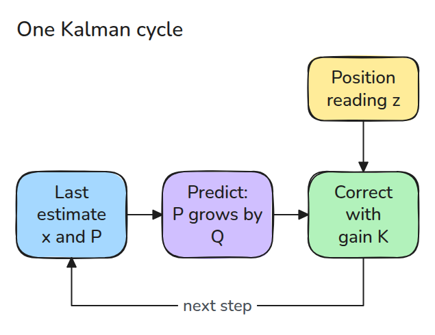
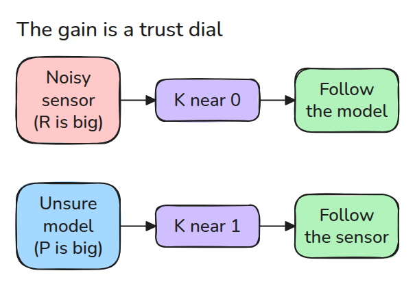
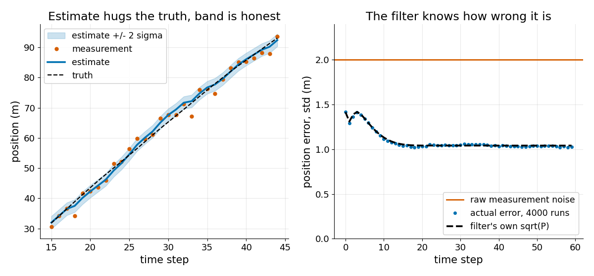

# Kalman Filter

> When a model and a noisy sensor disagree, the Kalman gain decides how far to move toward the sensor, and it also tells you how wrong the result still is.

**Type:** Build   **Prerequisites:** 07/01 Bayes Filter   **Time:** ~15 minutes

## In Plain Words

A toy car drives along a road while a position sensor reports where it is, but each report is off by a couple of metres. You also know roughly how fast the car goes, so you can predict its next position. If the sensor is very noisy, move your estimate only a little toward its report. If your prediction is shakier, move more.

The Kalman gain is that balance. It also tracks how unsure the estimate is, its covariance.

## The Problem

A position sensor is off by about 2 m on every reading. Plotted raw, the robot looks jittery. Averaging recent readings removes the jitter but lags every turn.

## The Concept



*Predict with the motion model, then correct with the reading. The result feeds the next cycle.*

The state `x` is `[position, velocity]`. `P` is its variance, the spread squared, so 2 m of doubt is `P = 4`.

Predict: `x = F x` and `P = F P F^T + Q`. `F` moves the state one step (position + velocity * time) and `Q` adds doubt, because the real speed may change a little.

A reading `z = H x + noise` sees only the position (`H` picks it out), with noise variance `R`. Correct: `x = x + K (z - H x)`, so the estimate moves by `K` times the surprise `z - H x`. The best `K = P H^T (H P H^T + R)^-1` leaves the least doubt, with `P = (I - K H) P (I - K H)^T + K R K^T` (Joseph form).

For the position alone, `K = P / (P + R)`. Start at 0 with `P = 4` and a reading of 3 m. With `R = 4` the gain is `K = 4 / (4 + 4) = 0.5`, so the estimate moves 1.5 m and `P` falls to 2. A sensor with 6 m of noise has `R = 36`, so `K = 4 / 40 = 0.1` and it moves only 0.3 m.


*Watch the pin slide to the amber reading. Blue road: noisy sensor (6 m), the pin barely moves. Green road: it moves halfway and the plus or minus 2 sigma strip (`sigma = sqrt(P)`, spread in metres) shrinks more.*



*A noisy sensor makes K small, so the filter follows its model. A shaky model makes K large, so it follows the sensor.*



*Left: one run, estimate inside its 2-sigma band. Right: over 4000 runs the error settles near 1.0 m, half the raw 2.0 m, matching `sqrt(P)`.*

## Build It

```python
def gain(P, H, R):
    return P @ H.T @ np.linalg.inv(H @ P @ H.T + R)

x, P = F @ x, F @ P @ F.T + Q        # predict
K = gain(P, H, R)
x = x + K @ (z[None, :] - H @ x)     # update
P = (np.eye(2) - K @ H) @ P
```

Tests check that any other `K` raises the Joseph trace, that 4000 runs match `P`, and that 95% of errors fall inside 2 sigma.

```bash
cd robotics-engineering-from-scratch
python3 -m pytest phases/07-state-estimation/02-kalman-filter -q
```

## Use It

ROS's `robot_localization` ships `ekf_localization_node`, an extended Kalman filter. SciPy's `solve_discrete_are` gives the settled `P`.

Sources: robot_localization state estimation nodes, https://docs.ros.org/en/melodic/api/robot_localization/html/state_estimation_nodes.html (opened 2026-11-09).

## Ship It

`outputs/skill-kalman-filter-check.md` reviews a filter for silent mistakes in `Q`, `R` and `P`.

## Exercises

1. Double `R_STD` and predict whether the settled `sqrt(P)` rises or falls.
2. Make `R` ten times too small and compare 2-sigma coverage with 95%.
3. Set `SA` to 0 and watch `K` shrink until the filter ignores the sensor.
