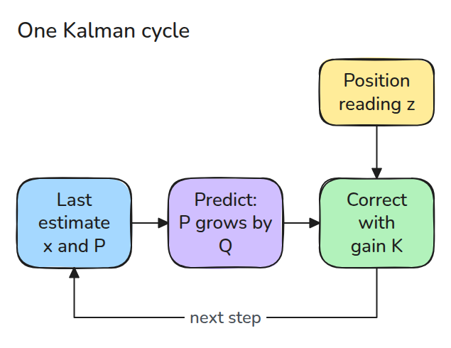
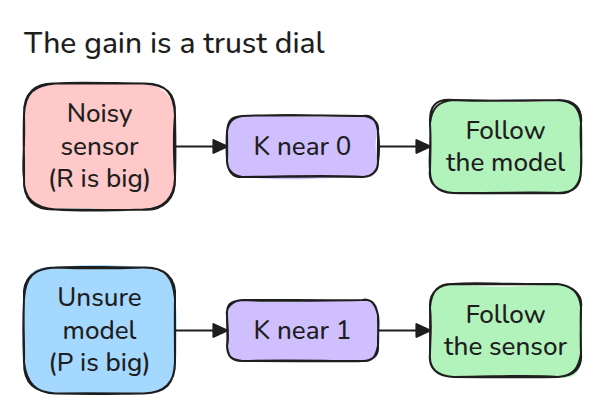
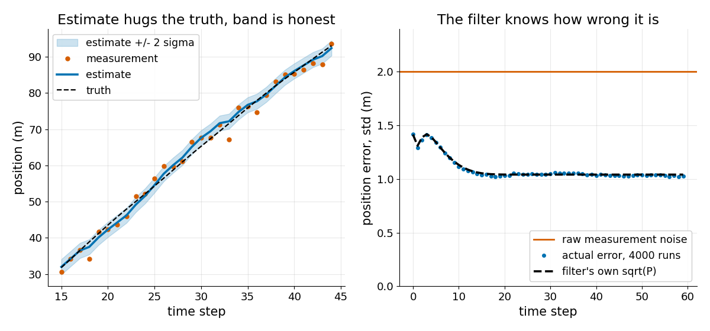

# Kalman Filter

> 모델과 잡음 낀 센서가 어긋날 때 Kalman gain이 센서 쪽으로 얼마나 움직일지를 정하고 결과가 아직 얼마나 틀렸는지도 알려 줍니다.

**유형:** 만들기   **선수 지식:** 07/01 Bayes Filter   **시간:** 약 15분

## 쉽게 말하면

스케이트장에서 친구의 지난 위치와 속도로 지금 위치를 짐작해요. 친구가 외쳐 주는 위치에도 오차가 있어요. 그 말이 평소 부정확하면 추정값을 조금만 고치고 움직임 예측이 불확실하면 더 크게 고쳐요.

Kalman gain은 이 비중을 정해요. filter는 추정한 위치와 속도를 고치고 covariance로 남은 불확실성을 나타내요. 보정해도 실제 위치를 정확히 안다는 뜻은 아니에요. 여러 번
실험했을 때의 실제 오차가 이 불확실성과 맞는지 확인해야 해요.

## 문제

위치 센서가 읽을 때마다 2 m쯤 틀립니다. 원본 출력을 그리면 로봇이 떠는 것처럼 보이고 그 값을 미분해 속도를 구하면 떨림이 더 커집니다. 최근 몇 개를 평균하면 떨림은 사라지지만 방향을 바꿀 때마다 뒤처집니다.

## 개념



*모션 모델로 predict하고 센서값으로 correct합니다. 보정된 추정값이 다음 사이클로 들어갑니다.*

상태는 `x = [position, velocity]`이고 속도는 작은 무작위 가속도로 변합니다. predict는 `x = F x`, `P = F P F^T + Q`입니다.

센서값 `z = H x + noise`의 분산은 `R`입니다. 보정은 `x = x + K (z - H x)`이고 그 오차 공분산을 Joseph 형태로 쓰면 `P = (I - K H) P (I - K H)^T + K R K^T`입니다.

이 식의 trace를 `K`로 미분해 0으로 놓으면 `K = P H^T (H P H^T + R)^-1`이 나옵니다.



*센서 잡음이 크면 K가 작아져 모델을 따릅니다. 모델이 불확실하면 K가 커져 센서를 따릅니다.*



*왼쪽은 한 번의 실행이고 추정값이 2-sigma 띠 안에 있습니다. 오른쪽은 4000번 실행했을 때 실제 오차가 원본 2.0 m의 절반인 1.0 m 근처로 가라앉고 filter 자신의 `sqrt(P)` 위에 놓이는 모습입니다.*

## 만들기

```python
def gain(P, H, R):
    return P @ H.T @ np.linalg.inv(H @ P @ H.T + R)

x, P = F @ x, F @ P @ F.T + Q        # predict
K = gain(P, H, R)
x = x + K @ (z[None, :] - H @ x)     # update
P = (np.eye(2) - K @ H) @ P
```

테스트는 세 가지를 확인합니다. `K`를 조금 바꾸면 Joseph trace가 커지는지, 4000번 실행한 오차 공분산이 `P`와 같은지, 오차의 약 95%가 2 sigma 안에 드는지입니다.

```bash
cd robotics-engineering-from-scratch
python3 -m pytest phases/07-state-estimation/02-kalman-filter -q
```

## 실제 도구로 보기

ROS의 `robot_localization`에는 `ekf_localization_node`가 들어 있습니다. 모션 모델로 상태를 앞으로 보내고 센서 데이터로 보정하는 extended Kalman filter입니다.

SciPy의 `solve_discrete_are`는 steady-state P를 주고 마지막 테스트가 이 값을 위의 루프와 비교합니다.

출처: robot_localization state estimation nodes, https://docs.ros.org/en/melodic/api/robot_localization/html/state_estimation_nodes.html (2026년 11월 9일 확인).

## 결과물

`outputs/skill-kalman-filter-check.md`는 filter에서 `Q`, `R`, `P`를 잘못 잡아 조용히 틀어지는 흔한 실수를 검토합니다.

## 연습 문제

1. `R_STD`를 두 배로 올리고 실행하기 전에 steady-state sqrt(P)가 오를지 내릴지 예측하세요.
2. `R`을 열 배 작게 넣고 2-sigma 안에 드는 비율을 95%와 비교하세요.
3. `SA`를 0으로 두고 `K`가 0으로 줄어 filter가 센서를 무시하게 되는 것을 보세요.
