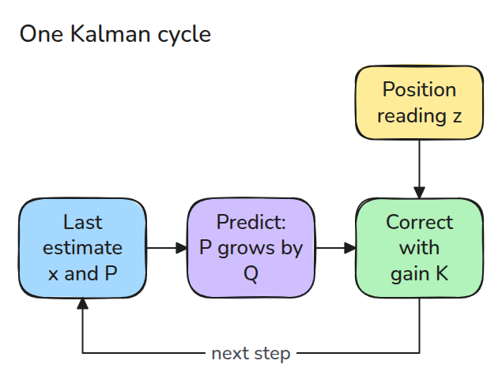
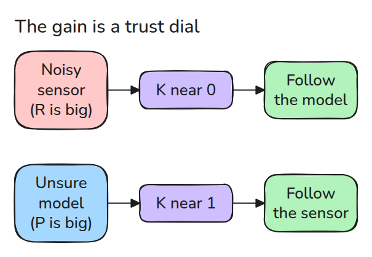
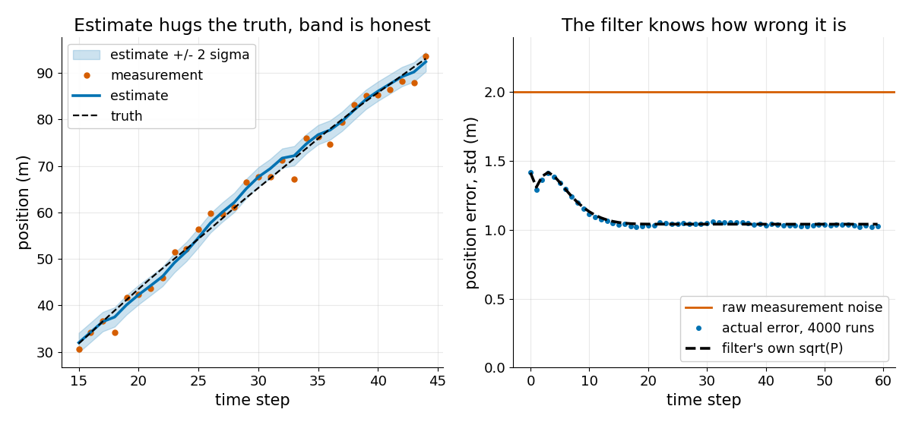

# Kalman Filter

> 잡음 낀 센서와 움직임 예측을 섞어 더 안정적인 추정값을 만드는 법을 배웁니다.

**유형:** 만들기   **선수 지식:** 07/01 Bayes Filter   **시간:** 약 15분

## 쉽게 말하면

자동차의 위치 센서는 보고할 때마다 몇 미터씩 틀려요. 자동차의 속도도 대충 알아요.

센서가 아주 들쭉날쭉하면(시끄러우면) 추정을 센서 쪽으로 조금만 옮기고 예측이 더 불안하면 많이 옮겨요.

## 핵심 용어

- **State (`x`)**: 필터가 추적하는 숫자들입니다. 여기서는 위치와 속도입니다.
- **Covariance (`P`)**: 추정이 얼마나 불확실한지입니다. 숫자 하나라면 퍼짐을 제곱한 값입니다.
- **Kalman gain (`K`)**: 새 센서 값 쪽으로 추정이 얼마나 움직일지입니다. 0이면 무시하고 1이면 전부 믿습니다.
- **Process noise (`Q`)**: 실제 움직임이 필터가 예측에 쓰는 규칙과 다를 수 있어서 한 단계마다 더하는 불확실성입니다.
- **Measurement noise (`R`)**: 센서가 얼마나 들쭉날쭉한지로, 센서 오차의 퍼짐을 제곱한 값입니다.
- **Innovation**: 놀라움입니다. 센서 값에서 필터가 기대한 값을 뺀 것입니다.

## 문제

로봇의 위치 센서는 읽을 때마다 약 2 m 틀려서 그래프에서 로봇이 떨립니다. 평균을 내면 떨림은 사라지지만 모든 회전이 늦게 나타납니다.

## 개념

로봇에게는 센서 값 하나보다 더 믿을 수 있는 위치가 필요합니다.



*모델로 predict하고 센서 값으로 correct합니다.*

Kalman filter는 가장 좋은 추측과 그것이 얼마나 불확실한지를 함께 지닙니다. 한 주기마다 모델(로봇이 어떻게 움직이는지의 규칙)로 로봇이 어디 있어야 하는지 예측하며 불확실성을 더합니다. 그다음 추측을 센서 값 쪽으로 gain만큼 옮깁니다.
아주 시끄러운 센서는 gain이 작아서 필터가 대부분 모델을 따릅니다.
모델이 불안하면 gain이 커서 센서를 따릅니다. 보정할 때마다 필터는 덜 불확실해집니다.


*파란 도로는 시끄러운 센서여서 추정(핀)이 거의 움직이지 않습니다. 초록 도로는 핀이 절반쯤 움직입니다.*



*센서가 시끄러우면 gain이 작고 모델이 불안하면 gain이 큽니다.*



*왼쪽은 추정이 불확실성 띠 안에 머무는 모습입니다. 오른쪽은 여러 번 실행에서 오차가 원래 오차의 절반 근처에 자리 잡는 모습입니다.*

<details><summary>The math (optional)</summary>

state `x`는 `[position, velocity]`이고 2 m의 불확실성은 `P = 4`입니다. Predict: `x = F x`, `P = F P F^T + Q`(`F`는 한 스텝의 움직임)입니다. 센서 값 `z = H x + noise`는 위치만 봅니다.
Correct: `x = x + K (z - H x)`이고 가장 좋은 `K = P H^T (H P H^T + R)^-1`이며 `P`는 Joseph 형태로 갱신합니다. 위치만 보면 `K = P / (P + R)`입니다.
0에서 시작해 `P = 4`이고 센서 값이 3 m일 때 `R = 4`이면 `K = 0.5`여서 추정은 1.5 m 움직이고 `P`는 2로 떨어집니다. 잡음이 6 m인 센서는 `R = 36`이므로 `K = 4 / 40 = 0.1`이고 0.3 m만 움직입니다.
4000번 실행에서 오차는 2.0 m가 아니라 1.0 m 근처에 자리 잡고 오차의 95%가 2 sigma 안에 듭니다.

</details>

## 만들기

```python
def gain(P, H, R):
    return P @ H.T @ np.linalg.inv(H @ P @ H.T + R)

x, P = F @ x, F @ P @ F.T + Q        # predict
K = gain(P, H, R)
x = x + K @ (z[None, :] - H @ x)     # update
P = (np.eye(2) - K @ H) @ P
```

테스트는 다른 gain이 불확실성을 더 적게 남기지 못하는지, 오차의 95%가 필터 자신이 주장한 불확실성 띠 안에 드는지 확인합니다.

```bash
cd robotics-engineering-from-scratch
python3 -m pytest phases/07-state-estimation/02-kalman-filter -q
```

## 실제 도구로 보기

로봇 소프트웨어 패키지 `robot_localization`은 확장 Kalman filter인 `ekf_localization_node`를 제공합니다.

출처: robot_localization state estimation nodes, https://docs.ros.org/en/melodic/api/robot_localization/html/state_estimation_nodes.html (2026년 11월 9일 확인).

## 결과물

`outputs/skill-kalman-filter-check.md`는 `Q`, `R`, `P`의 실수를 점검합니다.

## 연습 문제

1. 센서 잡음을 두 배로 하고 자리 잡은 불확실성이 오를지 내릴지 예측하세요.
2. 필터가 센서를 실제보다 열 배 좋다고 믿게 해 보세요.
3. 움직임 잡음을 0으로 두고 gain이 줄어드는 것을 보세요.
