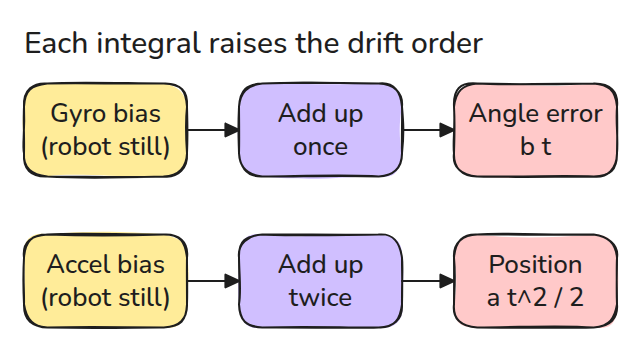
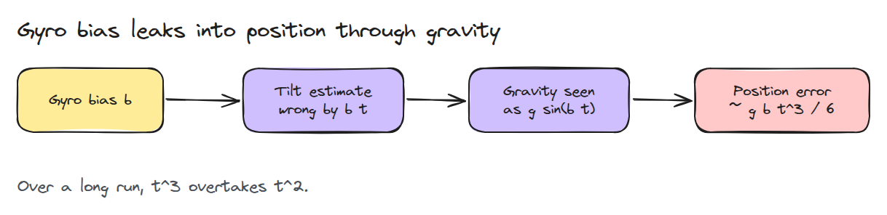
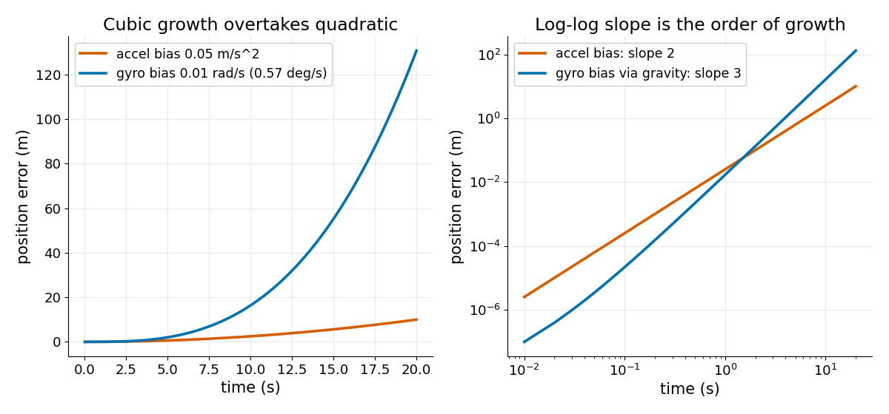

# IMU Integration and Drift

> Learn why a robot that adds up tiny sensor errors thinks it is rolling away while standing still.

**Type:** Build   **Prerequisites:** 07/02 Kalman Filter   **Time:** ~15 minutes

## In Plain Words

A robot sits still, but its gyro reads a tiny turn that is not there. Adding them up, it thinks it is tilting. It subtracts gravity with the wrong tilt, leaving a fake sideways push. Adding that up twice, it thinks it is rolling away.

## Key Terms

- **IMU**: a motion sensor made of a gyro and an accelerometer.
- **Accelerometer**: measures push (acceleration), and also feels gravity.
- **Bias**: a small steady error that is always there.
- **Integrate**: add readings up over time, turning turn speed into angle or acceleration into speed.
- **Drift**: the slowly growing error that integrating a biased reading produces.
- **Gyro**: a sensor that measures how fast something turns.

## The Problem

A robot stands still, yet its estimate says it turned and drifted away. Its sensors have tiny steady errors, and the robot adds them up as if they were real.

## The Concept

A robot that navigates by its IMU alone slowly goes blind, and gravity makes it worse.



*Each time you add readings up, the error grows faster.*

A tiny steady gyro error, added up once, gives an angle error that grows in a straight line. An accelerometer's error is added up twice, so the position error bends upward.


*Fifteen noisy runs follow the predicted growth.*



*A tilt error makes the robot subtract gravity wrongly; the leftover looks like acceleration.*

A wrong tilt makes the robot subtract gravity the wrong way, so a bit of gravity is left over and looks like a real push. Adding that up twice makes the position error grow even faster than the accelerometer's own.



*The gyro's fast curve passes the accelerometer's slower one.*


*The green robot stays put while the amber copy slides. The tilt is exaggerated.*

<details><summary>The math (optional)</summary>

A gyro bias `b` gives an angle error `b t`. An accelerometer bias `a` gives a velocity error `a t` and a position error `a t^2 / 2`. The tilt error `b t` leaves a fake `g sin(b t)`, about `g b t`, and adding that up twice gives `g b t^3 / 6`. With `b = 0.01 rad/s` and `a = 0.05 m/s^2`, after 20 s the robot has turned 11 degrees and moved 10 m. After 10 s the tilt is off by `0.1 rad` and the fake push is `9.81 * sin(0.1) = 0.98 m/s^2`. Position error: about `9.81 * 0.01 * 10^3 / 6 = 16 m`, against `0.05 * 10^2 / 2 = 2.5 m` from the accelerometer bias. The cubic passes the quadratic after about 1.5 s. The clip draws tilt 5 times larger and 1 m as 0.1 m.

</details>

## Build It

```python
meas = omega_true + bias + sigma * rng.standard_normal((n, runs))
angle = np.cumsum(meas, axis=0) * dt

fake_a = G * np.sin(bias_g * t)          # tilt error b*t leaks gravity
pos = np.cumsum(np.cumsum(fake_a) * dt) * dt
```

Tests compare the sums with the exact discrete formulas and the three derived ones.

```bash
cd robotics-engineering-from-scratch
python3 -m pytest phases/07-state-estimation/03-imu-integration-and-drift -q
```

## Use It

`imu_filter_madgwick` in `imu_tools` fuses gyro and accelerometer readings.

Sources: imu_tools README, https://github.com/CCNYRoboticsLab/imu_tools (2026-11-09).

## Ship It

`outputs/skill-imu-drift-check.md` estimates how long an IMU-only estimate stays usable.

## Exercises

1. Change the gyro bias and see how fast the angle error grows.
2. Double the time step and check the 10 s angle error.
3. Freeze the tilt at its 5 s value and watch the position error.
