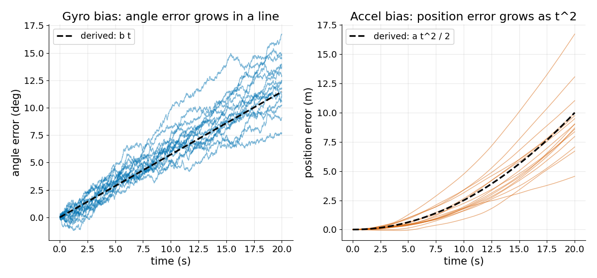

# IMU Integration and Drift

> Learn why a robot that adds up tiny sensor errors thinks it is rolling away while standing still.

**Type:** Build   **Prerequisites:** 07/02 Kalman Filter   **Time:** ~15 minutes

## In Plain Words

A robot sits still, but its gyro reads a tiny turn that is not there. Adding them up, it thinks it is tilting. It subtracts gravity with the wrong tilt, leaving a fake sideways push. Adding that up twice, it thinks it is rolling away.

## Key Terms

- **IMU**: a motion sensor made of a gyro and an accelerometer.
- **Accelerometer**: measures push (acceleration), and also feels gravity.
- **Bias**: a small steady error that is always there.
- **Integrate**: add readings up over time, turning turn speed into angle or acceleration into speed.
- **Drift**: the slowly growing error that integrating a biased reading produces.
- **Gyro**: a sensor that measures how fast something turns.

## The Problem

A robot stands still, yet after 20 seconds its estimate says it turned 11 degrees and moved 10 m. Its IMU has a gyro bias of 0.01 rad/s and an accelerometer bias of 0.05 m/s^2.

## The Concept

A robot that navigates by its IMU alone slowly goes blind, and gravity makes it worse.


*A gyro is added up once, an accelerometer twice, each adding a power of `t`.*

A constant gyro bias `b` gives an angle error of `b t`. A constant accelerometer bias `a` gives a velocity error `a t` and a position error `a t^2 / 2`.



*Fifteen noisy runs follow `b t` and `a t^2 / 2`.*


*A tilt error makes the robot subtract gravity wrongly; the leftover looks like acceleration.*


*The cubic (gyro bias) passes the quadratic (accelerometer bias) after about 1.5 s.*

A gyro bias `b` tilts the estimate by `b t`, so gravity leaves a fake `g sin(b t)`, about `g b t`. Adding that up twice gives `g b t^3 / 6`. With `b = 0.01 rad/s`, after 10 s the tilt is off by `0.1 rad` and the fake push is `9.81 * sin(0.1) = 0.98 m/s^2`. Position error: about `9.81 * 0.01 * 10^3 / 6 = 16 m`, against `0.05 * 10^2 / 2 = 2.5 m` from the accelerometer bias.


*The green robot stays put while the amber copy slides. Tilt drawn 5 times larger, 1 m as 0.1 m.*

## Build It

```python
meas = omega_true + bias + sigma * rng.standard_normal((n, runs))
angle = np.cumsum(meas, axis=0) * dt

fake_a = G * np.sin(bias_g * t)          # tilt error b*t leaks gravity
pos = np.cumsum(np.cumsum(fake_a) * dt) * dt
```

Tests compare the sums with the exact discrete formulas and the three derived ones.

```bash
cd robotics-engineering-from-scratch
python3 -m pytest phases/07-state-estimation/03-imu-integration-and-drift -q
```

## Use It

`imu_filter_madgwick` in `imu_tools` fuses gyro and accelerometer readings. Feed it a still recording and check the angle stops drifting.

Sources: imu_tools README, https://github.com/CCNYRoboticsLab/imu_tools (2026-11-09).

## Ship It

`outputs/skill-imu-drift-check.md` estimates how long an IMU-only estimate stays usable.

## Exercises

1. Find when the angle error reaches 1 degree at `b = 0.01 rad/s`.
2. Double `dt`.
3. Freeze tilt at its 5 s value and find the position error.
