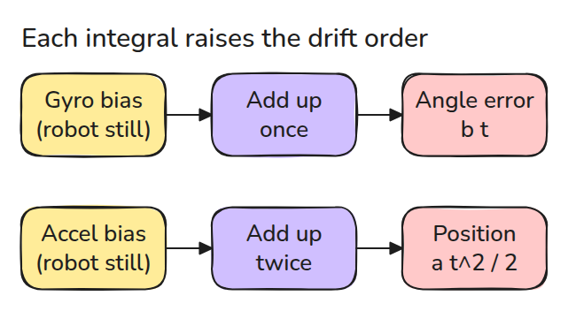
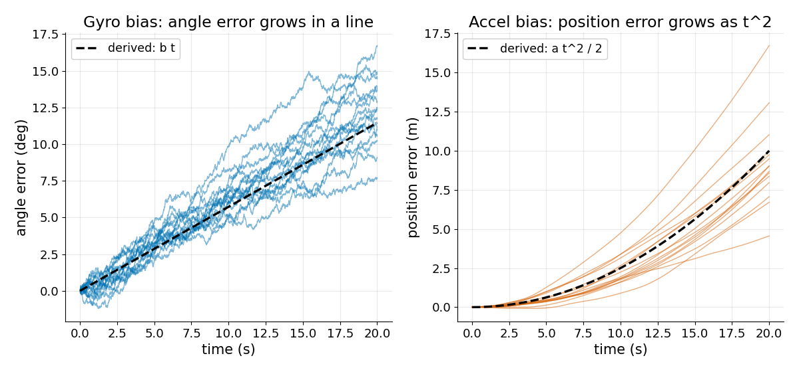
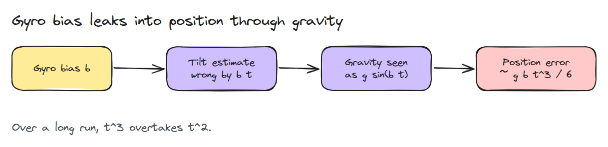
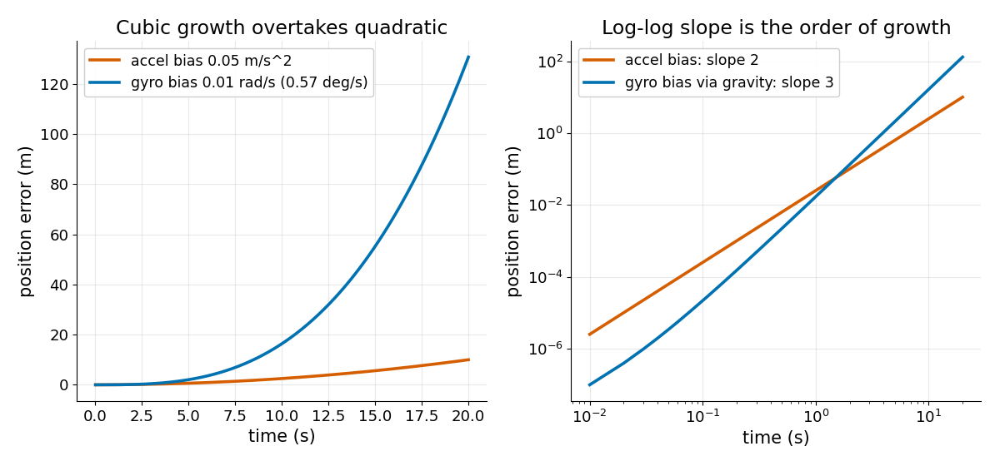

# IMU Integration and Drift

> Integrating a sensor that has a tiny constant error turns that error into a line, a parabola or a cubic, and gravity is the channel that makes it cubic.

**Type:** Build   **Prerequisites:** 07/02 Kalman Filter   **Time:** ~15 minutes

## In Plain Words

Leave a phone still on a desk. A gyro that reports a tiny constant turn makes the estimated tilt keep growing
when its readings are added over time. The phone itself has not tilted.

That wrong tilt makes gravity subtraction leave a false horizontal acceleration. Adding it into velocity and
then position produces roughly cubic position drift while the tilt error is small. A constant accelerometer
bias alone produces quadratic position drift instead. Integrating small sensor errors repeatedly can create
large apparent motion.

## The Problem

A robot sits still on a bench with an IMU that reads close to zero turn rate and zero acceleration. You integrate both for 20 seconds and the robot has apparently turned 11 degrees and walked 10 meters. Nothing moved: a constant error of a few hundredths, integrated, kept growing.

## The Concept



*A gyro is integrated once to get an angle. An accelerometer is integrated twice to get a position. Each integral adds one power of `t` to a constant error.*

With a constant gyro bias `b`, the angle error is `b t`. With a constant accelerometer bias `a`, the velocity error is `a t` and the position error is `a t^2 / 2`. White noise adds a random walk on top: its standard deviation after time `t` is `sigma * sqrt(dt * t)`.



*Fifteen noisy runs wander around the derived lines: `b t` for the angle, `a t^2 / 2` for the position.*



*A tilt error makes the robot subtract gravity in the wrong direction. The leftover looks like a real acceleration.*



*Both biases are example values. The gyro bias goes through the tilt error `b t`, so the fake acceleration is `g sin(b t)` and the position error is about `g b t^3 / 6`.*

## Build It

```python
meas = omega_true + bias + sigma * rng.standard_normal((n, runs))
angle = np.cumsum(meas, axis=0) * dt

fake_a = G * np.sin(bias_g * t)          # tilt error b*t leaks gravity
pos = np.cumsum(np.cumsum(fake_a) * dt) * dt
```

Tests compare the sums with the exact discrete formulas and the derived `b t`, `a t^2 / 2` and `g b t^3 / 6`. A 1 degree tilt error fakes `g sin(1 deg) = 0.171 m/s^2`, which is 8.6 m after 10 s.

```bash
cd robotics-engineering-from-scratch
python3 -m pytest phases/07-state-estimation/03-imu-integration-and-drift -q
```

## Use It

`imu_filter_madgwick` in `imu_tools` fuses angular velocity, acceleration and optionally magnetic readings into an orientation, so the gyro drift here is what it has to correct. Feed it a stationary recording and check that the angle stops drifting.

Sources: imu_tools README, https://github.com/CCNYRoboticsLab/imu_tools (opened 2026-11-09).

## Ship It

`outputs/skill-imu-drift-check.md` estimates how long an IMU-only estimate stays usable.

## Exercises

1. Find the time when an angle error of 1 degree appears for `b = 0.01 rad/s`.
2. Double `dt` and show that the angle error at 10 s does not change.
3. Write the position error when the gyro bias is `b` and the tilt error is held at its 5 s value.
