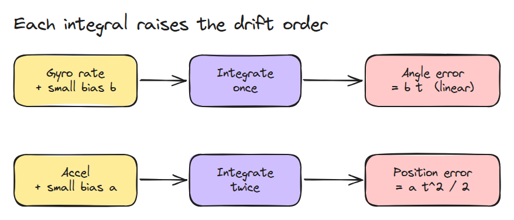
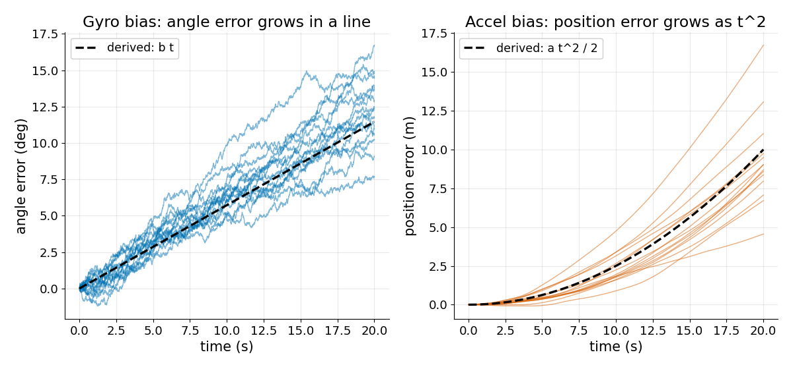
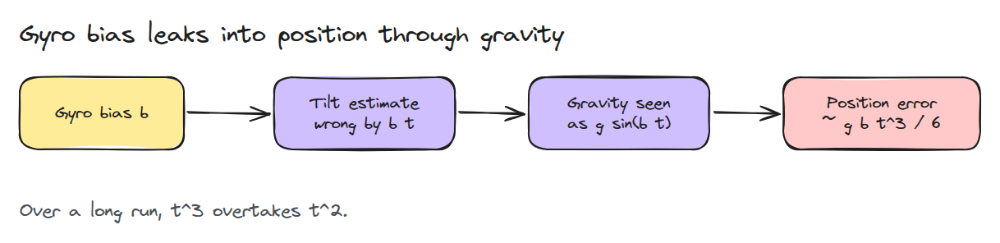
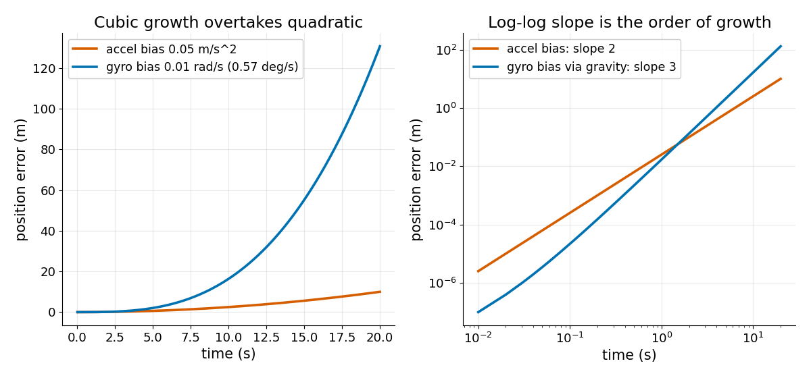

# IMU 적분과 Drift

> 아주 작은 상수 오차가 있는 센서를 적분하면 그 오차가 직선, 포물선, 3차 곡선으로 자랍니다. 3차로 만드는 통로가 중력입니다.

**유형:** 만들기   **선수 지식:** 07/02 Kalman Filter   **시간:** 약 15분

## 문제

로봇이 책상 위에 가만히 있고 IMU는 각속도와 가속도를 거의 0으로 읽습니다. 20초 동안 둘 다 적분하면 로봇이 11도 돌고 10 m 걸어간 것으로 나옵니다. 아무것도 움직이지 않았습니다. 백분의 몇 정도의 상수 오차를 적분했더니 계속 자란 것입니다.

## 개념



*gyro는 한 번 적분해 각도를 얻고 가속도계는 두 번 적분해 위치를 얻습니다. 적분이 한 번 늘 때마다 상수 오차에 `t`가 한 제곱씩 붙습니다.*

gyro bias가 상수 `b`이면 각도 오차는 `b t`입니다. 가속도계 bias가 상수 `a`이면 속도 오차는 `a t`이고 위치 오차는 `a t^2 / 2`입니다.

백색 잡음은 그 위에 random walk를 더하고 시간 `t` 뒤 표준편차는 `sigma * sqrt(dt * t)`입니다.



*잡음이 낀 15번의 실행이 유도한 직선 `b t`(각도)와 곡선 `a t^2 / 2`(위치) 주위에서 흔들립니다.*



*기울기 오차가 있으면 로봇이 중력을 엉뚱한 방향으로 뺍니다. 남은 값이 실제 가속도처럼 보입니다.*



*두 bias 값은 예시입니다. gyro bias는 기울기 오차 `b t`를 거치므로 가짜 가속도는 `g sin(b t)`이고 위치 오차는 약 `g b t^3 / 6`입니다.*

## 만들기

```python
meas = omega_true + bias + sigma * rng.standard_normal((n, runs))
angle = np.cumsum(meas, axis=0) * dt

fake_a = G * np.sin(bias_g * t)          # tilt error b*t leaks gravity
pos = np.cumsum(np.cumsum(fake_a) * dt) * dt
```

테스트는 합을 정확한 이산 공식과 유도한 `b t`, `a t^2 / 2`, `g b t^3 / 6`에 비교합니다. 기울기 오차 1도는 `g sin(1 deg) = 0.171 m/s^2`의 가짜 가속도를 만들고 10초 뒤에는 8.6 m가 됩니다.

```bash
cd robotics-engineering-from-scratch
python3 -m pytest phases/07-state-estimation/03-imu-integration-and-drift -q
```

## 실제 도구로 보기

`imu_tools`의 `imu_filter_madgwick`는 각속도와 가속도, 선택적으로 자기장 값을 합쳐 orientation을 냅니다.

여기서 본 gyro drift가 그 filter가 바로잡아야 하는 오차입니다. 정지 상태 녹화를 넣고 각도가 더 이상 drift하지 않는지 확인해 보세요.

출처: imu_tools README, https://github.com/CCNYRoboticsLab/imu_tools (2026년 11월 9일 확인).

## 결과물

`outputs/skill-imu-drift-check.md`는 IMU만으로 낸 추정값이 얼마나 오래 쓸 만한지 계산합니다.

## 연습 문제

1. `b = 0.01 rad/s`일 때 각도 오차가 1도가 되는 시간을 구하세요.
2. `dt`를 두 배로 하고 10초 시점의 각도 오차가 변하지 않음을 보이세요.
3. gyro bias가 `b`이고 기울기 오차를 5초 시점 값에 고정했을 때의 위치 오차를 식으로 쓰세요.
