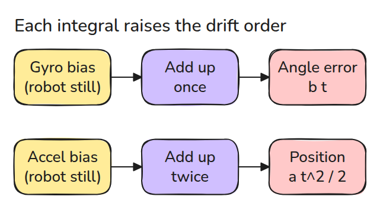
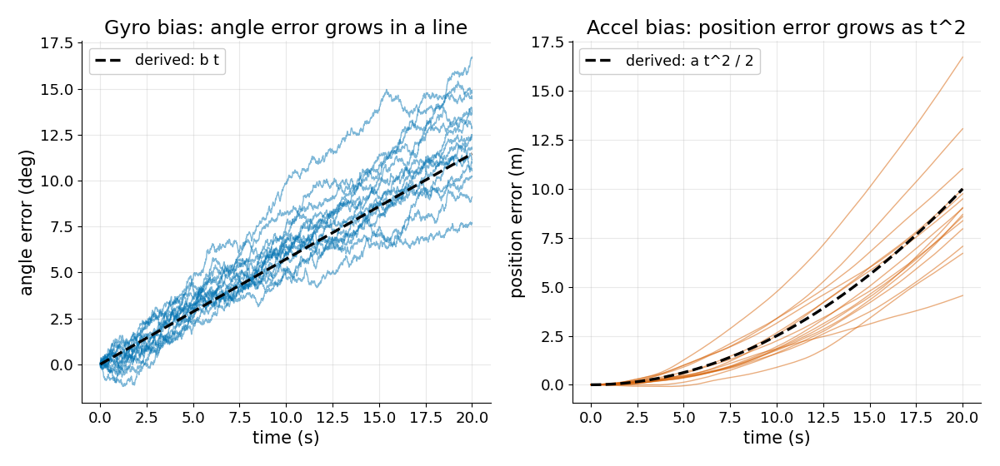
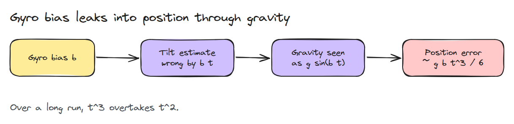
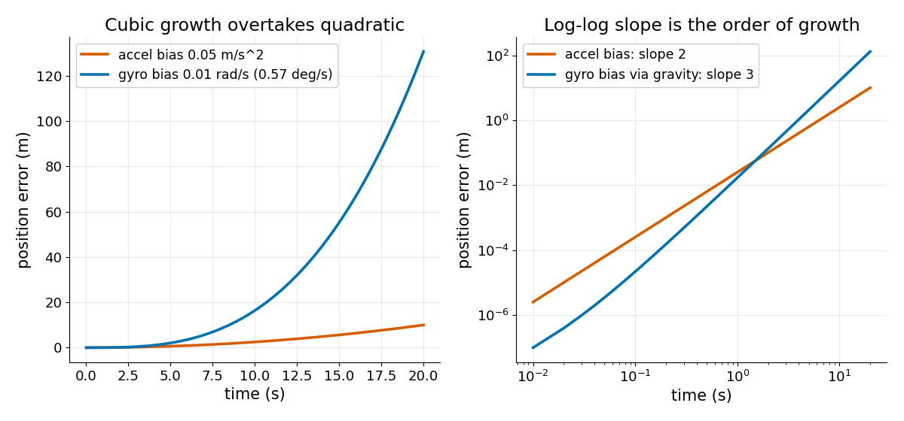

# IMU 적분과 Drift

> 작은 센서 오차를 계속 더하는 로봇이 가만히 서 있는데도 굴러간다고 믿는 이유를 배웁니다.

**유형:** 만들기   **선수 지식:** 07/02 Kalman Filter   **시간:** 약 15분

## 쉽게 말하면

로봇이 가만히 있는데 gyro가 있지도 않은 작은 회전을 읽어요. 그 값을 더해 가면 로봇은 자기가 기울고 있다고 생각해요.

잘못된 기울기로 중력을 빼면 가짜 옆으로 미는 힘이 남아요. 그것을 두 번 더하면 로봇은 자기가 굴러가고 있다고 생각해요.

## 핵심 용어

- **IMU**: gyro와 가속도계로 이루어진 움직임 센서입니다.
- **Accelerometer**: 미는 힘(가속도)을 재는 센서입니다. 중력도 느낍니다.
- **Bias**: 늘 붙어 있는 작고 일정한 오차입니다.
- **Integrate**: 읽은 값을 시간에 걸쳐 더하는 일입니다. 회전 속도는 각도로, 가속도는 속도로 바뀝니다.
- **Drift**: 편향된 값을 적분해서 서서히 커지는 오차입니다.
- **Gyro**: 얼마나 빨리 도는지를 재는 센서입니다.

## 문제

로봇이 가만히 서 있는데 추정값은 돌았고 멀어졌다고 말합니다. 센서에 작고 일정한 오차가 있고 로봇이 그것을 진짜인 것처럼 더하기 때문입니다.

## 개념

IMU만으로 길을 찾는 로봇은 서서히 눈이 멀고 중력이 그것을 더 나쁘게 만듭니다.



*읽은 값을 더할 때마다 오차는 더 빨리 자랍니다.*

작고 일정한 gyro 오차를 한 번 더하면 직선으로 자라는 각도 오차가 됩니다. 가속도계의 오차는 두 번 더해지므로 위치 오차는 위로 휩니다.



*잡음 있는 실행 열다섯 번이 예측한 증가를 따릅니다.*



*기울기 오차 때문에 로봇이 중력을 잘못 뺍니다. 남은 것이 가속도처럼 보입니다.*

기울기가 틀리면 로봇이 중력을 엉뚱한 방향으로 빼서 중력이 조금 남고 진짜 미는 힘처럼 보입니다. 그것을 두 번 더하면 위치 오차가 가속도계 자체의 오차보다 훨씬 빨리 자랍니다.



*gyro의 빠른 곡선이 accelerometer의 느린 곡선을 앞지릅니다.*


*초록 로봇은 가만히 있고 주황 복사본이 미끄러집니다. 기울기는 과장해서 그렸습니다.*

<details><summary>The math (optional)</summary>

gyro bias `b`는 각도 오차 `b t`를 줍니다. accelerometer bias `a`는 속도 오차 `a t`와 위치 오차 `a t^2 / 2`를 줍니다.
기울기 오차 `b t`는 가짜 `g sin(b t)`, 약 `g b t`를 남기고 그것을 두 번 더하면 `g b t^3 / 6`입니다. `b = 0.01 rad/s`, `a = 0.05 m/s^2`이면 20초 뒤 로봇은 11도 돌았고 10 m 움직인 것으로 나옵니다.
10초 뒤 기울기는 `0.1 rad` 틀리고 가짜 힘은 `9.81 * sin(0.1) = 0.98 m/s^2`입니다. 위치 오차는 약 `9.81 * 0.01 * 10^3 / 6 = 16 m`이고 accelerometer bias는 `0.05 * 10^2 / 2 = 2.5 m`입니다.
3차 곡선은 약 1.5초 뒤 2차 곡선을 앞지릅니다. 영상은 기울기를 5배, 1 m를 0.1 m로 그렸습니다.

</details>

## 만들기

```python
meas = omega_true + bias + sigma * rng.standard_normal((n, runs))
angle = np.cumsum(meas, axis=0) * dt

fake_a = G * np.sin(bias_g * t)          # tilt error b*t leaks gravity
pos = np.cumsum(np.cumsum(fake_a) * dt) * dt
```

테스트는 합을 정확한 이산 공식과 위의 세 공식에 견줍니다.

```bash
cd robotics-engineering-from-scratch
python3 -m pytest phases/07-state-estimation/03-imu-integration-and-drift -q
```

## 실제 도구로 보기

`imu_tools`의 `imu_filter_madgwick`은 gyro와 accelerometer 값을 합칩니다.

출처: imu_tools README, https://github.com/CCNYRoboticsLab/imu_tools (2026년 11월 9일 확인).

## 결과물

`outputs/skill-imu-drift-check.md`는 IMU만으로 낸 추정이 얼마나 오래 쓸 만한지 계산합니다.

## 연습 문제

1. gyro bias를 바꾸고 각도 오차가 얼마나 빨리 자라는지 보세요.
2. 시간 스텝을 두 배로 하고 10초 각도 오차를 확인하세요.
3. 기울기를 5초 값에 고정하고 위치 오차를 보세요.
