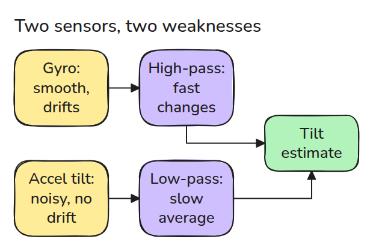
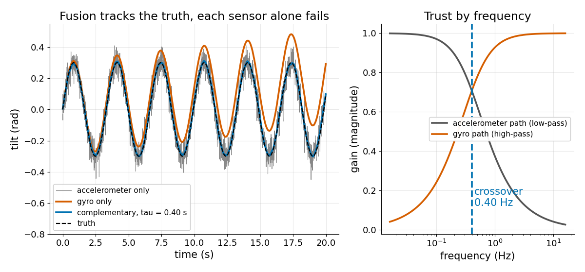
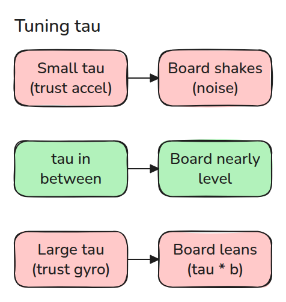
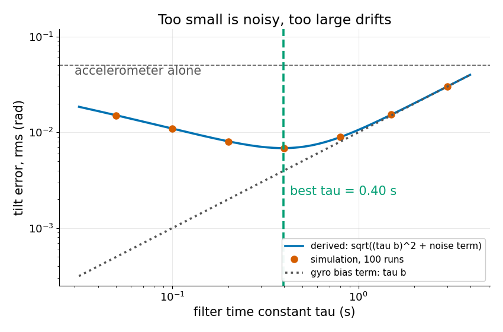

# Complementary Filter

> The gyro is right about fast changes and wrong about the long run, the accelerometer is the opposite, and one time constant decides who is believed when.

**Type:** Build   **Prerequisites:** 07/03 IMU Integration and Drift   **Time:** ~15 minutes

## In Plain Words

A flat board sits on a post with a sensor on top. The gyro measures turning speed, so adding its readings up follows quick tilts smoothly, but a small steady error makes the angle drift. The accelerometer feels gravity and gives the tilt directly, but jitters.

A complementary filter takes quick changes from the gyro and the slow average from the accelerometer. The time constant sets how long the gyro is trusted: longer means less jitter but more drift, shorter the opposite.

## The Problem

Tilt from the accelerometer alone jitters so much that a balancing controller shakes. The integrated gyro is smooth but creeps off, until the robot thinks it leans while standing straight.

## The Concept



*The gyro goes through a high-pass (keeps fast changes), the accelerometer through a low-pass (keeps the slow average); then they add.*

Each step, `theta = a (theta + gyro dt) + (1 - a) acc`, where `acc` is the tilt from the accelerometer. The weight is `a = tau / (tau + dt)`, with `tau` the time constant and `dt` the step.

As filters, the accelerometer path is `1 / (1 + j w tau)` and the gyro path `j w tau / (1 + j w tau)`, where `w` is the motion's frequency and `j` tracks timing. They add to exactly 1, so a true tilt passes unchanged. They cross at `1 / (2 pi tau)` Hz, where each has gain `1 / sqrt(2)` but a different timing.



*Left: at `tau = 0.40 s` the fused tilt sits on the truth. Right: the crossover is 0.40 Hz, a frequency, not `tau`. Below it the accelerometer is trusted, above it the gyro.*

The gyro is trusted for about `tau` seconds, so a constant bias `b` piles up to a steady error of exactly `tau b`. Accelerometer noise of spread `s` leaves variance `s^2 (1 - a) / (1 + a)`, about `s^2 dt / (2 tau)`. Minimising the two errors squared, `(tau b)^2 + s^2 dt / (2 tau)`, gives `tau^3 = s^2 dt / (4 b^2)`.



*A small `tau` lets accelerometer noise through. A large `tau` lets gyro bias through.*



*Example values `b = 0.01 rad/s`, `s = 0.05 rad`, `dt = 0.01 s`. Simulation matches the derived curve; its minimum is at 0.40 s.*

With those values, `tau = 2 s` leaves a bias error of `2 * 0.01 = 0.02 rad` and `tau = 0.05 s` a noise error of 0.015 rad. `tau = 0.40 s` leaves 0.004 and 0.0056, combining to `sqrt(0.004^2 + 0.0056^2) = 0.0068 rad`.


*Watch the level boards. Small `tau` (left): noise shakes the board. Large `tau` (right): a steady lean. The middle one stays closest to level. Errors drawn 10 times larger.*

## Build It

```python
def alpha(tau, dt):
    return tau / (tau + dt)

def complementary(gyro, acc, dt, tau, theta0=0.0):
    a, theta, out = alpha(tau, dt), np.full(gyro.shape[1], theta0, float), []
    for g, z in zip(gyro, acc):
        theta = a * (theta + g * dt) + (1 - a) * z
        out.append(theta)
    return np.array(out)
```

```bash
cd robotics-engineering-from-scratch
python3 -m pytest phases/07-state-estimation/04-complementary-filter -q
```

## Use It

`imu_complementary_filter` in `imu_tools` fuses gyro, accelerometer and optional magnetic readings into an orientation. Compare it with this `tau` trade-off.

Sources: imu_tools README, https://raw.githubusercontent.com/CCNYRoboticsLab/imu_tools/humble/README.md (opened 2026-11-09).

## Ship It

`outputs/skill-complementary-filter-check.md` checks the time constant against the measured bias and noise.

## Exercises

1. Compute the gyro-bias error for `tau = 5 s`, `b = 0.01 rad/s`.
2. Halve `s` and predict the new best `tau`.
3. If the accelerometer is noisy only during shaking, what should `tau` do?
