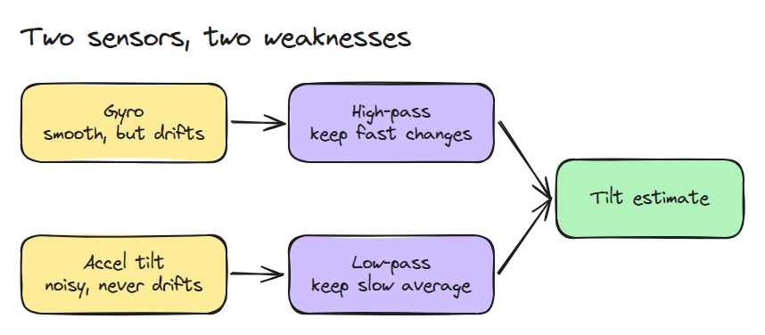
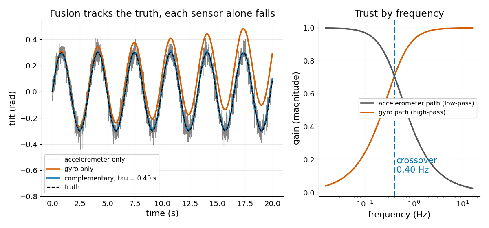
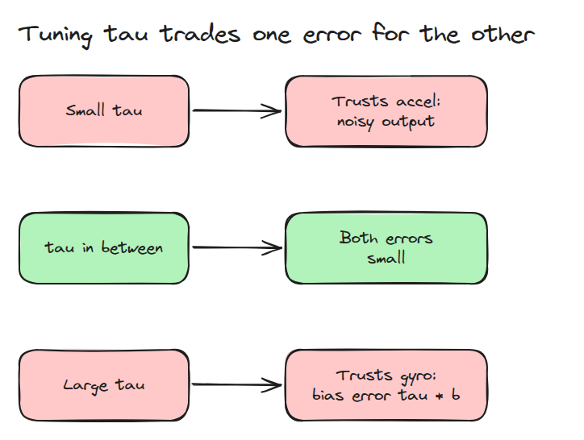
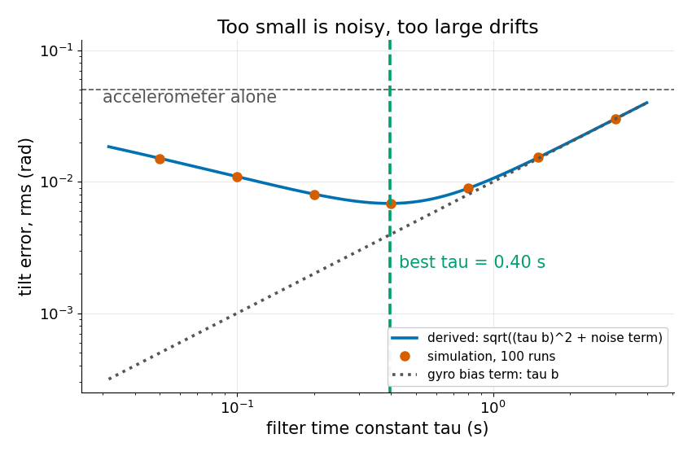

# Complementary Filter

> Learn how to combine a smooth-but-drifting sensor with a jittery-but-honest one to track tilt.

**Type:** Build   **Prerequisites:** 07/03 IMU Integration and Drift   **Time:** ~15 minutes

## In Plain Words

A flat board carries a tilt sensor. Adding up the gyro's readings follows quick tilts smoothly but drifts. The accelerometer gives the tilt from gravity but jitters. A complementary filter takes quick changes from the gyro and the slow average from the accelerometer.

## Key Terms

- **Gyro**: measures turning speed. Adding its readings up gives a smooth angle that drifts.
- **Accelerometer**: feels gravity, so it gives tilt directly, but jitters.
- **Time constant (`tau`)**: how long the gyro is trusted before the accelerometer takes over.
- **High-pass / low-pass**: a filter that keeps fast changes, or one that keeps the slow average.
- **Crossover**: the frequency (cycles per second, Hz) where both paths carry equal weight.
- **Bias**: a small steady sensor error.

## The Problem

A robot must balance upright. Tilt from its accelerometer alone jitters, so the controller shakes. The integrated gyro is smooth but creeps off until the robot thinks it leans while standing straight.

## The Concept

A balancing robot needs a tilt that is both smooth and honest over minutes.



*Fast changes come from the gyro, the slow average from the accelerometer.*

A complementary filter lets each sensor do what it is good at. The gyro is trusted for quick changes and the accelerometer for the long-run average. One setting, the time constant, decides how long the gyro is trusted before the accelerometer takes over.



*Left: the fused tilt sits on the truth. Right: the crossover separates where each sensor is trusted.*

A long time constant gives a smooth angle but lets gyro drift through. A short one removes the drift but lets accelerometer jitter through. Between them lies a best value.



*Small `tau` lets noise through, large `tau` lets bias through.*



*Simulation matches the predicted curve, which has a clear best value.*


*Left: noise shakes the board. Right: a steady lean. The middle one is closest to level. Errors are exaggerated.*

<details><summary>The math (optional)</summary>

Each step, `theta = a (theta + gyro dt) + (1 - a) acc`, where `acc` is the accelerometer's tilt and `a = tau / (tau + dt)`. The accelerometer path is a low-pass and the gyro path a high-pass. Their weights add to 1. They cross at `1 / (2 pi tau)` Hz. A constant gyro bias `b` piles up to an error of `tau b`. Accelerometer noise `s` leaves variance about `s^2 dt / (2 tau)`. Minimising `(tau b)^2 + s^2 dt / (2 tau)` gives `tau^3 = s^2 dt / (4 b^2)`. With `b = 0.01 rad/s`, `s = 0.05 rad`, `dt = 0.01 s`: `tau = 2 s` leaves a bias error of 0.02 rad, `tau = 0.05 s` a noise error of 0.015 rad, and `tau = 0.40 s` only 0.004 and 0.0056, together 0.0068 rad. The crossover is then 0.40 Hz. The clip draws errors 10 times larger.

</details>

## Build It

```python
def alpha(tau, dt):
    return tau / (tau + dt)

def complementary(gyro, acc, dt, tau, theta0=0.0):
    a, theta, out = alpha(tau, dt), np.full(gyro.shape[1], theta0, float), []
    for g, z in zip(gyro, acc):
        theta = a * (theta + g * dt) + (1 - a) * z
        out.append(theta)
    return np.array(out)
```

```bash
cd robotics-engineering-from-scratch
python3 -m pytest phases/07-state-estimation/04-complementary-filter -q
```

## Use It

`imu_complementary_filter` in `imu_tools` fuses gyro, accelerometer and optional magnetic readings.

Sources: imu_tools README, https://raw.githubusercontent.com/CCNYRoboticsLab/imu_tools/humble/README.md (2026-11-09).

## Ship It

`outputs/skill-complementary-filter-check.md` checks the time constant against the measured bias and noise.

## Exercises

1. Try a few time constants and pick the best by eye.
2. Halve the accelerometer noise and see where the best value moves.
3. What should the time constant do if the accelerometer is noisy only while shaking?
