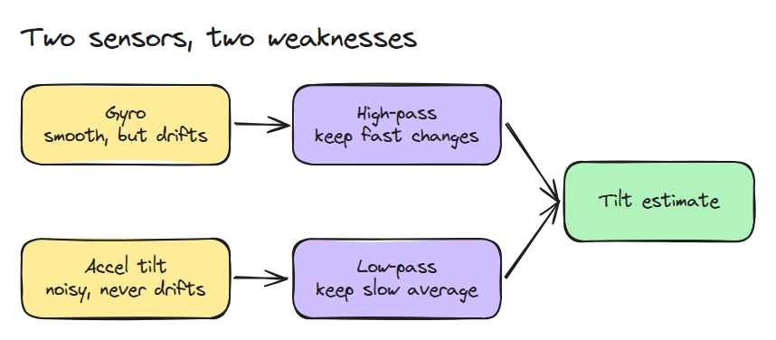
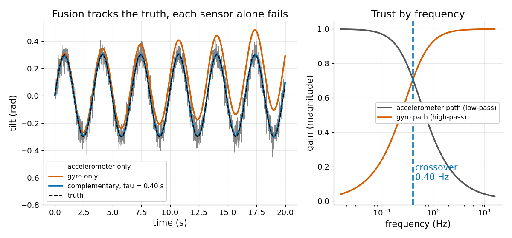
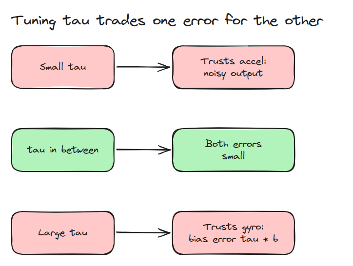
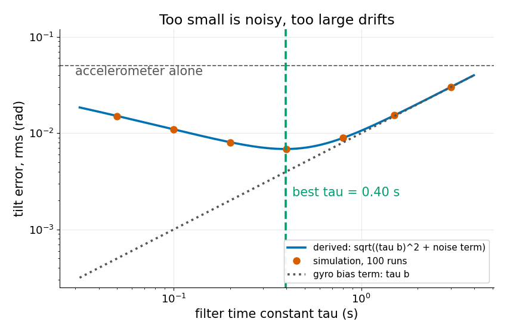

# 상보 필터 (Complementary Filter)

> 매끄럽지만 틀어지는 센서와 떨리지만 정직한 센서를 합쳐 기울기를 추적하는 법을 배웁니다.

**유형:** 만들기   **선수 지식:** 07/03 IMU 적분과 Drift   **시간:** 약 15분

## 쉽게 말하면

평평한 판에 기울기 센서가 붙어 있어요. gyro 값을 더해 가면 빠른 기울기는 매끄럽게 따라가지만 서서히 틀어져요. 가속도계는 중력으로 기울기를 바로 알려 주지만 떨려요.

complementary filter는 빠른 변화는 gyro에서 가져오고 느린 평균은 가속도계에서 가져와요.

## 핵심 용어

- **Gyro**: 회전 속도를 잽니다. 값을 더하면 매끄럽지만 틀어지는 각도가 나옵니다.
- **Accelerometer**: 중력을 느껴서 기울기를 바로 알려 주지만 떨립니다.
- **Time constant (`tau`)**: 가속도계가 넘겨받기 전까지 gyro를 믿는 시간입니다.
- **High-pass / low-pass**: 빠른 변화만 통과시키는 필터와 느린 평균만 통과시키는 필터입니다.
- **Crossover**: 두 경로의 비중이 같아지는 frequency(초당 진동 수, Hz)입니다.
- **Bias**: 작고 일정한 센서 오차입니다.

## 문제

로봇이 똑바로 균형을 잡아야 합니다. 가속도계만 쓴 기울기는 떨려서 controller가 흔들립니다. 적분한 gyro는 매끄럽지만 서서히 어긋나서 똑바로 서 있는데도 기울었다고 생각하게 됩니다.

## 개념

균형 잡는 로봇에게는 매끄러우면서 몇 분이 지나도 정직한 기울기가 필요합니다.



*빠른 변화는 gyro에서, 느린 평균은 가속도계에서 가져옵니다.*

complementary filter는 각 센서가 잘하는 일을 맡깁니다. 빠른 변화는 gyro를 믿고 오래 걸린 평균은 가속도계를 믿습니다. time constant라는 설정 하나가 가속도계가 넘겨받기 전까지 gyro를 얼마나 오래 믿을지 정합니다.



*왼쪽은 합친 기울기가 참값에 붙는 모습입니다. 오른쪽은 crossover가 각 센서를 믿는 곳을 가르는 모습입니다.*

time constant가 길면 각도는 매끄럽지만 gyro의 어긋남이 새어 듭니다. 짧으면 어긋남은 사라지지만 가속도계의 떨림이 새어 듭니다. 그 사이에 가장 좋은 값이 있습니다.



*`tau`가 작으면 잡음이 새어 들고 `tau`가 크면 bias가 새어 듭니다.*



*시뮬레이션이 예측한 곡선과 맞고 그 곡선에는 뚜렷한 최적값이 있습니다.*


*왼쪽은 잡음이 판을 흔들고 오른쪽은 판이 일정하게 기웁니다. 가운데가 수평에 가장 가깝습니다. 오차는 과장해서 그렸습니다.*

<details><summary>The math (optional)</summary>

매 스텝 `theta = a (theta + gyro dt) + (1 - a) acc`입니다. `acc`는 가속도계의 기울기이고 `a = tau / (tau + dt)`입니다. 가속도계 경로는 low-pass이고 gyro 경로는 high-pass입니다.
두 비중은 합이 1이고 `1 / (2 pi tau)` Hz에서 교차합니다. 일정한 gyro bias `b`는 `tau b`의 오차로 쌓입니다. 가속도계 잡음 `s`는 분산 약 `s^2 dt / (2 tau)`를 남깁니다.
`(tau b)^2 + s^2 dt / (2 tau)`를 최소로 하면 `tau^3 = s^2 dt / (4 b^2)`입니다.
`b = 0.01 rad/s`, `s = 0.05 rad`, `dt = 0.01 s`일 때 `tau = 2 s`이면 bias 오차가 0.02 rad이고 `tau = 0.05 s`이면 잡음 오차가 0.015 rad입니다.
`tau = 0.40 s`이면 각각 0.004와 0.0056이고 합치면 0.0068 rad입니다. 이때 crossover는 0.40 Hz입니다. 영상은 오차를 10배로 그렸습니다.

</details>

## 만들기

```python
def alpha(tau, dt):
    return tau / (tau + dt)

def complementary(gyro, acc, dt, tau, theta0=0.0):
    a, theta, out = alpha(tau, dt), np.full(gyro.shape[1], theta0, float), []
    for g, z in zip(gyro, acc):
        theta = a * (theta + g * dt) + (1 - a) * z
        out.append(theta)
    return np.array(out)
```

```bash
cd robotics-engineering-from-scratch
python3 -m pytest phases/07-state-estimation/04-complementary-filter -q
```

## 실제 도구로 보기

`imu_tools`의 `imu_complementary_filter`는 gyro와 가속도계와 선택적으로 자기 센서 값을 합칩니다.

출처: imu_tools README, https://raw.githubusercontent.com/CCNYRoboticsLab/imu_tools/humble/README.md (2026년 11월 9일 확인).

## 결과물

`outputs/skill-complementary-filter-check.md`는 time constant를 잰 bias와 잡음에 견주어 점검합니다.

## 연습 문제

1. time constant 몇 가지를 써 보고 눈으로 가장 좋은 것을 고르세요.
2. 가속도계 잡음을 절반으로 줄이고 최적값이 어디로 움직이는지 보세요.
3. 가속도계가 흔들 때만 시끄럽다면 time constant는 어떻게 해야 하나요?
